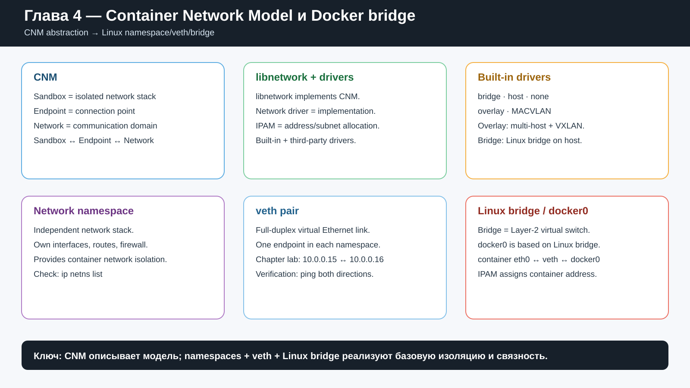
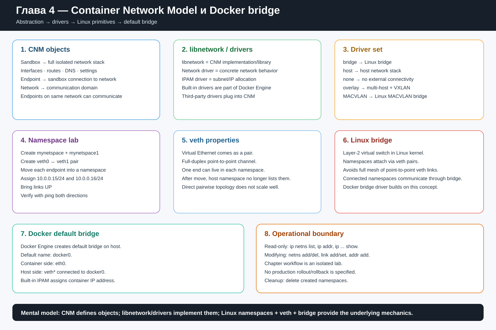

# Глава 4 — Модель Container Network и сетевой мост Docker

Практические и концептуальные материалы по главе 4 книги «Docker без секретов».





## Идентификация

- Book ID: `docker-demystified-saibal-ghosh-ru-2023`
- Глава: 4
- Название: «Модель Container Network и сетевой мост Docker»
- Slug: `container-network-model-and-docker-bridge`
- Source policy: `rag_only`
- External sources: запрещены
- Model memory: запрещена
- Прямой доступ к PDF: не использовался

## Provenance

- RAG chunks: `p0076:c01`–`p0087:c01`
- PDF pages: 76–87
- Printed pages: 81–92
- `p0076:c01` начинается заголовком «ГЛАВА 4 — Модель Container Network и сетевой мост Docker».
- `p0086:c01` содержит source answer key и открытые вопросы.
- `p0087:c01` содержит ключевые термины.
- Следующий чанк `p0088:c01` начинается заголовком «ГЛАВА 5 — Docker Swarm».
- Chapter boundary verified: yes
- Source SHA-256: `7a52f7d947347a470790c7d384390f60bf49fe5426827f5829a75757b50faaa8`

## Содержимое

- [cheatsheet.md](cheatsheet.md) — CNM, libnetwork, drivers, namespaces, veth и bridge.
- [commands.md](commands.md) — команды Linux networking из главы с effect/risk, verification и rollback.
- [diagram.md](diagram.md) — Mermaid-карты CNM, namespace/veth и docker0.
- [visual-cheatsheet.svg](visual-cheatsheet.svg) — компактный обзор.
- [visual-cheatsheet-detailed.svg](visual-cheatsheet-detailed.svg) — подробный обзор.
- [summary.md](summary.md) — структурированный итог главы.
- [review-questions.md](review-questions.md) — контрольный тест и вопросы.
- [review-answers.md](review-answers.md) — source answer key и RAG-grounded ответы.

## Карта главы

1. Container Network Model (CNM).
2. Sandbox как изолированный сетевой стек контейнера.
3. Endpoint как точка соединения sandbox с network.
4. Network как среда связи endpoint-ов.
5. Network drivers и IPAM drivers.
6. Libnetwork как реализация CNM и интерфейс между Docker daemon и drivers.
7. Встроенные и сторонние network drivers.
8. Встроенные drivers: bridge, host, none, overlay, MACVLAN.
9. Linux network namespace как независимый сетевой стек.
10. veth pair как full-duplex link между namespaces.
11. Ручное создание двух namespaces и veth pair.
12. Назначение IP, поднятие interfaces и ping между namespaces.
13. Почему point-to-point veth плохо масштабируется.
14. Linux bridge как L2-механизм объединения namespaces.
15. Docker bridge `docker0` как high-level использование Linux bridge.
16. Встроенный IPAM назначает container IP address.

## Краткий анализ главы

Глава строит Docker networking от абстрактной модели к Linux primitives. На верхнем уровне используется Container Network Model. В CNM sandbox содержит сетевой стек container — interfaces, routing tables, DNS settings и другие network settings. Endpoint соединяет sandbox с network. Network объединяет endpoints, между которыми возможна связь.

Drivers отделяют модель от конкретной реализации сети. Источник различает network drivers и IPAM drivers. Network driver определяет сетевую реализацию; IPAM driver предоставляет subnets/IP addresses, если они не назначены извне. Libnetwork описывается как реализация CNM и как библиотека/интерфейс, связывающий Docker daemon с network drivers.

Встроенные network drivers по главе: bridge, host, none, overlay и MACVLAN. Bridge использует Linux bridge. Host означает использование сети host без отдельного network namespace container. None оставляет container изолированным от внешнего мира. Overlay предназначен для связи между несколькими hosts и использует Linux bridge + VXLAN. MACVLAN опирается на Linux MACVLAN bridge.

Практическая часть разбирает Linux network namespaces. Namespace — отдельный экземпляр network stack с routes, firewall rules и network devices. Два namespaces соединяются veth pair: это full-duplex канал, у которого по одному endpoint/interface в каждой namespace.

Источник вручную создаёт `mynetspace` и `mynetspace1`, затем veth pair `veth0/veth1`, перемещает каждый interface в свой namespace, назначает `10.0.0.15/24` и `10.0.0.16/24`, поднимает interfaces и проверяет двустороннюю reachability через ping.

Этот point-to-point подход плохо масштабируется: при большом числе namespaces пришлось бы обслуживать много veth pairs. Linux bridge решает проблему как виртуальный L2 switch в kernel. Docker адаптирует эту модель через bridge `docker0`. Один конец veth остаётся в container как `eth0`, другой подключается к `docker0` и имеет host-side имя, начинающееся с `veth`.

## Основной принцип

```text
CNM:
sandbox -- endpoint -- network -- endpoint -- sandbox
```

Linux implementation mental model:

```text
container namespace
      eth0
       |
     veth pair
       |
   docker0 bridge
       |
     veth pair
       |
      eth0
container namespace
```

## Ограничения

- Глава объясняет базовую модель и Linux primitives; практическая реализация Docker networks переносится в следующую главу по формулировке источника.
- Версии Docker, driver behavior и формулировки соответствуют источнику; внешняя актуализация не выполнялась.
- OCR искажает отдельные имена interface/namespace; нормализация сделана только там, где последовательность команд однозначно подтверждает `veth0/veth1` и `mynetspace/mynetspace1`.
- Источник использует терминологию `dockerO` в OCR; в артефактах нормализовано до `docker0`, так как адресный вывод и текст главы однозначно описывают default Docker bridge.
