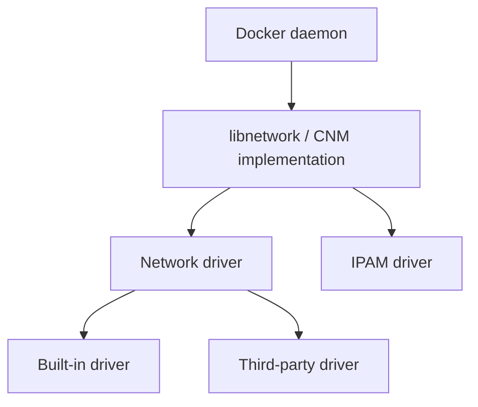
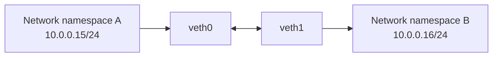
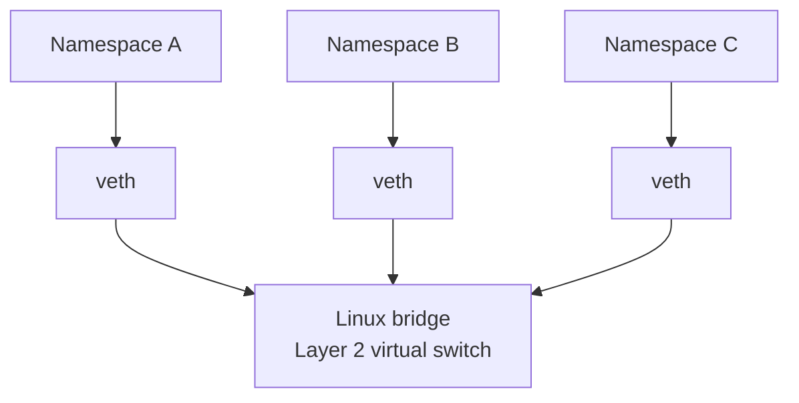
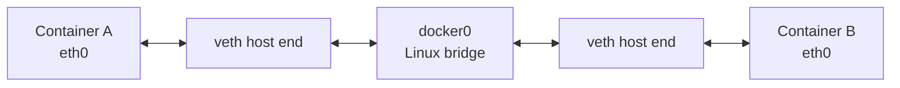
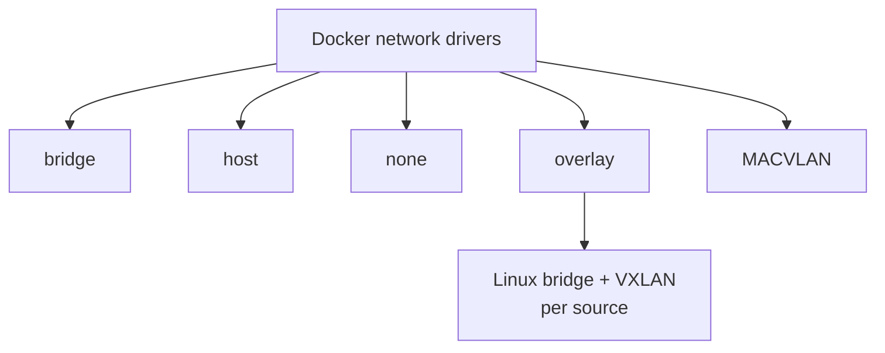

# Диаграммы: CNM и Docker bridge

## Container Network Model

Sandbox содержит interfaces, routes, DNS и другие network settings. Endpoint — connection point между sandbox и network.

## Driver architecture

## veth pair between namespaces

## Why bridge scales better

Вместо отдельного point-to-point link между каждой парой namespaces каждый namespace подключается к общему bridge.

## Docker default bridge

## Built-in driver view

