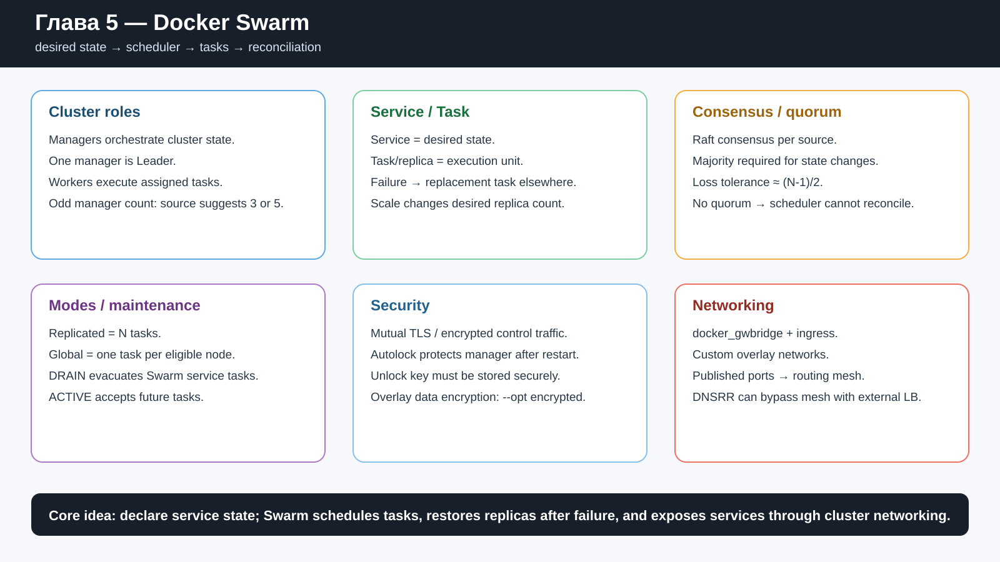
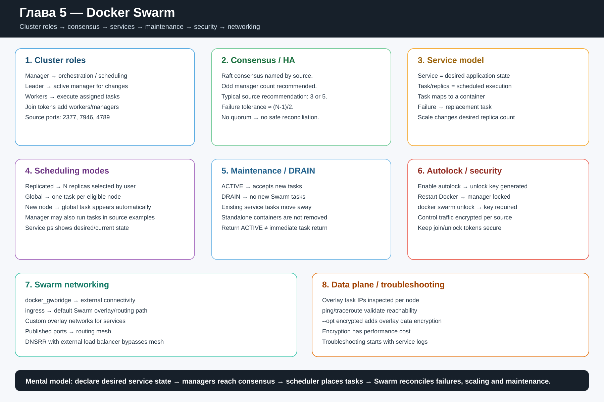

# Глава 5 — Docker Swarm

Практические и концептуальные материалы по главе 5 книги «Docker без секретов».





## Идентификация

- Book ID: `docker-demystified-saibal-ghosh-ru-2023`
- Глава: 5
- Название: «Docker Swarm»
- Slug: `docker-swarm`
- Source policy: `rag_only`
- External sources: запрещены
- Model memory: запрещена
- Прямой доступ к PDF: не использовался

## Provenance

- RAG chunks: `p0088:c01`–`p0113:c01`, включая `p0096:c02`
- PDF pages: 88–113
- Printed pages: 93–118
- `p0088:c01` начинается заголовком «ГЛАВА 5 — Docker Swarm».
- `p0112:c01` содержит source answer key.
- `p0113:c01` содержит вопросы и ключевые термины.
- Следующий чанк `p0114:c01` начинается заголовком «ГЛАВА 6 — Сети Docker».
- Chapter boundary verified: yes
- Source SHA-256: `7a52f7d947347a470790c7d384390f60bf49fe5426827f5829a75757b50faaa8`

## Содержимое

- [cheatsheet.md](cheatsheet.md) — Swarm mental model: managers/workers, services/tasks, replicas, quorum, networking, autolock.
- [commands.md](commands.md) — команды главы с effect/risk, verification и rollback.
- [diagram.md](diagram.md) — Mermaid-карты control plane, service lifecycle, quorum, routing mesh и overlay.
- [visual-cheatsheet.svg](visual-cheatsheet.svg) — компактный визуальный обзор.
- [visual-cheatsheet-detailed.svg](visual-cheatsheet-detailed.svg) — подробная визуальная шпаргалка.
- [summary.md](summary.md) — структурированный итог главы.
- [review-questions.md](review-questions.md) — контрольный тест и открытые вопросы.
- [review-answers.md](review-answers.md) — source answer key и RAG-grounded ответы.

## Карта главы

1. Docker Swarm как встроенная Docker orchestration/cluster capability.
2. Desired state, scaling, reconciliation, service discovery, TLS и rolling updates.
3. Manager и worker nodes.
4. Service как desired-state description; task/replica как конкретная единица выполнения.
5. Swarm initialization, join tokens и joining workers.
6. Node inspection и manager leader.
7. Consensus, Raft, quorum и split-brain.
8. Создание service, просмотр tasks и service metadata.
9. Replicas и автоматическое восстановление desired state после node failure.
10. Scaling service up/down.
11. Replicated vs global service mode.
12. ACTIVE vs DRAIN для node maintenance.
13. Autolock, encrypted Raft logs и unlock key.
14. Swarm networking: `docker_gwbridge`, `ingress`, custom overlay networks.
15. Published ports, routing mesh и DNSRR bypass.
16. Overlay traffic encryption через `--opt encrypted`.
17. Troubleshooting через service logs.

## Краткий анализ главы

Глава вводит Swarm как встроенный Docker orchestration layer для управления несколькими Docker Engine hosts как единым кластером. Основная abstraction — desired state. Пользователь описывает требуемое состояние service, а manager continuously compares фактическое состояние с желаемым и создаёт/переносит tasks, если возникает расхождение.

Cluster состоит из manager и worker nodes. Managers принимают orchestration decisions и назначают tasks. Один manager выступает Leader. В главе отдельно рассматривается consensus: источник связывает Swarm с Raft и подчёркивает необходимость quorum. Рекомендуется нечётное число managers, обычно 3 или 5; Raft tolerates до `(N-1)/2` manager failures. При потере quorum существующие tasks продолжают работать, но scheduler не может корректно изменять cluster state.

Service — описание desired state: image, command, network, ports, resource settings и количество/режим replicas. Task (или replica в терминологии главы) — конкретная единица выполнения service, связанная с container. Для replicated service задаётся число replicas; global service размещает по одной task на каждом доступном node.

Высокая доступность демонстрируется на failure experiment: после остановки Docker на worker manager создаёт replacement task на другом доступном node. При возвращении старого worker task автоматически назад не мигрирует. Scaling выполняется декларативно через `docker service scale`.

Для maintenance глава вводит ACTIVE/DRAIN. В DRAIN node перестаёт принимать новые Swarm tasks, а существующие service tasks останавливаются и пересоздаются на ACTIVE nodes. Возврат в ACTIVE означает готовность снова принимать новые tasks, но ранее перемещённые tasks не обязаны возвращаться.

Security block посвящён autolock. Source говорит о шифровании Raft logs на disk и unlock key, который manager должен предоставить после restart Docker, если autolock включён. Ключ необходимо хранить отдельно и безопасно: без него manager не сможет вернуться в cluster после restart.

Network layer Swarm включает default `docker_gwbridge` и overlay `ingress`. Custom overlay network распространяется на workers фактически при размещении service/tasks на этой network. Для межузловой работы source перечисляет TCP 2377, TCP/UDP 7946 и UDP 4789. Published ports обслуживаются routing mesh; альтернативой при собственном load balancer выступает endpoint mode DNSRR. Application data в overlay можно шифровать через `--opt encrypted`, при этом source предупреждает о performance cost.

## Основной принцип

```text
desired state
    ↓
manager / scheduler
    ↓
service
    ↓
tasks / replicas
    ↓
worker nodes
    ↑
reconciliation after failure / scaling
```

HA / consensus:

```text
manager leader
   ↕
Raft consensus + quorum
   ↕
other managers
```

## Source-specific caveat

Источник в начале главы говорит, что cluster metadata хранится в распределённой базе `etcd` на managers, а далее описывает consensus и Raft logs. Эти утверждения сохранены как материал книги и не reconciled/corrected внешними знаниями в режиме `rag_only`.

## Ограничения

- Product/version statements, protocol behavior и recommendations отражают контекст книги; внешняя актуализация не выполнялась.
- Join tokens/unlock keys в артефактах не копируются целиком: они трактуются как sensitive cluster credentials даже в учебном примере.
- Команды нормализованы только там, где OCR-контекст однозначно подтверждает syntax.
- Firewall rules для перечисленных ports в source не даны как готовая vendor-specific command sequence, поэтому такие команды не добавлялись.
