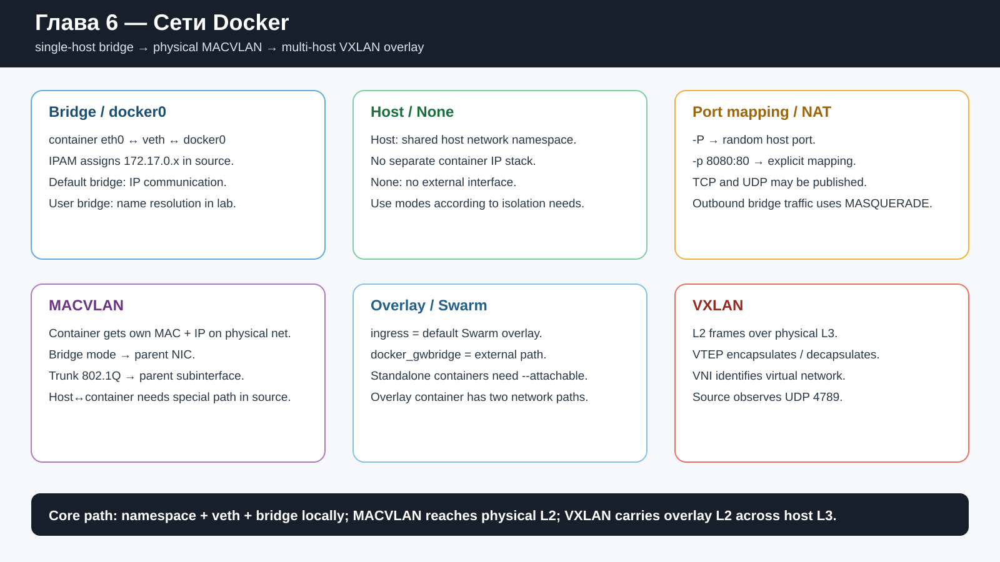
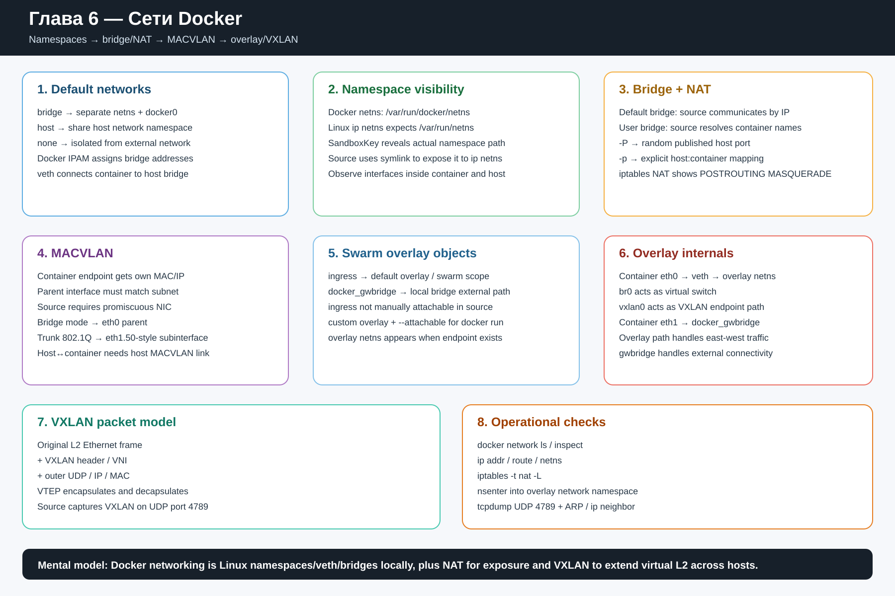

# Глава 6 — Сети Docker

Практические и концептуальные материалы по главе 6 книги «Docker без секретов».





## Идентификация

- Book ID: `docker-demystified-saibal-ghosh-ru-2023`
- Глава: 6
- Название: «Сети Docker»
- Slug: `docker-networks`
- Source policy: `rag_only`
- External sources: запрещены
- Model memory: запрещена
- Прямой доступ к PDF: не использовался

## Provenance

- RAG chunks: `p0114:c01`–`p0151:c01`
- PDF pages: 114–151
- Printed pages: 119–156
- `p0114:c01` начинается заголовком «ГЛАВА 6 — Сети Docker».
- `p0150:c01` содержит source answer key и открытые вопросы.
- `p0151:c01` содержит ключевые термины.
- Следующий чанк `p0152:c01` начинается заголовком «ГЛАВА 7 — Безопасность в Docker. Часть 1».
- Chapter boundary verified: yes
- Source SHA-256: `7a52f7d947347a470790c7d384390f60bf49fe5426827f5829a75757b50faaa8`

## Содержимое

- [cheatsheet.md](cheatsheet.md) — Bridge/Host/None/MACVLAN/Overlay, port mapping, namespace/veth/VXLAN.
- [commands.md](commands.md) — команды главы с effect/risk, verification и rollback.
- [diagram.md](diagram.md) — Mermaid-карты Docker networking paths.
- [visual-cheatsheet.svg](visual-cheatsheet.svg) — компактный визуальный обзор.
- [visual-cheatsheet-detailed.svg](visual-cheatsheet-detailed.svg) — подробный визуальный обзор.
- [summary.md](summary.md) — структурированный итог главы.
- [review-questions.md](review-questions.md) — контрольный тест и вопросы.
- [review-answers.md](review-answers.md) — source answer key и RAG-grounded ответы.

## Карта главы

1. Стандартные Docker networks: bridge, host, none.
2. Default bridge `docker0`, IPAM, veth pair и container network namespace.
3. Docker network namespaces под `/var/run/docker/netns`.
4. Symbolic-link workaround для просмотра Docker netns через `ip netns`.
5. Container-to-container communication на default bridge и user-defined bridge.
6. Host network: shared host network namespace.
7. None network: полная изоляция от внешней сети.
8. Использование network namespace существующего container.
9. Port mapping, NAT/netfilter/iptables и MASQUERADE.
10. `-P` и `-p`, TCP/UDP mappings.
11. MACVLAN bridge: parent NIC, subnet/gateway/IP range, host↔container caveat.
12. MACVLAN trunk bridge 802.1Q через parent subinterface.
13. Overlay network: Swarm, ingress, `docker_gwbridge`, attachable networks.
14. Два interfaces container в overlay: overlay path + external path.
15. Overlay network namespace, `br0`, veth и VXLAN.
16. VXLAN: L2-over-L3 encapsulation, VNI, VTEP, UDP 4789.
17. Neighbor/IP↔MAC mappings в overlay namespace.

## Краткий анализ главы

Глава 6 углубляет сетевую модель из главы 4 и переводит её в конкретные Docker network modes.

Для обычной Docker installation источник показывает три default networks: `bridge`, `host` и `none`. Default bridge основан на Linux bridge и называется `docker0`. Container получает собственный network namespace, interface `eth0` и IP от Docker IPAM; другой конец veth pair остаётся на host и подключается к `docker0`.

Источник отдельно показывает, что Docker network namespaces хранятся не в стандартном `/var/run/netns`, а в `/var/run/docker/netns`. Поэтому `ip netns list` напрямую их не видит. В учебном примере namespace path извлекается через `docker inspect ... NetworkSettings.SandboxKey` и символически связывается с `/var/run/netns`.

На default bridge containers общаются по IP. В примере source name resolution между containers на default bridge не работает. Для user-defined bridge `mybridge` containers успешно обращаются друг к другу по имени.

Host network означает отсутствие отдельного container network stack: container использует host network namespace и host IP addresses. Source подчёркивает, что port mapping при этом не нужен/игнорируется. None network, напротив, оставляет container без interface для внешнего connectivity.

Port mapping объясняется через NAT и Linux netfilter. Source показывает `iptables -t nat -L` и MASQUERADE для `172.17.0.0/16`. `-P` публикует container port на случайный host port; `-p host:container` задаёт mapping явно; можно отдельно публиковать TCP и UDP.

MACVLAN нужен, когда container должен выглядеть как отдельный endpoint в physical network. Source перечисляет prerequisites: Linux host, подходящее kernel support, same subnet as parent, promiscuous NIC, один MACVLAN network per parent/subnet, возможность задать IP range. Bridge mode использует parent interface напрямую; trunk bridge 802.1Q использует subinterface вида `eth1.50`.

В source example MACVLAN containers могут общаться друг с другом, но host и container по умолчанию не могут ping друг друга через parent interface. Далее source создаёт host-side MACVLAN interface `macnet0` для связи host→container. Этот lab preserved as source behavior; внешняя корректировка адресного плана не выполнялась.

Overlay network требует Swarm. Swarm создаёт `ingress` и `docker_gwbridge`. Стандартная ingress network не предназначена для manual attachment standalone containers; для этого source создаёт custom overlay с `--attachable`.

Container в custom overlay получает два network paths: один interface в overlay network namespace и второй — через `docker_gwbridge` для external connectivity. Внутри overlay namespace source показывает `br0` как virtual switch, veth endpoints и `vxlan0`. Между hosts traffic инкапсулируется VXLAN: Ethernet L2 frame inside UDP over L3, port 4789, with VNI and VTEP concepts.

## Основной принцип

```text
single-host default bridge:
container eth0 ↔ veth ↔ docker0 ↔ host NIC ↔ external network
```

Overlay:

```text
container eth0
   ↕ veth
overlay netns / br0
   ↕ vxlan0 / VTEP
UDP 4789 over host L3 network
   ↕
remote VTEP / br0
   ↕ veth
remote container eth0
```

External path for overlay container:

```text
container eth1 ↔ veth ↔ docker_gwbridge ↔ host/external network
```

## Ограничения

- Network behavior, flags and product constraints reflect the book context; no external current-version verification was performed.
- OCR `dockerO` normalized to `docker0` where context is unambiguous.
- OCR command spelling/spacing normalized only when neighboring text clearly supports the intended syntax.
- Exact CLI syntax for sharing an existing container network namespace is not present in the retrieved chapter chunks; therefore it is not invented.
- MACVLAN address examples are preserved as source examples, including potentially confusing address choices; no external correction is applied.
