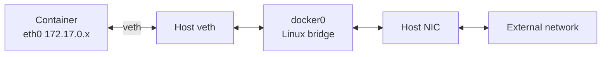
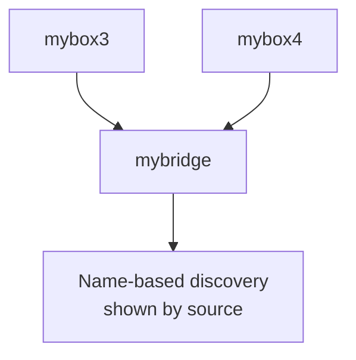
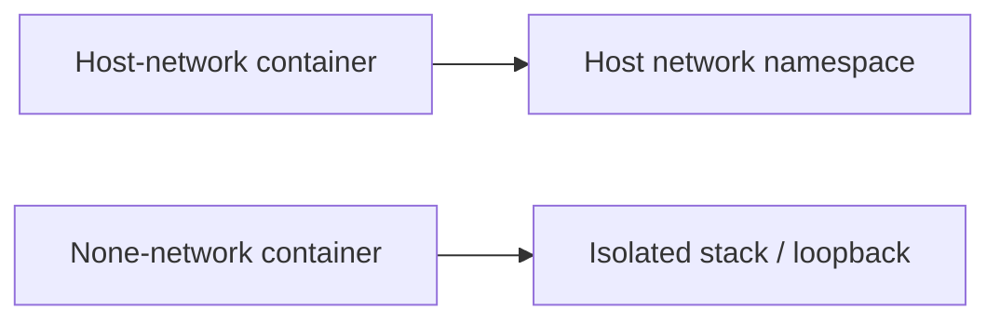
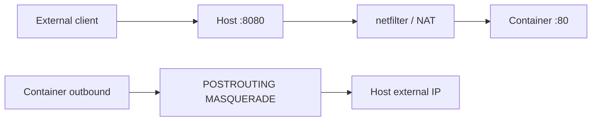
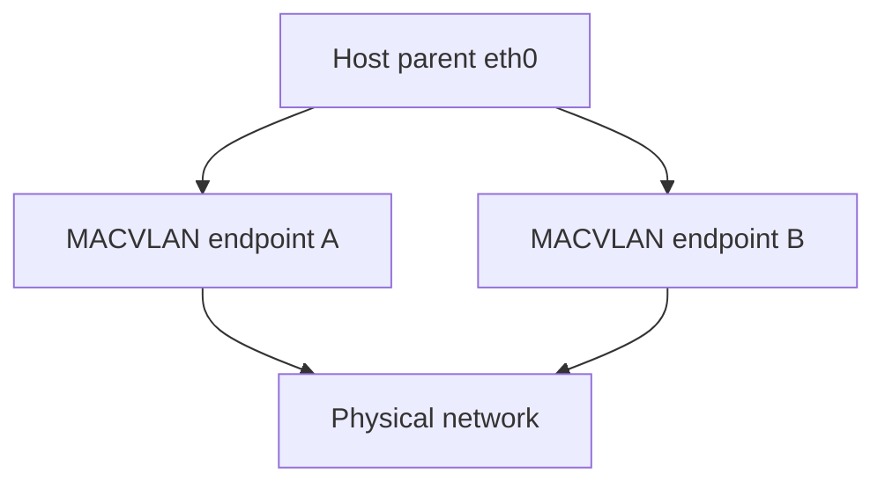
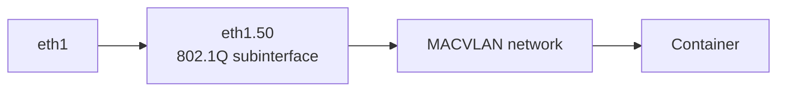
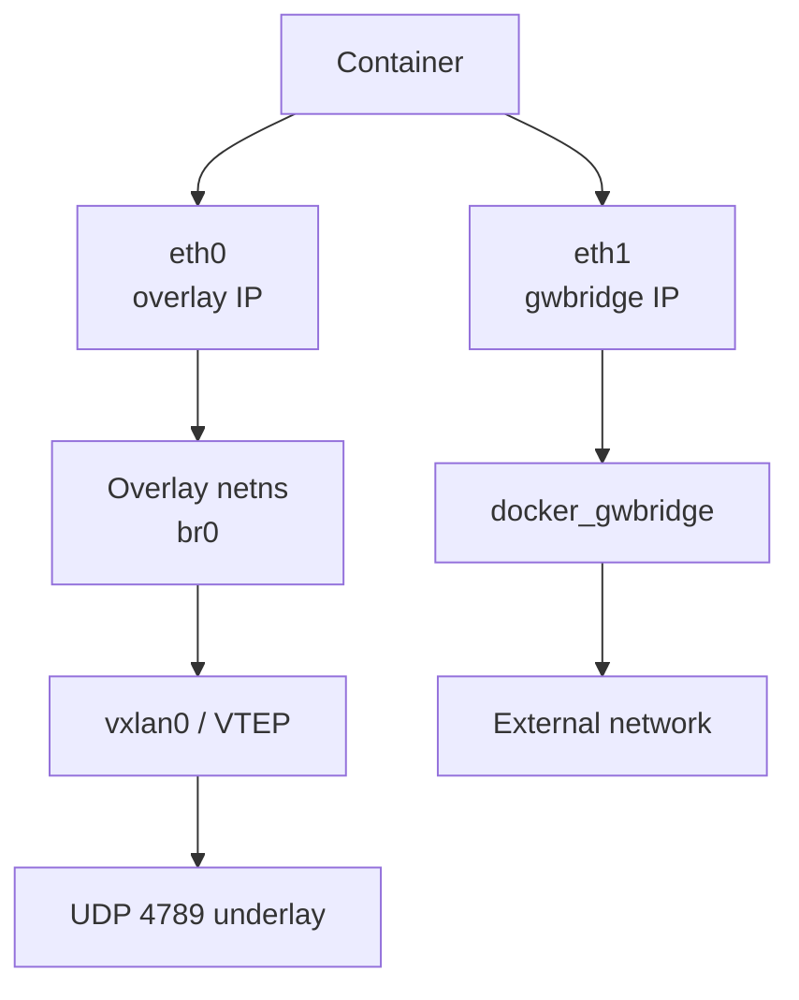
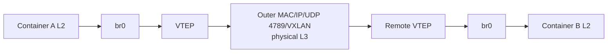
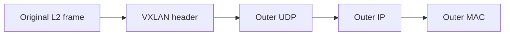

# Диаграммы: Docker networks

## Default bridge

## User-defined bridge

## Host / None

## Port mapping / NAT

## MACVLAN

## MACVLAN trunk

## Overlay container interfaces

## Cross-host VXLAN

## VXLAN encapsulation

