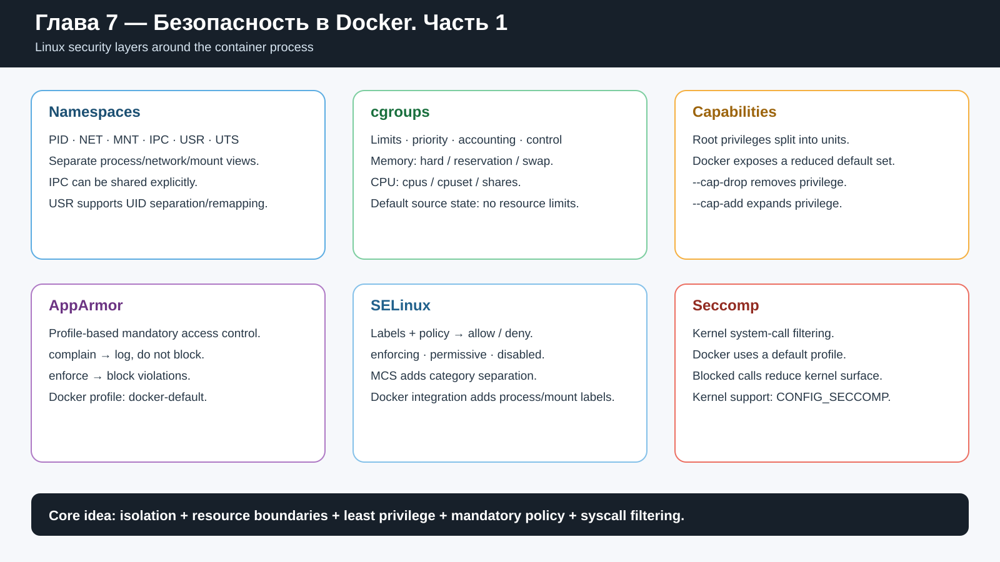
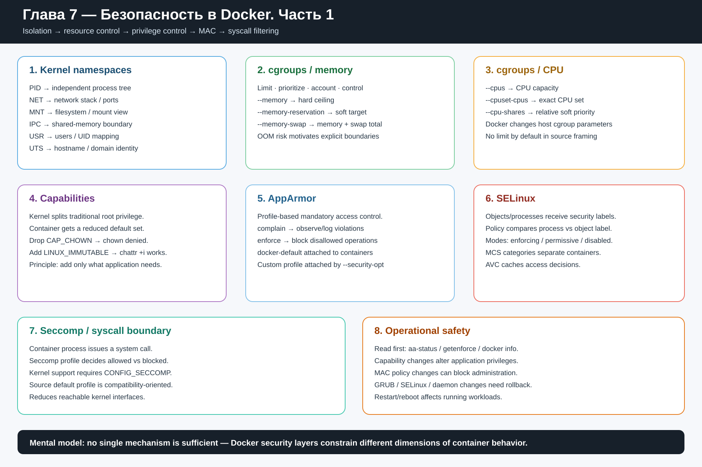

# Глава 7 — Безопасность в Docker. Часть 1

Практические и концептуальные материалы по главе 7 книги «Docker без секретов».





## Идентификация

- Book ID: `docker-demystified-saibal-ghosh-ru-2023`
- Глава: 7
- Название: «Безопасность в Docker. Часть 1»
- Slug: `docker-security-part-1`
- Source policy: `rag_only`
- External sources: запрещены
- Model memory: запрещена
- Прямой доступ к PDF: не использовался

## Provenance

- RAG chunks: `p0152:c01`–`p0184:c01`
- PDF pages: 152–184
- Printed pages: 157–189
- `p0152:c01` начинается заголовком «ГЛАВА 7 — Безопасность в Docker. Часть 1».
- `p0181:c01` содержит заключение и основные тезисы.
- `p0182:c01`–`p0183:c01` содержат контрольный тест, source answer key и открытые вопросы.
- `p0184:c01` содержит ключевые термины.
- Следующий чанк `p0185:c01` начинает главу 8 — «Безопасность в Docker. Часть 2».
- Chapter boundary verified: yes
- Source SHA-256: `7a52f7d947347a470790c7d384390f60bf49fe5426827f5829a75757b50faaa8`

## Содержимое

- [cheatsheet.md](cheatsheet.md) — namespaces, cgroups, capabilities, AppArmor, SELinux, seccomp.
- [commands.md](commands.md) — команды главы, разделённые на read-only и state-changing.
- [diagram.md](diagram.md) — Mermaid-карты security layers.
- [visual-cheatsheet.svg](visual-cheatsheet.svg) — компактный визуальный обзор.
- [visual-cheatsheet-detailed.svg](visual-cheatsheet-detailed.svg) — подробная визуальная шпаргалка.
- [summary.md](summary.md) — структурированный итог главы.
- [review-questions.md](review-questions.md) — контрольный тест и вопросы.
- [review-answers.md](review-answers.md) — source answer key и RAG-grounded ответы.

## Карта главы

1. Linux kernel namespaces как фундамент container isolation.
2. PID, NET, MNT, IPC, USR и UTS namespaces.
3. IPC namespace sharing между containers.
4. User namespace/remap и принцип минимальных привилегий.
5. cgroups: limits, prioritization, accounting, control.
6. Memory limits: `--memory`, `--memory-reservation`, `--memory-swap`.
7. CPU limits: `--cpus`, `--cpuset-cpus`, `--cpu-shares`.
8. Linux capabilities как декомпозиция root privileges.
9. `--cap-drop` / `--cap-add` и least privilege.
10. Mandatory Access Control: AppArmor и SELinux.
11. AppArmor complain/enforce, docker-default и custom profiles.
12. SELinux modes, labels, MCS and Docker integration.
13. Seccomp как фильтрация system calls.

## Краткий анализ главы

Глава строит security model Docker снизу вверх: от механизмов Linux kernel до policy enforcement вокруг container process.

Первый слой — namespaces. Source перечисляет шесть namespaces, используемых Docker на Linux: PID, NET, MNT, IPC, USR и UTS. Их роль — разделить процессы, network stacks, filesystems/mounts, shared memory/IPC, users/UID mapping и hostname/domain state. Изоляция namespaces позволяет нескольким containers использовать одинаковые внутренние ports, схожие filesystems и собственные process trees без прямого конфликта.

IPC можно явно разделить между containers. User namespace в изложении главы не включён по умолчанию; source рекомендует снижать риск root-in-container через `userns-remap` либо запускать application process под непривилегированным user внутри container.

Второй слой — cgroups. Source описывает четыре функции: resource limiting, prioritization, accounting и pause/resume control. Docker runtime flags меняют cgroup parameters на host. Для памяти разбираются hard limit `--memory`, soft limit `--memory-reservation` и combined memory+swap semantics `--memory-swap`. Для CPU — `--cpus`, `--cpuset-cpus` и relative priority `--cpu-shares`.

Третий слой — Linux capabilities. Вместо монолитного root privilege kernel разбивает privileged operations на отдельные capabilities. Docker по умолчанию предоставляет container ограниченный набор. Source показывает принцип least privilege: удалить `CAP_CHOWN` и получить отказ `chown`; добавить `LINUX_IMMUTABLE` и разрешить `chattr +i`.

Четвёртый слой — Mandatory Access Control. AppArmor описывается как profile-based mechanism, типичный для Debian-derived distributions, SELinux — как label/policy-based mechanism для RHEL/Fedora/CentOS-family systems. AppArmor example проходит путь от complain к enforce и затем к custom Docker profile. SELinux example включает system-level enforcing mode, Docker daemon integration, labels и Multi-Category Security.

Пятый слой — seccomp. Source определяет его как kernel feature для ограничения system calls container process и указывает, что default Docker profile блокирует часть syscalls, сохраняя совместимость с широким набором applications.

## Основной принцип

```text
container security
├─ namespaces     → isolation
├─ cgroups        → resource boundaries
├─ capabilities   → split root privileges
├─ AppArmor/SELinux → mandatory policy
└─ seccomp        → syscall filtering
```

## Security boundary

Глава показывает не одну «функцию безопасности», а composable layers. Namespaces не ограничивают resource consumption; cgroups не заменяют access-control policy; capabilities не заменяют MAC; seccomp не заменяет filesystem/network isolation. Защита строится комбинацией механизмов.

## Ограничения

- Все version-specific statements сохранены в source context; внешняя актуализация не выполнялась.
- Команды изменения GRUB, SELinux mode, Docker daemon config, AppArmor profiles и host sysctl являются state-changing и потенциально disruptive.
- Source examples относятся к Ubuntu 18.04.1/CentOS-era environment и не трактуются как универсальные current best practices.
- OCR command forms нормализованы только при однозначном контексте.
- Source утверждает конкретные numbers для capabilities и seccomp default profile в своей среде; эти числа не обновлялись внешними данными.
