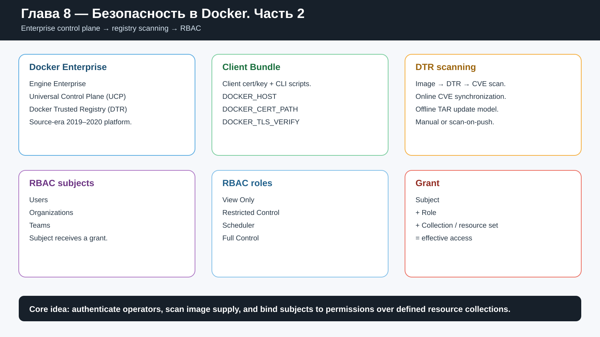
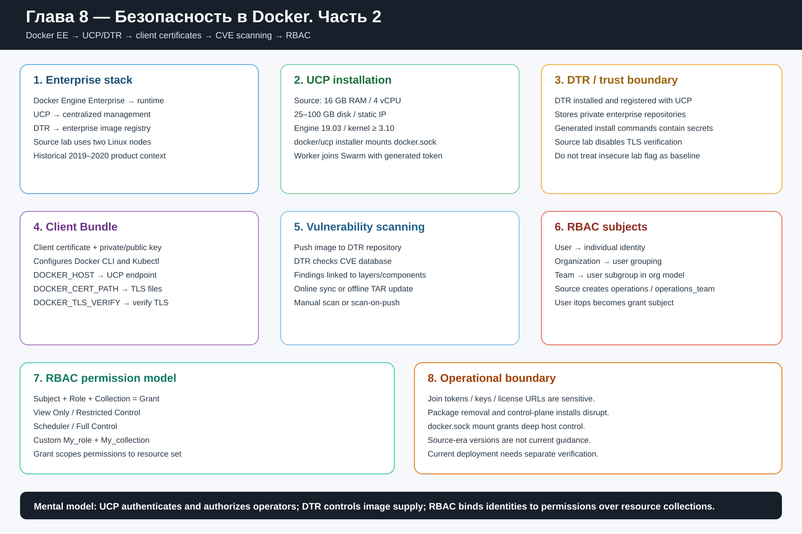

# Глава 8 — Безопасность в Docker. Часть 2

Практические и концептуальные материалы по главе 8 книги «Docker без секретов».





## Идентификация

- Book ID: `docker-demystified-saibal-ghosh-ru-2023`
- Глава: 8
- Название: «Безопасность в Docker. Часть 2»
- Slug: `docker-security-part-2`
- Source policy: `rag_only`
- External sources: запрещены
- Model memory: запрещена
- Прямой доступ к PDF: не использовался

## Provenance

- RAG chunks: `p0185:c01`–`p0212:c01`
- PDF pages: 185–212
- Printed pages: 191–218
- `p0185:c01` начинается заголовком «ГЛАВА 8 — Безопасность в Docker. Часть 2».
- `p0209:c01` содержит заключение и основные тезисы.
- `p0210:c01`–`p0212:c01` содержат контрольный тест, source answer key, вопросы и ключевые термины.
- Следующий чанк `p0213:c01` начинает предметный указатель, а не новую главу.
- Chapter boundary verified: yes
- Source SHA-256: `7a52f7d947347a470790c7d384390f60bf49fe5426827f5829a75757b50faaa8`

## Содержимое

- [cheatsheet.md](cheatsheet.md) — Docker EE/UCP/DTR, Client Bundle, vulnerability scanning, RBAC.
- [commands.md](commands.md) — source-era operational commands с risk/verification/rollback boundary.
- [diagram.md](diagram.md) — Mermaid-карты enterprise control plane, scanning и RBAC.
- [visual-cheatsheet.svg](visual-cheatsheet.svg) — компактный визуальный обзор.
- [visual-cheatsheet-detailed.svg](visual-cheatsheet-detailed.svg) — подробная визуальная шпаргалка.
- [summary.md](summary.md) — структурированный итог главы.
- [review-questions.md](review-questions.md) — контрольный тест и открытые вопросы.
- [review-answers.md](review-answers.md) — source answer key и RAG-grounded ответы.

## Карта главы

1. Docker Enterprise Edition как enterprise package.
2. Три компонента: Docker Engine Enterprise, Universal Control Plane, Docker Trusted Registry.
3. Лицензия и source-era установка Docker EE на Ubuntu.
4. UCP requirements и установка через `docker/ucp`.
5. Присоединение worker node к Swarm через UCP-generated join command.
6. Установка и регистрация Docker Trusted Registry.
7. Client Bundle и certificate-based access к UCP.
8. Переменные `DOCKER_HOST`, `DOCKER_CERT_PATH`, `DOCKER_TLS_VERIFY`.
9. Vulnerability scanning и CVE database в DTR.
10. Online/offline CVE database update.
11. Scan-on-push.
12. RBAC: subject + role + collection/resource set.
13. Users, organizations, teams.
14. Built-in roles: View Only, Restricted Control, Scheduler, Full Control.
15. Custom collection, custom role и grant.
16. Built-in collections.

## Краткий анализ главы

Глава 8 переключается с Linux kernel security mechanisms на enterprise control-plane security из Docker Enterprise Edition в контексте продукта 2019–2020 годов.

Source делит Docker Enterprise на три основных компонента. Docker Engine Enterprise запускает containers и работает с images. Universal Control Plane (UCP) централизует управление cluster/applications и в изложении книги работает со Swarm и Kubernetes. Docker Trusted Registry (DTR) хранит enterprise images и предоставляет security-scanning workflow.

Практическая часть сначала строит двухузловой стенд: Docker EE устанавливается на manager и worker, затем UCP разворачивается на первом node, worker присоединяется к Swarm, а DTR устанавливается на втором node. В chapter используется лицензия, source-specific Docker EE repository и версии Engine 19.03.x / UCP 3.2.5 / DTR 2.7.5.

Следующий security boundary — authenticated client access. UCP требует client certificate bundle. Client Bundle создаёт key pair и содержит scripts/configuration для Docker CLI и Kubectl. После активации environment настраиваются `DOCKER_HOST`, `DOCKER_CERT_PATH` и `DOCKER_TLS_VERIFY`; CLI обращается к UCP endpoint с TLS client credentials.

DTR vulnerability scanning строится вокруг CVE database. Source включает scanning, online synchronization, затем сравнивает fresh BusyBox image со старым `busybox:1.25.1`. В source-era lab старый image показывает critical/major vulnerabilities. DTR может запускать scanning вручную или автоматически при push. Для offline environment source описывает загрузку tar-file с CVE updates.

RBAC описан формулой «кто / что может / над какими ресурсами». Subject — user, organization или team; role — набор permissions; collection/resource set — объектная область. Grant связывает эти три части. Source показывает создание user `itops`, organization/team, custom collection `My_collection`, custom role `My_role` и grant.

## Основной принцип

```text
Enterprise security plane
├─ UCP → centralized control + authentication + RBAC
├─ DTR → image registry + vulnerability scanning
└─ Client Bundle → certificate-based CLI access
```

RBAC:

```text
Subject
   +
Role
   +
Collection / resource set
   ↓
Grant
```

Image security:

```text
image push
   ↓
DTR
   ↓
CVE database
   ↓
scan result
   ↓
manual / scan-on-push workflow
```

## Source-era caveat

Эта глава сильно привязана к исторической Docker Enterprise platform. Сам source отдельно отмечает, что 13 ноября 2019 года Mirantis приобрела Docker Enterprise. Все product names, versions, repository URLs, install flows, UI paths и license behavior сохранены как материал книги и не рассматриваются как current deployment guidance.

## Security boundary

- Subscription/repository URLs, join tokens, client private keys и credentials считаются sensitive и не переносятся в reusable artifacts.
- Source example использует отключение TLS verification при установке DTR. Это сохранено как факт лабораторного примера, но не оформлено как рекомендуемый secure baseline.
- Source показывает обход browser certificate warning для lab UCP. Это не превращено в универсальную рекомендацию.
- Installation/removal commands могут менять package state и control plane всего Docker cluster.

## Ограничения

- External verification/current product mapping не выполнялись.
- Данные о trial license, Docker EE repositories, supported versions и UI отражают source-era состояние.
- Generated UCP/DTR commands, содержащие tokens/IPs/credentials, не копируются verbatim.
- OCR-normalization применяется только там, где syntax однозначен.
