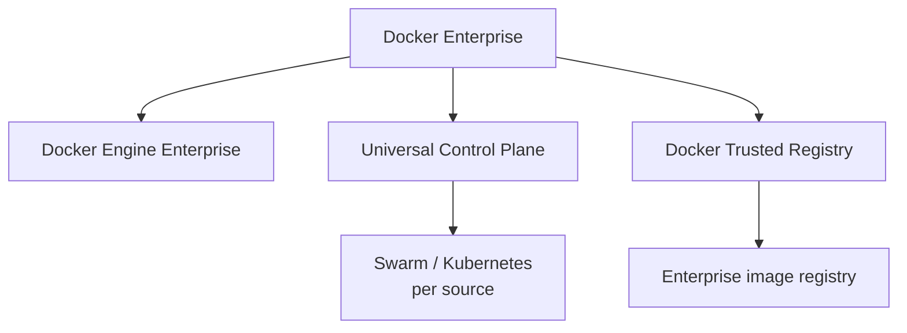
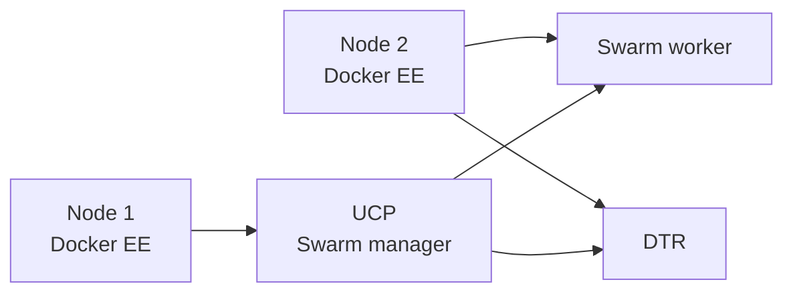
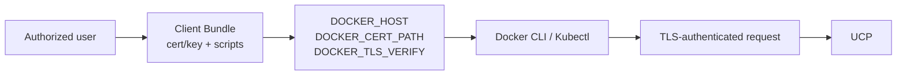
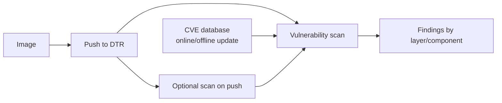
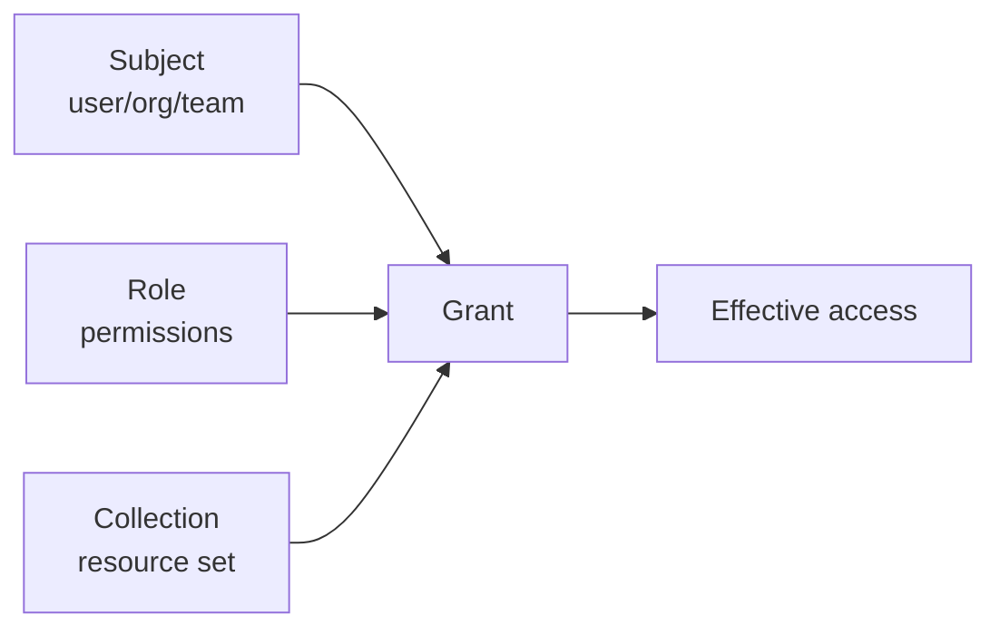
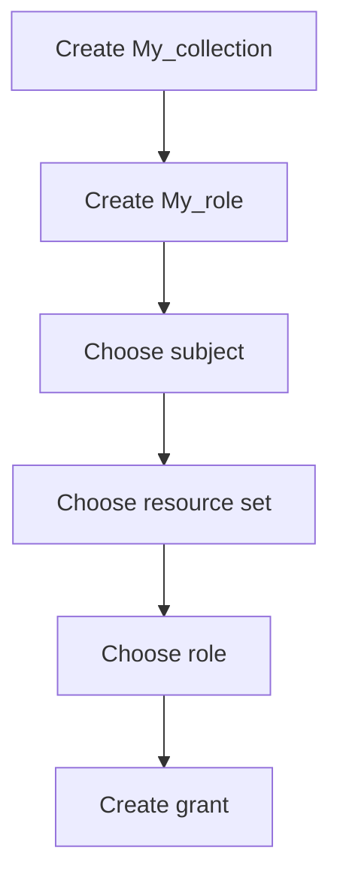
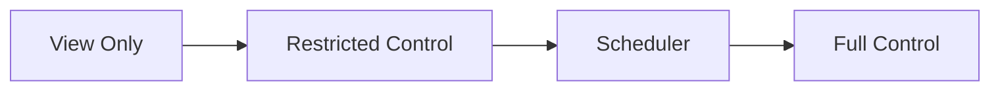

# Диаграммы: Docker Enterprise security

## Enterprise components

## Source lab topology

## Client Bundle

## Vulnerability scanning

## RBAC model

## Custom grant workflow

## Built-in role spectrum

Это conceptual ordering для запоминания names; конкретные permission sets source описывает отдельно и не сводит их к строгой линейной superset hierarchy.
