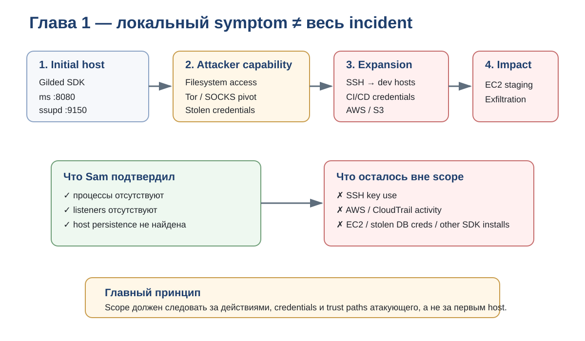

# Глава 1 — Кейс: катастрофа в цепочке поставок

Практический разбор главы 1 книги *Dynamic Incident Response: A Framework for Security Teams*.



## Идентификация

- Book ID: `dynamic-incident-response-joshua-wright-en-2026`
- Глава: 1
- Source title: `Case Study: Supply Chain Calamity`
- Русское название: «Кейс: катастрофа в цепочке поставок»
- Slug: `case-study-supply-chain-calamity`
- Source policy: `rag_only`
- External sources: запрещены
- Model memory: запрещена
- Прямой доступ к PDF: не использовался
- Язык артефактов: русский

## Provenance

- Canonical RAG: `p0027:c01`–`p0043:c01`
- PDF pages: 27–43
- Следующий chunk `p0044:c01` начинает Chapter 2 `Introduction`.
- Source format: PDF
- RAG validation status: `READY_WITH_KNOWN_LIMITATIONS`
- Chapter boundary verified: yes

## Содержимое

- [cheatsheet.md](cheatsheet.md) — operational-разбор: от локального симптома к реальному incident scope.
- [commands.md](commands.md) — команды и инструменты, явно присутствующие в RAG главы.
- [diagram.md](diagram.md) — Mermaid-схема compromise path и ошибки узкого host-centric response.
- [visual-cheatsheet.svg](visual-cheatsheet.svg) — компактная визуальная модель главы.
- [visual-cheatsheet-detailed.svg](visual-cheatsheet-detailed.svg) — подробная схема цепочки атаки и response gap.
- [translation-editorial-findings.md](translation-editorial-findings.md) — находки для будущего ремонта русского перевода v2.

## Карта главы

### 1. Джордан: локальный симптом

Джордан устанавливает SDK Gilded Freight и сталкивается с конфликтом TCP/8080. Проверка показывает два неожиданных процесса:

- `ms` слушает `127.0.0.1:8080`;
- `ssupd` слушает `0.0.0.0:9150`.

Родительский процесс — `gilded-sdk-update`; сам скрипт обфусцирован. Джордан завершает процессы и удаляет дерево SDK.

Ключевой факт: локальная очистка действительно прекращает работу обнаруженных процессов на рабочей станции, но не отвечает на вопрос, что злоумышленник уже успел сделать.

### 2. Pyrix: supply-chain compromise и расширение доступа

Атакующий предварительно компрометирует поставщика SDK, добавляет в установщик:

- минимальный web server;
- Tor hidden service;
- SOCKS proxy.

После установки SDK на workstation жертвы атакующий получает доступ к файловой системе, извлекает:

- SSH private key и `known_hosts`;
- MySQL credential;
- AWS credentials.

Далее используются три пути расширения доступа:

1. SSH lateral movement на внутренние development systems;
2. harvesting дополнительных credentials на dev server и CI/CD runner;
3. cloud pivot в AWS с доступом к S3 data и созданием отдельного EC2 instance для staging/exfiltration.

### 3. Сэм: корректный локальный response с неправильной границей scope

Через шесть дней security analyst Сэм расследует ticket по workstation.

Он:

- подтверждает отсутствие процессов и listeners;
- просматривает system/network logs;
- проверяет persistence locations;
- запускает malware scan;
- фиксирует, что workstation operational;
- закрывает ticket.

Каждый отдельный шаг логичен в рамках выбранной границы расследования.

Проблема в том, что границей incident фактически становится одна workstation.

### 4. Что осталось

После закрытия ticket:

- attacker-controlled EC2 instance продолжает работать;
- украденные SSH keys остаются valid на внутренних hosts;
- production database credentials остаются active;
- S3 data уже были exfiltrated;
- не проверено, ставили ли тот же SDK другие developers;
- не исследовано использование Jordan AWS credentials в CloudTrail;
- не проверено unexpected use SSH keys.

## Краткий анализ

Глава демонстрирует не столько ошибку конкретного analyst, сколько недостаток линейного и слишком локального понимания incident scope.

Первичный observable — подозрительные процессы на workstation — был только точкой входа в расследование. Реальная compromise chain уже вышла за её пределы: credentials → internal servers → CI/CD → AWS → data exfiltration.

Локальные признаки после cleanup могли выглядеть благополучно:

- processes отсутствуют;
- ports не слушаются;
- malware scan clean;
- persistence на workstation не найдена.

Но это не доказывает incident closure.

Глава специально противопоставляет:

`host is clean`

и

`incident is understood and contained`.

Это разные утверждения.

## Основной принцип

**Scope должен следовать за возможностями и действиями атакующего, а не останавливаться на системе, где впервые заметили симптом.**

После подтверждения unauthorized access необходимо спрашивать:

- что attacker мог прочитать или украсть;
- какие credentials были доступны;
- где эти credentials могли использоваться;
- какие trust paths открывались с compromised system;
- какие external/cloud resources могли быть созданы;
- затронут ли тот же software/supply-chain component на других systems.

Глава показывает, что преждевременный переход от локального containment к eradication/recovery способен создать ложное ощущение завершённости.

## Практический вывод для IR

При incident, начавшемся с endpoint:

```text
необычный процесс / listener
        ↓
подтвердить локальную activity
        ↓
определить доступные attacker'у credentials и trust paths
        ↓
проверить downstream systems / cloud / identities / same-software population
        ↓
только после этого оценивать containment и closure
```

## Ограничения источника

- Figures 3–6 представлены в RAG только captions/текстовыми ссылками; изображения не являются самостоятельными multimodal RAG objects.
- Глава не содержит отдельного chapter-end summary.
- Глава не содержит review/control questions.
- Конкретной универсальной команды для полного scoping главы не даёт; недостающие проверки формулируются как направления расследования.
- Rollback для `killall`, удаления SDK и attacker-side действий в источнике не описан.

## Связь с ремонтом перевода v2

В ходе анализа Chapter 1 дополнительно проверена русская версия. Крупных непреведённых narrative-блоков не обнаружено, однако есть несколько mixed-language и редакционных мест, которые следует нормализовать в v2. Они вынесены в [translation-editorial-findings.md](translation-editorial-findings.md).
