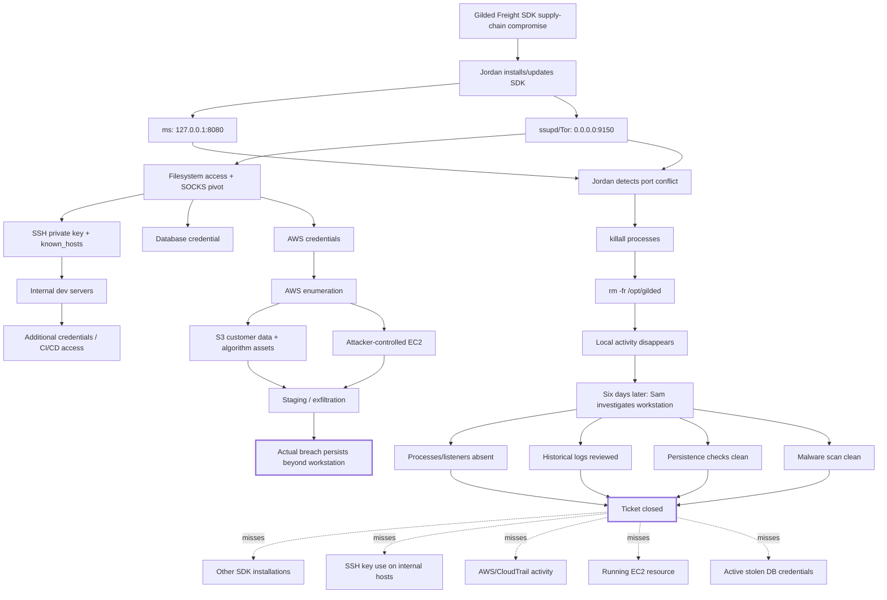

# Диаграмма: почему локальный cleanup не равен incident closure



## Interpretation

Глава строит две параллельные линии:

1. **что видно defender'у локально**;
2. **что attacker уже успел сделать за пределами initial host**.

Локальная cleanup действительно прекращает работу обнаруженного implant на workstation. Ошибка возникает позже, когда это локальное состояние принимают за границу всего incident.

Ключевой переход:

```text
initial indicator
      ↓
attacker capability
      ↓
credentials / trust paths
      ↓
downstream systems
      ↓
cloud / data / persistence
```

Если investigation останавливается после первого блока, реальный scope остаётся неизвестным.
