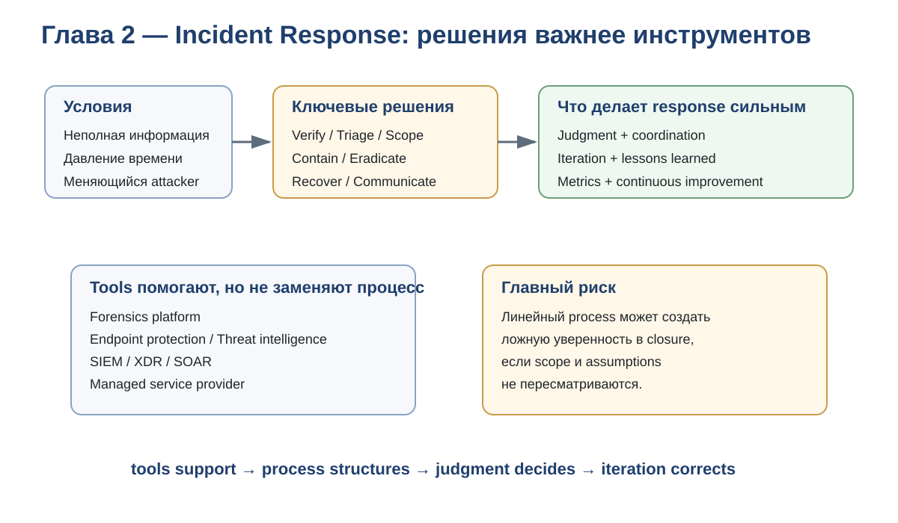

# Глава 2 — Введение

Практический разбор главы 2 книги *Dynamic Incident Response: A Framework for Security Teams*.



## Идентификация

- Book ID: `dynamic-incident-response-joshua-wright-en-2026`
- Глава: 2
- Source title: `Introduction`
- Русское название: «Введение»
- Slug: `introduction`
- Source policy: `rag_only`
- External sources: запрещены
- Model memory: запрещена
- Прямой доступ к PDF: не использовался
- Язык артефактов: русский

## Provenance

- Canonical RAG: `p0044:c01`–`p0048:c01`
- PDF pages: 44–48
- Следующий chunk `p0049:c01` начинает Chapter 3 `A Short History of Incident Response`.
- Source format: PDF
- RAG validation status: `READY_WITH_KNOWN_LIMITATIONS`
- Chapter boundary verified: yes

## Содержимое

- [cheatsheet.md](cheatsheet.md) — operational/conceptual шпаргалка по смыслу incident response и требованиям к современной response function.
- [commands.md](commands.md) — команды отсутствуют; перечислены только явно названные инструменты/классы tooling.
- [diagram.md](diagram.md) — Mermaid-схема: от incident pressure к adaptive response и continuous improvement.
- [visual-cheatsheet.svg](visual-cheatsheet.svg) — компактная визуальная модель главы.
- [visual-cheatsheet-detailed.svg](visual-cheatsheet-detailed.svg) — подробная схема требований к современной IR-функции.
- [translation-editorial-findings.md](translation-editorial-findings.md) — находки для будущего RU v2 repair.

## Краткий анализ

Глава 2 формулирует центральную идею книги: ценность incident response определяется не количеством tools и не сложностью exploit, а качеством решений под давлением.

Неполный scope может привести к ошибочным заверениям leadership, regulators и customers. Слишком ранний containment способен предупредить attacker, не устранив его access. Поспешная eradication может оставить persistence. Плохая communication recovery plan может привести к downtime или data loss.

Отсюда книга выводит главный принцип: responder должен не механически выполнять checklist, а адаптировать response к реальной ситуации, опираясь на verification, triage, scope, containment, eradication и recovery.

Глава также задаёт рамки самой книги. Она не является:

- каталогом forensic tools;
- исчерпывающим incident management handbook;
- руководством по построению всей IR program.

Её цель — дать technical analysts и responders повторяемую методологию принятия решений и уменьшения impact.

## Почему современный incident response стал сложнее

Глава перечисляет факторы, которые изменили требования к IR-функции:

- рост зависимости бизнеса от digital services;
- рост объёма и сложности угроз;
- regulatory pressure;
- coordinated threat-intelligence sharing;
- ransomware/extortion;
- cloud и third-party risk;
- remote work;
- stakeholder expectations;
- переход к proactive defense;
- AI-driven attack orchestration.

Вывод автора: модели, созданные для более раннего threat landscape, могут оставаться полезными, но их недостаточно без более adaptive и iterative подхода.

## Основной принцип

**Incident response — это дисциплина принятия решений в условиях неполной информации и давления времени.**

Эффективность определяется тем, насколько хорошо организация:

- понимает реальный scope;
- проверяет assumptions;
- координирует technical и business decisions;
- адаптирует действия по мере появления новой информации;
- использует lessons learned и metrics для improvement.

## Practical framing

Глава предлагает думать о response не как о прямой линии:

```text
detect → fix → close
```

а как о процессе принятия решений:

```text
observe
  ↓
orient / verify / triage
  ↓
scope
  ↓
contain / eradicate / recover
  ↓
measure / learn / improve
  ↺
```

## Ограничения источника

- Chapter 2 не содержит отдельного Step-by-Step section, несмотря на общее заявление о таких разделах в последующих process chapters.
- Команд shell/CLI в главе нет.
- Figures/tables отсутствуют.
- Есть одна source reference [1].
- Review questions отсутствуют.

## Связь с ремонтом перевода v2

Русский перевод главы смыслово качественный и полный, но содержит заметное количество mixed-language prose. Это хороший кандидат на stylistic normalization без изменения semantics. Подробности вынесены в [translation-editorial-findings.md](translation-editorial-findings.md).
