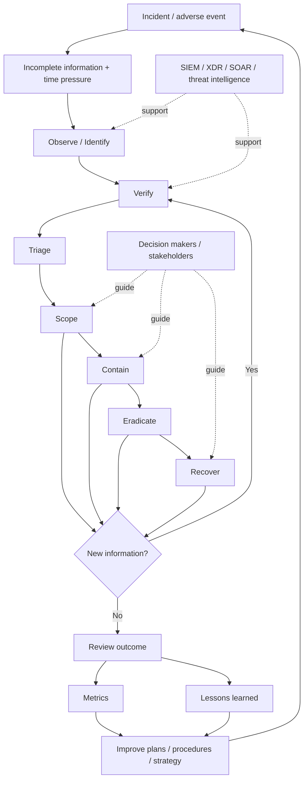

# Диаграмма: от давления инцидента к adaptive response

## Смысл

Chapter 2 задаёт book-level worldview:

- tools поддерживают response;
- process структурирует response;
- judgment определяет качество решений;
- iteration нужна, когда новая информация меняет scope;
- continuous improvement завершает один incident и улучшает готовность к следующему.
