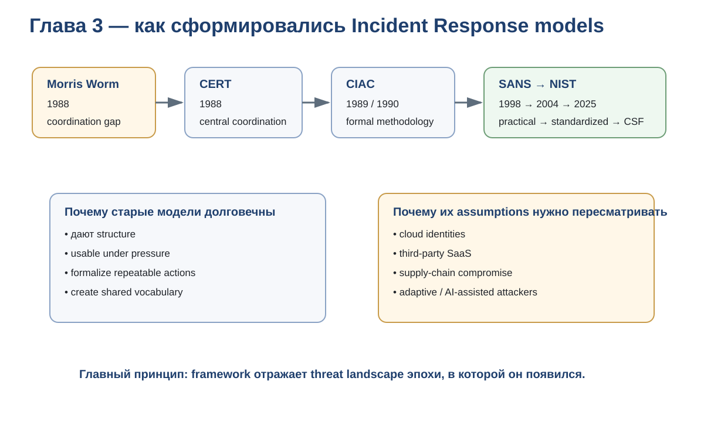

# Глава 3 — Краткая история реагирования на инциденты

Практический разбор главы 3 книги *Dynamic Incident Response: A Framework for Security Teams*.

## Идентификация

- Book ID: `dynamic-incident-response-joshua-wright-en-2026`
- Глава: 3
- Source title: `A Short History of Incident Response`
- Русское название: «Краткая история реагирования на инциденты»
- Slug: `a-short-history-of-incident-response`
- Source policy: `rag_only`
- External sources: запрещены
- Model memory: запрещена
- Прямой доступ к PDF: не использовался
- Язык артефактов: русский

## Provenance

- Canonical RAG: `p0049:c01`–`p0060:c01`
- PDF pages: 49–60
- Следующий chunk `p0061:c01` начинает Chapter 4 `Getting Started`.
- Source format: PDF
- RAG validation status: `READY_WITH_KNOWN_LIMITATIONS`
- Chapter boundary verified: yes

## Содержимое

- [cheatsheet.md](cheatsheet.md) — хронология развития incident response и смысл эволюции моделей.
- [commands.md](commands.md) — command-level материал отсутствует; Listing 24 зафиксирован как исторический pseudocode artifact, а не operational workflow.
- [diagram.md](diagram.md) — Mermaid-схема эволюции CERT → CIAC → SANS → NIST.
- [visual-cheatsheet.svg](visual-cheatsheet.svg) — компактная визуальная хронология.
- [visual-cheatsheet-detailed.svg](visual-cheatsheet-detailed.svg) — расширенная карта исторических инцидентов и response models.
- [translation-editorial-findings.md](translation-editorial-findings.md) — находки для будущего RU v2 repair.

## Краткий анализ

Глава объясняет, откуда появились современные incident response models и почему их исторический контекст важен для оценки их сильных и слабых сторон.

Первая линия главы — ранние cybersecurity incidents. Наиболее важным turning point автор считает Morris Worm 1988 года. Он показал масштабный риск interconnected systems и отсутствие централизованного механизма response.

Вторая линия — институционализация incident response:

- 1988: DARPA создаёт CERT в Carnegie Mellon;
- 1989: DOE создаёт CIAC;
- 1990: CIAC публикует первую formalized methodology incident handling;
- 1996: US Navy публикует `Computer Incident Response Guidebook P-5239-19`;
- 1998: SANS превращает expert practice в пошаговое руководство для generalists;
- 2004–2012: NIST SP 800-61 закрепляет four-phase lifecycle;
- 2025: NIST SP 800-61 Revision 3 переходит к alignment с CSF: Govern, Identify, Protect, Detect, Respond, Recover.

Главная мысль: IR models не возникли из абстрактной теории. Они формировались как ответ на реальные failure modes конкретной эпохи.

## Morris Worm как catalyst

Source подчёркивает несколько факторов:

- около 6 000 infected systems;
- примерно 10% тогдашнего интернета;
- Sendmail DEBUG RCE;
- Finger buffer overflow;
- weak passwords через RSH;
- programming error сделал replication гораздо агрессивнее;
- cleanup cost: $200–$53 000 на infected machine;
- incident стал catalyst для formal response coordination.

Значение кейса не только техническое. Он показал, что distributed incident требует coordinated response infrastructure.

## Что привнесли основные модели

### CERT

- central point of contact;
- coordination;
- vulnerability information;
- secure communication channels.

### CIAC / Schultz

Систематизировал incident handling и сформировал priorities:

1. human life and safety;
2. classified/sensitive data;
3. other data;
4. prevent system damage;
5. minimize disruption.

Также formalized six response stages.

### SANS

Главный вклад — usability:

- six-step model;
- numbered actions;
- problem statement для каждого step;
- Emergency Action Card;
- reusable forms;
- practical material, usable under pressure.

### NIST

Сначала упрощает six-step lineage до four-phase lifecycle:

- Preparation;
- Detection and Analysis;
- Containment, Eradication, and Recovery;
- Post-Incident Activity.

Revision 3 затем связывает response с broader cyber risk management через CSF functions.

## Основной принцип

**Любая incident response model отражает assumptions, угрозы и operational constraints эпохи, в которой она появилась.**

Это объясняет одновременно:

- почему старые models всё ещё полезны;
- почему они могут не полностью соответствовать cloud, SaaS, supply-chain и AI-driven incidents.

## Практический вывод

При оценке framework полезно задавать:

- Какой тип incident этот framework изначально должен был решать?
- Какая environment предполагалась?
- Какой уровень attacker adaptation учитывался?
- Требует ли model iterative scoping?
- Предполагает ли model distributed/cloud identities?
- Как model работает при third-party dependencies и supply-chain compromise?

Chapter 3 сам ещё не вводит DAIR как решение, но создаёт историческое основание для последующих глав.

## Ограничения источника

- Chapter 3 не содержит chapter-end summary.
- Review/control questions отсутствуют.
- Figures 7–11 присутствуют только как captions/text references в RAG.
- Listing 24 — pseudocode исторического exploit path, не defensive command workflow.
- Один reference: [1].
- External historical verification не выполнялась: анализ строго отражает canonical RAG.

## Связь с ремонтом перевода v2

Перевод смыслово полный, но mixed-language density заметна: `buffer overflow`, `security advisory`, `incident response`, `incident handling`, `best practices`, `generalist`, `checklist`, `cloud identities`, `third-party SaaS`, `AI` и другие выражения. Для v2 нужна редакторская унификация. Детали — в [translation-editorial-findings.md](translation-editorial-findings.md).
