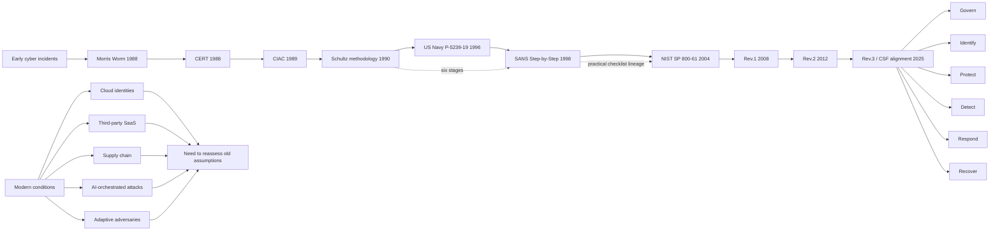

# Диаграмма: эволюция incident response

## Смысл

История не показывает, что старые models «плохие». Она показывает, что они были rational answers на threat landscape своего времени.

Следующая логическая задача книги — сохранить их полезные принципы, но добавить adaptation и iteration для современных incidents.
