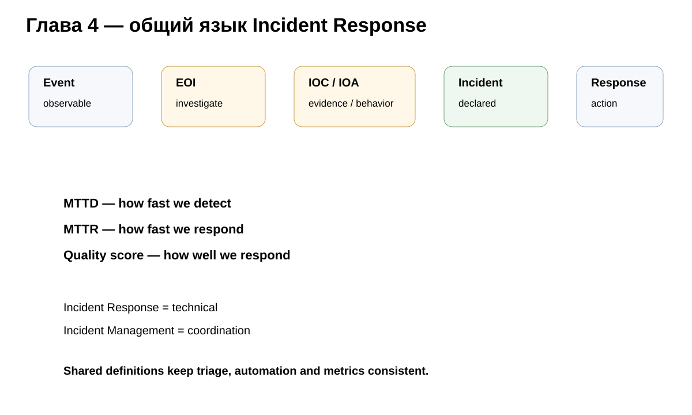

# Глава 4 — С чего начать

Практический разбор главы 4 книги *Dynamic Incident Response: A Framework for Security Teams*.



## Идентификация

- Book ID: `dynamic-incident-response-joshua-wright-en-2026`
- Глава: 4
- Source title: `Getting Started`
- Русское название: «С чего начать»
- Slug: `getting-started`
- Source policy: `rag_only`
- External sources: запрещены
- Model memory: запрещена
- Прямой доступ к PDF: не использовался
- Язык артефактов: русский

## Provenance

- Canonical RAG: `p0061:c01`–`p0075:c01`
- PDF pages: 61–75
- Следующий chunk `p0076:c01` относится к Chapter 5 `Incident Response Models and Their Limitations`.
- Source format: PDF
- RAG validation status: `READY_WITH_KNOWN_LIMITATIONS`
- Chapter boundary verified: yes

## Содержимое

- [cheatsheet.md](cheatsheet.md) — терминология incident / event / EOI / IOC / IOA и метрики MTTD/MTTR.
- [commands.md](commands.md) — SQL и Sigma artifacts, явно присутствующие в source.
- [diagram.md](diagram.md) — поток `event → EOI → IOC/IOA → incident` и metrics layer.
- [visual-cheatsheet.svg](visual-cheatsheet.svg) — компактная визуальная модель.
- [visual-cheatsheet-detailed.svg](visual-cheatsheet-detailed.svg) — подробная карта терминов, evidence и metrics.
- [translation-editorial-findings.md](translation-editorial-findings.md) — findings для RU v2 repair.

## Краткий анализ

Глава 4 задаёт общий словарь, без которого последующие DAIR activities трудно обсуждать точно.

Ключевая цепочка:

```text
event
  ↓
event of interest (EOI)
  ↓
evidence / context
  ↓
IOC / behavioral pattern / IOA
  ↓
incident decision
```

Главная мысль: **не каждое событие является инцидентом**, и даже большое количество подозрительных events не автоматически означает confirmed compromise. Организация должна интерпретировать events в собственном context, с учётом policies, priorities и risk tolerance.

## Incident

Инцидент — adverse event или угроза такого события, подразумевающая harm или попытку harm.

Source выделяет три типа:

1. malicious;
2. accidental;
3. environmental.

Книга главным образом ориентирована на malicious incidents, но terminology применима шире.

Практически важный нюанс: regulated organization может сознательно оставаться в pre-incident investigative state, чтобы сначала собрать facts и scope, прежде чем formal incident declaration запустит regulatory timelines.

## Event

Event — любое observable occurrence.

Это не только log entry. Event может быть:

- запись firewall/web/server log;
- Windows/Linux event;
- support ticket;
- network-device entry;
- сообщение инженера или пользователя.

Глава использует метафору waterfall: events идут непрерывным потоком, а analyst извлекает из него meaningful signals.

## Event of Interest (EOI)

EOI — event, который warrants further investigation.

EOI — organizational concept.

Одинаковые данные могут привести к разным решениям:

- одна организация начнёт investigation;
- другая признает attack, но не сочтёт event достаточно важным для отдельного response.

Это подчёркивает различие:

```text
event = objective observation
interpretation = organizational judgment
```

## IOC

Indicator of Compromise — evidence успешной compromise.

Глава разделяет IOC на:

### Atomic

Прямые datapoints:

- filename;
- registry key;
- URL;
- IP address.

Плюсы:
- простота;
- automation;
- низкая computation cost.

### Computed

Получаются после calculation/analysis:

- file hash;
- regular-expression match;
- derived pattern.

### Behavioral

Комбинация:

- attacker behavior;
- events;
- atomic IOC;
- computed IOC;
- TTP understanding;
- baseline normal behavior.

Behavioral IOC лучше подходит для detection новых/unknown techniques, но требует больше context.

## IOA

Source рассматривает Indicator of Attack как практически близкий concept к behavioral IOC.

Фокус:

- intent;
- attacker behavior;
- sequence of suspicious/malicious events;

а не только конкретный malware/hash/IP.

Практический вывод главы: терминология может различаться между vendors, но analyst должен понимать underlying detection concept.

## MTTD

Mean Time to Detect измеряет среднее время от возникновения incident до detection.

Главные ограничения:

- точное occurrence time часто неизвестно;
- оно может сдвигаться назад по мере discovery новых evidence;
- MTTD часто становится retrospective metric;
- сравнение имеет смысл только при consistent definitions.

## MTTR

Mean Time to Respond измеряет время от detection до response/resolution.

Но source отдельно предупреждает:

**низкий MTTR не означает высокое качество response.**

Команда может быстро закрывать tickets и одновременно:

- пропускать logs;
- принимать initial triage без validation;
- не исследовать related systems;
- не документировать root cause.

Поэтому Chapter 4 предлагает дополнять MTTR quality scoring.

## Quality score

Пример вопросов:

- Был ли initial analysis thorough?
- Стоял ли ticket без progress?
- Проверены ли related systems?
- Документирована ли root cause?
- Был ли premature closure/reopen?

Главная идея:

```text
speed metric + quality metric > speed metric alone
```

## Incident Response vs Incident Management

### Incident Response

Technical discipline:

- detect;
- analyze;
- contain;
- eradicate;
- recover;
- forensic collection;
- host isolation;
- restore known-good state.

### Incident Management

Organizational coordination:

- stakeholder communication;
- escalation;
- resource allocation;
- legal/HR/insurance/law enforcement coordination;
- compliance/litigation documentation;
- post-incident tracking.

Обе функции идут параллельно.

## Основной принцип

**Хорошая IR-программа начинается с общего языка и consistent definitions.**

Без ясного различия между event, EOI, IOC и incident:

- metrics становятся несопоставимыми;
- analysts принимают inconsistent decisions;
- automation создаёт noise;
- management получает misleading numbers.

## Ограничения источника

- Figures 12–15 присутствуют только как captions/text references.
- MTTD equation отсутствует в canonical RAG text layer: `RAG_MISS`.
- MTTR equation отсутствует в canonical RAG text layer: `RAG_MISS`.
- CrowdStrike direct quote отмечена как third-party material.
- Review questions отсутствуют.

## Связь с ремонтом перевода v2

Глава 4 — один из наиболее заметных кандидатов на stylistic normalization: mixed-language prose плотный и встречается почти в каждом concept block. Смысл перевода сохранён, но v2 должен сделать terminology намного цельнее. Подробности — в [translation-editorial-findings.md](translation-editorial-findings.md).
