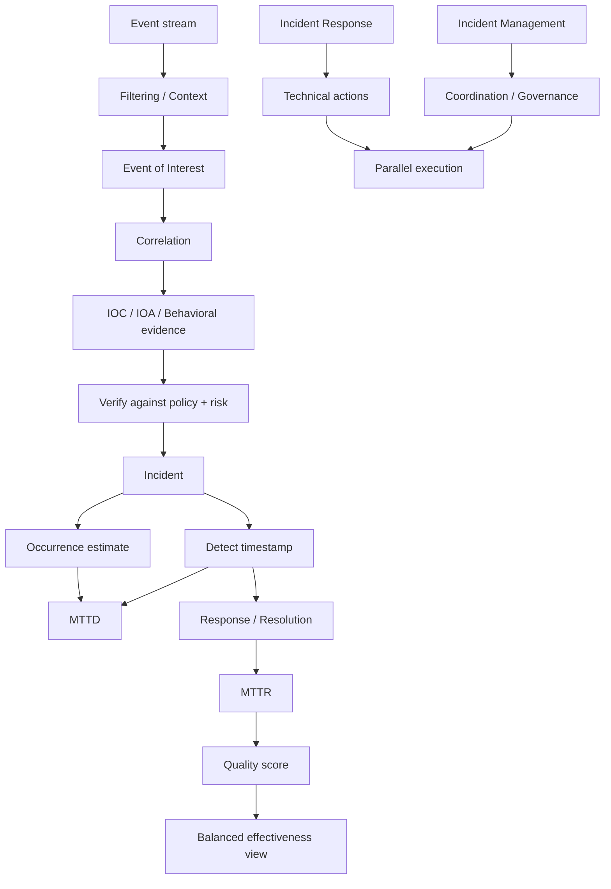

# Диаграмма: vocabulary and measurement model

## Interpretation

Chapter 4 connects three layers:

1. **Vocabulary** — what are events, EOI, IOC, incidents.
2. **Measurement** — how fast the organization detects and responds.
3. **Organization** — who performs technical response and who coordinates the broader incident.

Если definitions inconsistent, все три слоя становятся unreliable.
