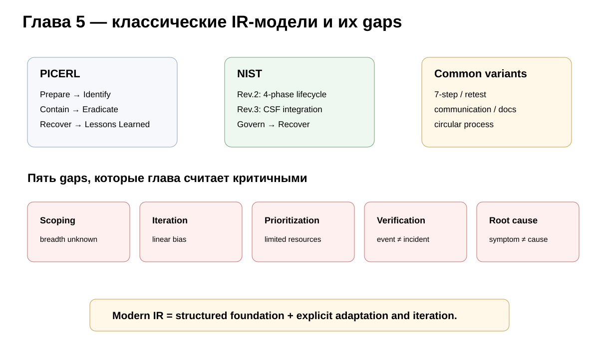

# Глава 5 — Модели реагирования на инциденты и их ограничения

Практический разбор главы 5 книги *Dynamic Incident Response: A Framework for Security Teams*.



## Идентификация

- Book ID: `dynamic-incident-response-joshua-wright-en-2026`
- Глава: 5
- Source title: `Incident Response Models and Their Limitations`
- Русское название: «Модели реагирования на инциденты и их ограничения»
- Slug: `incident-response-models-and-their-limitations`
- Source policy: `rag_only`
- External sources: запрещены
- Model memory: запрещена
- Прямой доступ к PDF: не использовался
- Язык артефактов: русский

## Provenance

- Canonical RAG: `p0076:c01`–`p0084:c01`
- PDF pages: 76–84
- `p0085:c01` — Part 2 divider.
- `p0086:c01` начинает Chapter 6 `A Dynamic Approach to Incident Response`.
- Source format: PDF
- RAG validation status: `READY_WITH_KNOWN_LIMITATIONS`
- Chapter boundary verified: yes

## Содержимое

- [cheatsheet.md](cheatsheet.md) — сравнение PICERL, NIST и common variants.
- [commands.md](commands.md) — operational commands отсутствуют; сохранён только source-supported model reference.
- [diagram.md](diagram.md) — Mermaid-схема: classic models → limitations → требования к modern model.
- [visual-cheatsheet.svg](visual-cheatsheet.svg) — компактная визуальная модель главы.
- [visual-cheatsheet-detailed.svg](visual-cheatsheet-detailed.svg) — подробная карта моделей и пяти ключевых gaps.
- [translation-editorial-findings.md](translation-editorial-findings.md) — findings для RU v2 repair.

## Краткий анализ

Глава 5 — переходная. Она закрывает Part 1 и подготавливает введение DAIR.

Автор не утверждает, что PICERL или NIST плохие. Наоборот, обе модели дали индустрии структуру и общую логику response. Проблема в другом: современный incident response стал сложнее, а некоторые critical activities в классических моделях либо скрыты внутри более широких phases, либо вообще не выделены явно.

## PICERL

PICERL:

- Preparation
- Identification
- Containment
- Eradication
- Recovery
- Lessons Learned

Сильные стороны:

- понятная последовательность;
- explicit containment;
- explicit lessons learned;
- usable structure для responders.

Ограничение:

- часто визуализируется как linear/stepped process;
- scoping, verification, resource prioritization и root cause analysis не выделены отдельно.

## NIST SP 800-61 Rev.2

Four phases:

1. Preparation
2. Detection and Analysis
3. Containment, Eradication, and Recovery
4. Post-Incident Activity

Сильные стороны:

- более flexible treatment после detection;
- detection/analysis рассмотрены подробнее;
- post-incident activity включает metrics и information sharing;
- cyclical feedback в preparation.

Ограничение:

- less detailed guidance по recovery;
- iterative behavior упоминается, но не встроено как explicit response loop.

## NIST SP 800-61 Rev.3

Rev.3 меняет positioning incident response:

- Govern
- Identify
- Protect
- Detect
- Respond
- Recover

Это уже не tactical lifecycle в стиле Rev.2, а integrated view внутри CSF 2.0.

Плюс:
- response становится частью enterprise cybersecurity risk management.

Минус:
- меньше step-by-step guidance для technical response teams.

## Variations

Source рассматривает:

- seven-step model с retesting;
- models с communication/documentation;
- circular model Virginia Tech.

Но автор подчёркивает: эти variations в основном меняют emphasis, а не устраняют core limitations.

## Пять ключевых gaps

### 1. Недостаточный scoping

Без scoping responder может устранить symptom на одном host и пропустить тот же attacker access на других systems.

### 2. Linear model bias

Реальные incidents не идут строго слева направо.

Новое evidence может потребовать:

- повторного analysis;
- расширения scope;
- нового containment;
- повторной eradication;
- повторной recovery validation.

### 3. Нет явной resource prioritization

Если incident затронул много systems, организация почти никогда не может обработать всё одновременно.

Нужна приоритизация по:

- business impact;
- criticality;
- available people/tools;
- organizational objectives.

### 4. Нет explicit verification

Не каждый abnormal event — incident.

Performance issue, misconfiguration и malicious activity могут выглядеть похоже в начале investigation.

Без verification IR team может потратить дорогие resources не туда.

### 5. Нет explicit root cause analysis

Если устранить только exploited weakness, но не понять underlying cause, incident может повториться.

Пример source:

```text
weak password
   ↓
change password
   ≠
root cause fixed
```

Root cause analysis может выявить:

- weak password policy;
- missing audit;
- weak remote access controls;
- другие системные проблемы.

## Основной вывод

**Структура нужна, но modern IR model должен быть не только structured, но и adaptive.**

Он должен явно поддерживать:

- verification;
- scoping;
- iteration;
- resource prioritization;
- root cause analysis.

Именно этот gap Chapter 6 начинает закрывать через DAIR.

## Ограничения источника

- Figures 16–21 представлены в RAG captions/текстовыми references, visual assets отдельно не доступны.
- Прямые quotes Applied Risk и NIST SP 800-61r2 в текущем переводе сохранены fail-closed.
- Shell/CLI commands отсутствуют.
- Review questions отсутствуют.
- References: [1]–[2].

## Связь с ремонтом перевода v2

Перевод смыслово полный, но mixed-language prose плотный: `incident response`, `framework`, `containment`, `eradication`, `recovery`, `lessons learned`, `scoping`, `resource prioritization`, `verification`, `root cause analysis`, `business imperatives` и др.

Chapter 5 важен как bridge к DAIR, поэтому v2 должен сделать этот conceptual transition максимально чистым и читабельным.
