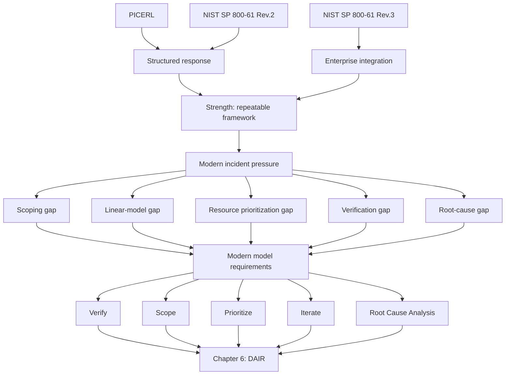

# Диаграмма: от classic models к требованиям modern IR



## Interpretation

Глава не отвергает existing frameworks.

Логика такая:

```text
existing models
    ↓
useful foundation
    ↓
modern complexity reveals hidden gaps
    ↓
make missing decision points explicit
    ↓
DAIR
```
