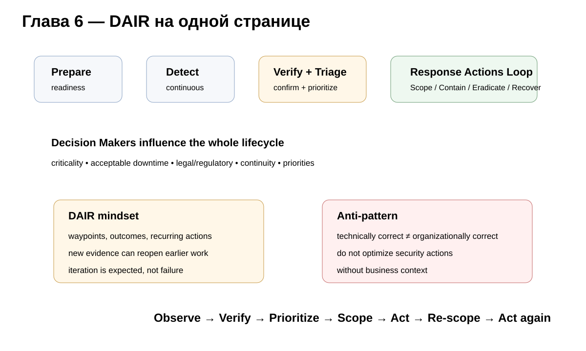

# Глава 6 — Динамический подход к реагированию на инциденты

Практический разбор главы 6 книги *Dynamic Incident Response: A Framework for Security Teams*.



## Идентификация

- Book ID: `dynamic-incident-response-joshua-wright-en-2026`
- Глава: 6
- Source title: `A Dynamic Approach to Incident Response`
- Русское название: «Динамический подход к реагированию на инциденты»
- Slug: `a-dynamic-approach-to-incident-response`
- Source policy: `rag_only`
- External sources: запрещены
- Model memory: запрещена
- Прямой доступ к PDF: не использовался
- Язык артефактов: русский

## Provenance

- Canonical RAG: `p0086:c01`–`p0093:c01`
- PDF pages: 86–93
- `p0094:c01` начинает Chapter 7 `Prepare Activity`.
- Source format: PDF
- RAG validation status: `READY_WITH_KNOWN_LIMITATIONS`
- Chapter boundary verified: yes

## Содержимое

- [cheatsheet.md](cheatsheet.md) — вся DAIR-модель на одной странице.
- [commands.md](commands.md) — command-level material отсутствует; сохранены только source-supported operational concepts.
- [diagram.md](diagram.md) — Mermaid-схема DAIR waypoints и response actions loop.
- [visual-cheatsheet.svg](visual-cheatsheet.svg) — компактная визуальная модель.
- [visual-cheatsheet-detailed.svg](visual-cheatsheet-detailed.svg) — подробная карта waypoints, decision makers и iteration.
- [translation-editorial-findings.md](translation-editorial-findings.md) — findings для RU v2 repair.

## Краткий анализ

Chapter 6 — ключевая conceptual глава книги. Здесь впервые полностью формулируется DAIR.

DAIR не отбрасывает PICERL и NIST. Он сохраняет знакомые response phases, но меняет способ мышления о них.

Вместо жёсткой последовательности шагов DAIR использует:

- waypoints;
- outcomes;
- actions;
- continuous/iterative activities.

Это позволяет лучше отражать реальный incident response, где многие действия идут параллельно и повторяются.

## DAIR flow

```text
Prepare
   ↓
Detect
   ↓
Verify + Triage
   ↓
Response Actions Loop:
  Scope ↔ Contain ↔ Eradicate ↔ Recover
   ↓
Debrief
```

При этом Decision Makers участвуют не в одной отдельной фазе, а дают context на протяжении всего response lifecycle.

## Waypoints, outcomes, actions

Главный методологический сдвиг:

```text
steps with hard start/stop
        ↓
waypoints + outcomes + recurring actions
```

Почему это важно:

- detection продолжается даже после обнаружения одного incident;
- eradication может дать новые TTPs;
- новые TTPs расширяют scope;
- новый scope может потребовать повторного containment;
- recovery может быть пересмотрен, если появляется новое evidence.

То есть DAIR делает iteration нормой, а не исключением.

## Decision makers

DAIR явно встраивает организационный context в technical response.

Decision makers помогают понять:

- какие systems/data наиболее critical;
- какой downtime acceptable;
- какие regulatory/legal obligations действуют;
- какие notification requirements есть;
- как балансировать thorough investigation и business continuity.

Пример source:

- 5 production DB servers;
- 10 finance workstations;
- production DB приносит $500k/hour;
- finance workstations важны для quarter close;
- sensitive customer data отсутствует на finance workstations;
- leadership приоритизирует customer continuity.

Результат:

- DB servers исследуются live-response методами;
- disruptive actions переносятся на maintenance window;
- finance workstations сегментируются, сохраняя operational access;
- heavy forensic analysis планируется позже.

Главный вывод: technically correct action может быть organizationally damaging.

## Verify and Triage

DAIR делает explicit то, что в classic models было implicit.

### Verify

Подтвердить:

- event действительно incident;
- incident требует response effort.

### Triage

Определить:

- priority;
- relative business importance;
- required resources.

Оба действия происходят concurrently, потому что требуют business context.

## Scope

Scope отвечает на вопрос:

**насколько широк incident и какие systems реально затронуты?**

Scoping использует:

- findings detect;
- verification output;
- TTPs;
- IOC.

Пример source:

phishing domain → поиск других systems, которые могли взаимодействовать с той же lure infrastructure.

## Response Actions Loop

Loop:

```text
Scope
  ↕
Contain
  ↕
Eradicate
  ↕
Recover
  ↺
```

Он не означает фиксированную очередность.

Это iterative analysis function.

Пример source:

1. найден unauthorized account;
2. system contained;
3. analysis показывает malicious scheduled task;
4. scheduled task становится новым scoping artifact;
5. ищутся другие similarly configured systems;
6. scope расширяется;
7. containment/eradication/recovery повторяются.

Loop завершается, когда:

- new evidence больше не появляется;
- IRT confident;
- decision makers confident;
- business needs satisfied.

## Основной принцип

**DAIR делает явными три вещи, которые modern IR обязан уметь делать постоянно: проверять, расширять scope и повторять response actions.**

## Ограничения источника

- Figures 22–28 доступны в RAG только captions/text references.
- Shell/CLI commands отсутствуют.
- Review questions отсутствуют.
- References отсутствуют.
- Chapter 6 — conceptual framework chapter.

## Связь с ремонтом перевода v2

Перевод смыслово сильный, но stylistic debt высокий из-за плотного смешения русского и английского. Chapter 6 должен стать одним из главных style anchors для v2, потому что именно здесь формируется canonical DAIR terminology.
