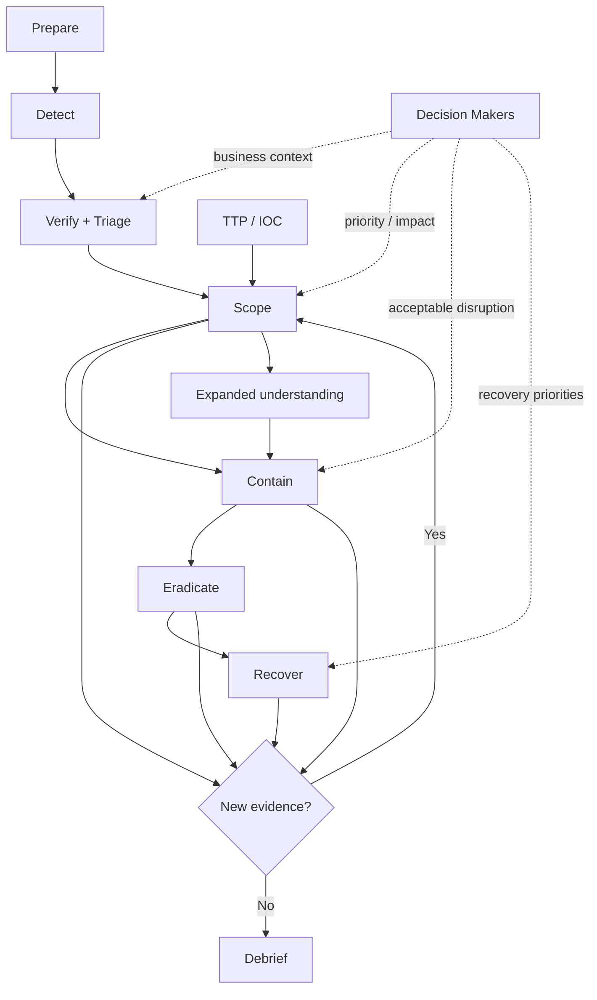

# Диаграмма: DAIR

## Interpretation

DAIR не требует, чтобы actions выполнялись строго по часовой стрелке.

Response Actions Loop — analytical loop, а не rigid sequence.

Любой новый artifact может вернуть команду к scoping и изменить последующие actions.
