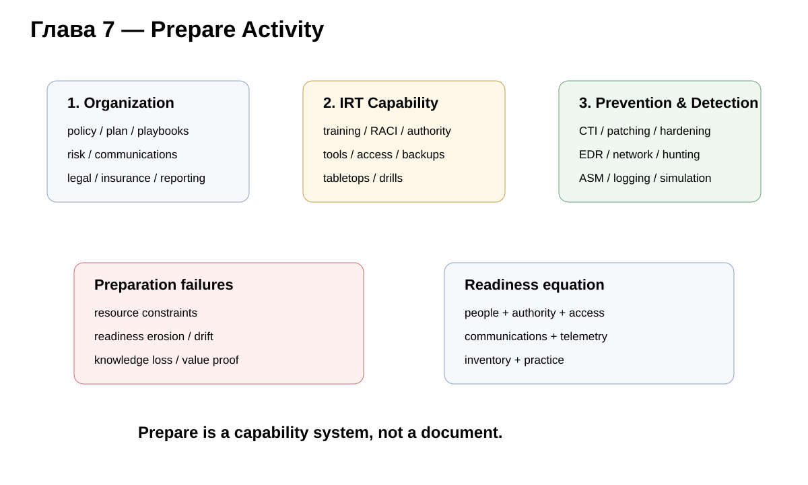

# Глава 7 — Подготовка

Практический разбор главы 7 книги *Dynamic Incident Response: A Framework for Security Teams*.

## Идентификация

- Book ID: `dynamic-incident-response-joshua-wright-en-2026`
- Глава: 7
- Source title: `Prepare Activity`
- Русское название: «Подготовка»
- Slug: `prepare-activity`
- Source policy: `rag_only`
- External sources: запрещены
- Model memory: запрещена
- Прямой доступ к PDF: не использовался
- Язык артефактов: русский

## Provenance

- Canonical RAG: `p0094:c01`–`p0165:c01`
- PDF pages: 94–165
- `p0166:c01` начинает Chapter 8 `Detect Activity`.
- Source format: PDF
- RAG validation status: `READY_WITH_KNOWN_LIMITATIONS`
- Chapter boundary verified: yes

## Содержимое

- [cheatsheet.md](cheatsheet.md) — operational map всей Prepare activity.
- [commands.md](commands.md) — source-supported technical artifacts: security.txt, STIX, monitoring/logging/tooling references.
- [diagram.md](diagram.md) — Mermaid-схема подготовки: organization → team → proactive prevention/detection.
- [visual-cheatsheet.svg](visual-cheatsheet.svg) — компактная визуальная модель.
- [visual-cheatsheet-detailed.svg](visual-cheatsheet-detailed.svg) — подробная карта Prepare domains.
- [translation-editorial-findings.md](translation-editorial-findings.md) — findings для RU v2 repair.

## Краткий анализ

Chapter 7 превращает Prepare из абстрактного «будьте готовы» в крупную инженерную программу.

Source делит Prepare на три objectives:

1. **organizational readiness**;
2. **incident response team capability**;
3. **proactive prevention and detection**.

Глава подчёркивает: большая часть времени IRT вне активных incidents должна уходить именно на подготовку и detection readiness.

## Preparation paradox

Подготовка труднее всего оправдывается тогда, когда она работает.

Если incidents редки, management может решить, что investment был избыточным. Поэтому preparation value следует показывать не как «мы предотвратили то, что нельзя доказать», а как **risk reduction**.

Source предлагает подтверждать readiness через measurable outcomes:

- lower MTTD;
- faster containment during exercises;
- better coordination in tabletop scenarios;
- improved coverage and documented readiness.

## Organizational readiness

### Policies, plans, playbooks

Source различает:

- **policy** — что организация требует;
- **plan** — кто, когда и как координирует response;
- **playbook** — конкретные действия для типового scenario.

Эти документы не взаимозаменяемы.

### Management support

IRT должен заранее получить:

- authority;
- funding;
- clear escalation paths;
- decision-maker engagement;
- communication model.

Management нельзя подключать только в момент crisis.

### Risk assessment and classification

До incident нужно определить:

- risk tolerance;
- severity criteria;
- escalation triggers;
- classification matrix.

Factors:

- number of systems/users;
- data sensitivity;
- business impact;
- regulatory obligations;
- lateral movement potential.

## Communication readiness

Prepare включает отдельную communication architecture.

Нужно заранее определить:

- primary channel;
- backup channel;
- independent authentication;
- logging/audit;
- data provenance;
- threaded communication;
- voice/video/screen-share capability.

Ключевой source lesson:

**backup channel должен быть независим от identity infrastructure, которая сама может быть compromised.**

Если primary directory контролирует attacker, backup Teams/Slack-like service с тем же SSO не является настоящим backup.

## Contacts and reporting

Глава требует заранее документировать:

- IRT;
- IT Ops;
- Legal;
- HR;
- executives;
- law enforcement;
- regulators;
- insurers;
- retainer providers;
- vendors/cloud providers.

Также нужны:

- reporting SLA;
- audience-specific templates;
- distribution lists;
- emergency communication plan;
- notification triggers;
- spokespersons.

## Regulatory notifications

Source рассматривает примеры obligations:

- GDPR;
- HIPAA;
- SEC;
- PCI DSS;
- NIS2;
- DORA;
- CRA.

Практический смысл не в запоминании списка, а в том, что legal timelines должны быть mapped в Emergency Communication Plan до incident.

PowerSchool case показывает стоимость плохой communication: incomplete notification, inconsistent messaging и loss of stakeholder confidence.

## Incident Response Team

Глава рассматривает:

- virtual vs dedicated IRT;
- platform for incident tracking;
- standardized vocabulary через MITRE ATT&CK;
- RACI;
- authority matrix;
- relationships with essential personnel.

Главный принцип:

**отношения между teams строятся до incident, а не во время него.**

## Cyber insurance

Prepare должен учитывать policy requirements до breach:

- notification timelines;
- pre-approval requirements;
- approved vendor panels;
- policy owner in IRT;
- offline copy of policy;
- independent legal counsel;
- protection of coverage details.

Source отдельно предупреждает: carrier-directed cost minimization может конфликтовать с нужной глубиной investigation.

## Team readiness

IRT должен быть готов технически и организационно.

Source covers:

- training;
- backup/recovery procedures;
- immutable/offline backup;
- 3-2-1-1 rule;
- relationships;
- RACI;
- decision authority;
- playbooks;
- forensic workstations;
- collection/analysis tools;
- evidence storage;
- jump bag/go kit;
- commercial vs open-source tooling;
- break-glass access;
- vendor/cloud escalation paths;
- tabletop exercises;
- drills.

## Tabletop exercises

Exercises нужны не для «галочки», а для проверки:

- decision points;
- communication;
- role clarity;
- access paths;
- vendor contacts;
- legal/insurance constraints;
- recovery assumptions.

Глава рассматривает Backdoors & Breaches и NCSC exercise toolkit как способы сделать practice реалистичнее.

## Proactive prevention and detection

Prepare включает не только response process, но и controls, которые уменьшают likelihood/impact incidents.

### CTI

Cyber Threat Intelligence используется для:

- threat awareness;
- enrichment;
- detection;
- scoping;
- response planning.

STIX позволяет machine-readable representation indicators, threat actors, campaigns, malware, vulnerabilities и relationships.

CTI platform превращает threat intelligence из статического feed в searchable investigation resource.

### Software management

Source covers:

- patching;
- configuration;
- inventory;
- supply-chain risk;
- end-of-life software;
- vulnerability prioritization.

MongoBleed example показывает cost of deferred patching and weak software inventory.

### Hardening

- disable unnecessary services;
- remove default accounts;
- least privilege;
- central logging;
- CIS Benchmarks / DISA STIG;
- application allowlisting.

### Endpoint telemetry

- EDR;
- Sysmon for gaps;
- central collection;
- adversary simulation validation.

### Network monitoring

Source covers:

- full packet capture;
- strategic packet capture;
- NetFlow/IPFIX/sFlow;
- eBPF;
- NDR.

Important nuance:
router flow can be sampled and may miss evidence; responder должен знать collection characteristics.

### Detection engineering

Preparation включает:

- ATT&CK-mapped rules;
- testing;
- tuning;
- coverage tracking;
- rule lifecycle management.

### Threat hunting

Нужны:

- hypothesis catalog;
- data sources;
- cadence;
- ownership;
- findings;
- promotion findings into automated detections.

### Asset inventory and attack surface

Нельзя корректно scope incident вокруг assets, о существовании которых команда не знает.

Source прямо связывает ASM и response quality:

**unknown assets are likely to be missed during scoping.**

### Adversary simulation

Используется для validation:

- controls;
- telemetry;
- detection rules;
- response procedures.

### Logging

Prepare требует:

- critical log source inventory;
- relevant event capture;
- retention aligned to detection/investigation/compliance;
- central collection;
- tamper protection.

Глава подчёркивает distinction между:

- logs useful for active detection;
- logs retained only for compliance.

Не каждый log source обязан жить в дорогом SIEM.

## Preparation challenges

Source выделяет пять recurring problems:

1. Resource Constraints
2. Readiness Erosion
3. Documentation Drift
4. Knowledge Loss
5. Value Demonstration

Countermeasures:

- risk-based funding argument;
- recurring exercises;
- document review cadence;
- knowledge transfer;
- measurable readiness metrics.

## Step-by-Step synthesis

Source финализирует Chapter 7 тремя большими workstreams:

### Step 1 — Prepare the Organization
- policy/plan/playbooks;
- management support;
- classification;
- communication;
- contacts;
- reporting;
- emergency communications;
- IRT structure;
- tracking platform.

### Step 2 — Prepare the Incident Response Team
- skills;
- backups;
- relationships;
- RACI;
- authority;
- playbooks;
- tools/resources;
- access;
- exercises.

### Step 3 — Proactive Prevention and Detection
- CTI;
- software management;
- hardening;
- endpoint telemetry;
- network monitoring;
- detection engineering;
- threat hunting;
- asset inventory;
- attack-surface monitoring;
- adversary simulation;
- vulnerability management;
- logging.

## Основной принцип

**Prepare — это не документ. Это capability system.**

Она объединяет people, authority, communications, tooling, access, telemetry, inventory, practice и governance.

## Ограничения источника

- Figures 29–49 представлены в RAG как captions/text references.
- Tables 3–13 preserved in source.
- Listings 27–28 preserved.
- References [1]–[24] are present across the chapter reference section.
- Review questions отсутствуют.
- Некоторые external quotes/visuals требуют third-party review.

## Связь с ремонтом перевода v2

Chapter 7 — крупнейший stylistic debt на текущем этапе: перевод смыслово богатый, но mixed-language density чрезвычайно высокая, особенно в headings. Из-за размера главы именно здесь v2 должен применять уже зафиксированный canonical terminology policy из Chapter 6.
