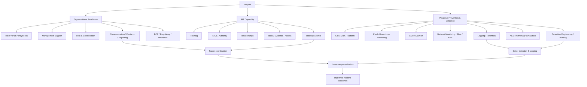

# Диаграмма: Prepare Activity

## Interpretation

Prepare — это dependency graph, а не один task.

Слабое звено в communication, access, inventory или telemetry проявляется уже во время active incident, когда исправлять его дороже.
