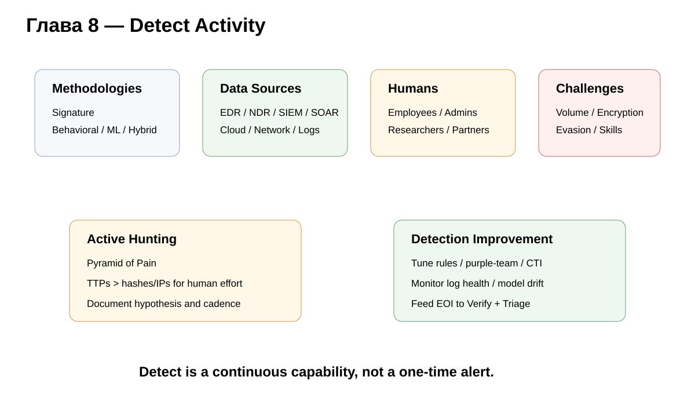

# Глава 8 — Обнаружение

Практический разбор главы 8 книги *Dynamic Incident Response: A Framework for Security Teams*.

## Идентификация

- Book ID: `dynamic-incident-response-joshua-wright-en-2026`
- Глава: 8
- Source title: `Detect Activity`
- Русское название: «Обнаружение»
- Slug: `detect-activity`
- Source policy: `rag_only`
- External sources: запрещены
- Model memory: запрещена
- Прямой доступ к PDF: не использовался
- Язык артефактов: русский

## Provenance

- Canonical RAG: `p0166:c01`–`p0189:c01`
- PDF pages: 166–189
- `p0190:c01` начинает Chapter 9 `Verify and Triage Activities`.
- Source format: PDF
- RAG validation status: `READY_WITH_KNOWN_LIMITATIONS`
- Chapter boundary verified: yes

## Содержимое

- [cheatsheet.md](cheatsheet.md) — operational map Detect activity.
- [commands.md](commands.md) — source-supported Zeek/RITA, KQL, TShark/jq и Elasticsearch artifacts.
- [diagram.md](diagram.md) — Mermaid-схема detection pipeline.
- [visual-cheatsheet.svg](visual-cheatsheet.svg) — компактная визуальная модель.
- [visual-cheatsheet-detailed.svg](visual-cheatsheet-detailed.svg) — подробная карта methodologies, sources, hunting и challenges.
- [translation-editorial-findings.md](translation-editorial-findings.md) — findings для RU v2 repair.

## Краткий анализ

Chapter 8 описывает Detect как постоянную, многоисточниковую activity. Главный тезис: качественное обнаружение строится не на одном инструменте, а на комбинации methodologies, telemetry, human observations и active hunting.

## Четыре detection methodologies

### Signature-based
Сильна для известных угроз:
- hash;
- domain;
- byte pattern;
- protocol/port indicators.

Плюсы:
- быстро;
- автоматизируемо;
- обычно мало false positives.

Минус:
- реактивна;
- новые/изменённые techniques могут обходить signatures.

### Behavioral
Ищет не внешний вид, а поведение:
- mass encryption;
- unusual access;
- living-off-the-land;
- insider misuse.

Критическое условие — хорошие baselines.

### Machine Learning
Полезен для high-volume telemetry и subtle patterns.

Ограничения:
- model drift;
- training-data quality;
- evasion;
- false positives.

Source рекомендует human-in-the-loop: ML помогает приоритизировать, но final classification остаётся за analyst.

### Hybrid
Лучший practical model — сочетание signatures + behavior + ML, привязанных к attacker techniques, например MITRE ATT&CK.

## Baseline должен учитывать context

Organization-wide baseline часто слишком широк.

Source показывает, что разные business units имеют разную норму:
- CAD/CAM-heavy engineering;
- classified mission systems;
- corporate IT.

Чем точнее baseline, тем лучше видны реальные anomalies.

## Active vs Passive Detection

### Passive
Срабатывает, когда:
- alert fired;
- employee reported;
- partner/researcher notified.

### Active
Threat hunting:
- proactive search;
- no predefined alert;
- поиск unknown threats.

Главная сложность hunting — “tyranny of infinite choice”: слишком много возможных направлений.

Pyramid of Pain помогает выбирать hunting focus:
- hashes/IP — легко автоматизировать, легко менять;
- TTPs — труднее искать, но attacker'у труднее менять.

## Detection data sources

### Technical
- EDR;
- NDR;
- SIEM;
- SOAR;
- OpenObserve;
- Zeek/RITA;
- email/web/cloud logging;
- CWPP.

### Human
- employees;
- sysadmins;
- help desk;
- external researchers;
- customers/partners.

Важный вывод: культура reporting — часть detection capability. Дismissive response снижает будущую observability.

## Cloud-native detection

Source отдельно выделяет:
- containers/Kubernetes;
- serverless/microservices;
- hybrid/multi-cloud.

Techniques:
- eBPF;
- runtime socket monitoring;
- Kubernetes audit logs;
- service mesh telemetry;
- provider logs;
- control-plane analytics;
- native AWS/Azure/GCP tools;
- cross-environment correlation.

## Detection-driven collection

Главный принцип:

**collect data for defined detection use cases, а не “собирай всё”.**

Практики:
- start from use cases;
- tiered retention;
- source filtering;
- intentional disposal;
- correlation-based alerting;
- continuous tuning.

## Encrypted traffic

Когда payload недоступен, detection смещается к metadata:
- timing;
- size;
- direction;
- certificate;
- SNI;
- TLS fingerprinting.

Source показывает JA4 analysis через TShark + local JSON database.

## Adversary evasion

Attackers:
- clear logs;
- disable audit;
- timestomp;
- abuse PowerShell/WMI/PsExec;
- stay below thresholds;
- test malware against security products.

Вывод: detection rules должны постоянно эволюционировать.

## Purple team

Особенно полезен для проверки реальной coverage:
- red team демонстрирует technique;
- blue team видит telemetry;
- detection корректируется почти в real time.

## Skills gap

Detection tooling не заменяет skill.

Source рекомендует:
- training;
- MSSP supplementation;
- knowledge management;
- AI-assisted detection с human oversight.

## Two practical examples

### External Breach Hunter
Внешний researcher сообщает о suspicious accounts.

Правильная реакция:
- не доверять имени отправителя автоматически;
- проверить infrastructure;
- account naming;
- geo/context;
- evidence quality;
- затем передать в Verify/Triage.

### SIEM Wizard
Threat hunter ищет beaconing pattern.

Findings:
- 2,016 requests за 7 days;
- ровно 5-minute interval;
- один finance workstation;
- suspicious recent domain.

Это становится EOI и передаётся в Verify/Triage.

## Detect Step-by-Step

Source формализует 8 steps:

1. Select and Combine Detection Methodologies
2. Operate Detection Data Sources
3. Adapt Detection to Cloud-Native Environments
4. Implement Data Reduction and Prioritization Strategies
5. Conduct Active Threat Hunting
6. Monitor Passive Detection Sources
7. Respond to Detection Events
8. Continuously Improve Detection Capabilities

## Основной принцип

**Detect — это continuous capability, а не одноразовый alert.**

Сильная detection function:
- комбинирует methods;
- знает свои data sources;
- hunts proactively;
- использует humans;
- понимает encrypted/cloud constraints;
- улучшает rules через testing и incidents.

## Ограничения источника

- Figures 50–56 представлены в RAG captions/text references.
- Listings 29–33 preserved.
- References [1]–[6].
- Review questions отсутствуют.

## Связь с ремонтом перевода v2

Семантика перевода хорошая, но headings и prose сильно mixed-language. Chapter 8 должен наследовать canonical terminology policy из Chapter 6 и использовать consistent Russian narrative with preserved acronyms/tool names.
