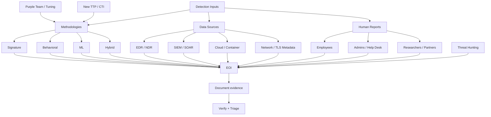

# Диаграмма: Detect Activity

## Interpretation

Detect имеет два направления:

- passive intake;
- active hunting.

Оба должны приводить не к premature incident declaration, а к хорошо документированному EOI для следующей DAIR activity.
