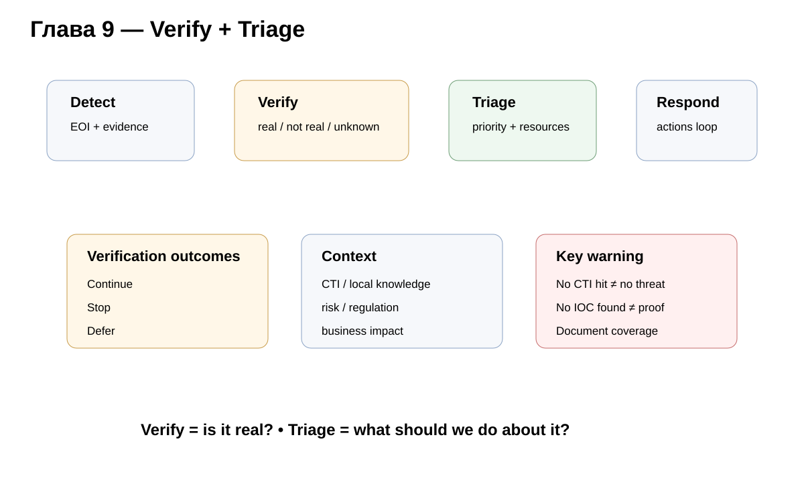

# Глава 9 — Проверка и триаж

Практический разбор главы 9 книги *Dynamic Incident Response: A Framework for Security Teams*.



## Идентификация

- Book ID: `dynamic-incident-response-joshua-wright-en-2026`
- Глава: 9
- Source title: `Verify and Triage Activities`
- Русское название: «Проверка и триаж»
- Slug: `verify-and-triage-activities`
- Source policy: `rag_only`
- External sources: запрещены
- Model memory: запрещена
- Прямой доступ к PDF: не использовался
- Язык артефактов: русский

## Provenance

- Canonical RAG: `p0190:c01`–`p0212:c01`
- PDF pages: 190–212
- `p0213:c01` начинает Chapter 10 `Response Actions Loop`.
- Source format: PDF
- RAG validation status: `READY_WITH_KNOWN_LIMITATIONS`
- Chapter boundary verified: yes

## Содержимое

- [cheatsheet.md](cheatsheet.md) — Verify/Triage как gating function.
- [commands.md](commands.md) — source-supported verification artifacts: WHOIS, curl, AWS CLI, jq и forensic examples.
- [diagram.md](diagram.md) — Mermaid-схема `Detect → Verify → Continue/Stop/Defer → Triage`.
- [visual-cheatsheet.svg](visual-cheatsheet.svg) — компактная визуальная модель.
- [visual-cheatsheet-detailed.svg](visual-cheatsheet-detailed.svg) — подробная карта verification, CTI, risk и triage.
- [translation-editorial-findings.md](translation-editorial-findings.md) — findings для RU v2 repair.

## Краткий анализ

Chapter 9 делает explicit activity, которая в PICERL/NIST часто скрыта внутри detection/analysis:

**сначала подтвердить, что incident реален, затем решить, насколько серьёзно и какими ресурсами на него реагировать.**

Это снижает риск двух противоположных ошибок:

- тратить дорогие IR resources на false positive;
- недооценить реальный incident и вовлечь нужных людей слишком поздно.

## Verification как gating function

Verify стоит перед Response Actions Loop не случайно.

Логика:

```text
Detect
  ↓
Verify
  ├─ Continue → engage broader IRT
  ├─ Stop → close with evidence
  └─ Defer → request more information
```

Source подчёркивает: verification не гарантирует абсолютную истину. Иногда unexplained behavior остаётся, но evidence compromise не находится.

Главное — чтобы verdict был defensible на основании объёма выполненной работы.

## Documentation

Документирование начинается уже на Verify, а не после incident.

Source рекомендует фиксировать:

- incident ID;
- title;
- handler;
- summary;
- classification;
- evidence references.

Главный принцип:

**документировать по ходу incident лучше, чем восстанавливать память после него.**

Отдельный акцент — pristine documentation. Notes могут стать evidence, поэтому contamination, смешивание unrelated cases и небрежная формулировка снижают их юридическую ценность.

## Initial Risk Assessment

До presentation decision maker analyst должен дать начальную оценку impact.

Source упоминает VERIS, FAIR и NIST SP 800-30 как возможные frameworks, но допускает простой четырехуровневый подход:

- Low
- Medium
- High
- Critical

Factors:
- financial;
- operational;
- reputational;
- regulatory impact.

## CTI в verification

CTI не заменяет verification, а добавляет context.

Три use cases:

1. EOI validation/enrichment;
2. initial risk classification;
3. pivot to related indicators.

Критический warning source:

**absence of threat intelligence ≠ absence of threat.**

Zero-days и новые actors могут не присутствовать в feeds.

## Same indicator, different risk

Chapter показывает, как CTI способен изменить interpretation, не меняя исходные technical facts.

Один analyst видит ambiguous network pattern.

Другой добавляет threat-intelligence context и получает stronger evidence adversary infrastructure.

Вывод:

```text
technical evidence + context = better verification
```

## Verification examples

### Unresponsive WordPress Site

Симптом:
- recurring performance problems;
- repeated reboots;
- strange PHP file.

Проверка:
- Apache logs;
- suspicious repeated requests;
- inspection of PHP;
- SHA-256 + CTI;
- compare against legitimate WordPress manifest.

Результат:
- confirmed incident.

### Unpaid Toll

Suspicious SMS ведёт на fresh domain.

Проверка:
- domain creation date;
- TLS certificate age;
- browser history;
- proxy logs.

Результат:
- IOA есть;
- EOI для дальнейшего investigation нет;
- indicator добавлен в CTI platform;
- incident closed.

Это хороший пример того, что attack indicator не всегда требует full response.

### Simple, Secure Storage Bucket

Public S3 bucket выглядит suspicious.

Проверка показывает:
- public read/list policy реальна;
- часть content предназначена для public use;
- чувствительность данных неясна.

Результат:
- verification deferred;
- нужен owner review.

### Temperamental Server

System нестабилен, но после deep forensic review IOC не найдено.

Главный lesson:

**proving a negative требует document coverage, а не фразы "ничего не нашли".**

## Triage

После подтверждения analyst работает с decision makers.

Triage отвечает на вопросы:

- насколько incident важен;
- какие resources выделить;
- какие teams/legal/external parties вовлечь;
- какие response actions допустимы.

Analyst даёт:
- technical facts;
- risk classification;
- recommendations.

Decision maker принимает resource-allocation decision.

## Third-Party Vendor Breach

Source показывает mature triage:

- vendor сообщает breach;
- IRT независимо сверяет API/egress/SSO/CASB telemetry;
- vendor count не принимается blindly;
- incident classified high;
- Legal/Customer Experience подключаются;
- notification timelines учитываются;
- analyst role частично смещается в coordination/documentation.

Главный вывод:

**third-party incident всё равно требует собственной verification, а не принятия vendor narrative как source of truth.**

## Verify/Triage Step-by-Step

1. Document Incident Details
2. Enrich EOI with CTI
3. Perform Initial Risk Assessment
4. Verify Incident
5. Present to Decision Makers
6. Agree Response Actions and Resource Allocation
7. Review and Improve Process

## Основной принцип

**Verify защищает организацию от лишней мобилизации; Triage защищает её от неправильной приоритизации.**

Обе activity связывают technical evidence с organizational decisions.

## Ограничения источника

- Figures 57–65 представлены в RAG captions/text references.
- Listings 34–40 preserved.
- Review questions отсутствуют.
- References/CTI examples preserved only where source provides them.

## Связь с ремонтом перевода v2

Перевод смыслово хороший, но English-heavy headings и hybrid prose нарушают flow. Особенно важна нормализация terminology around Verify/Triage/Decision Makers/CTI, потому что эти термины повторяются во всей последующей книге.
