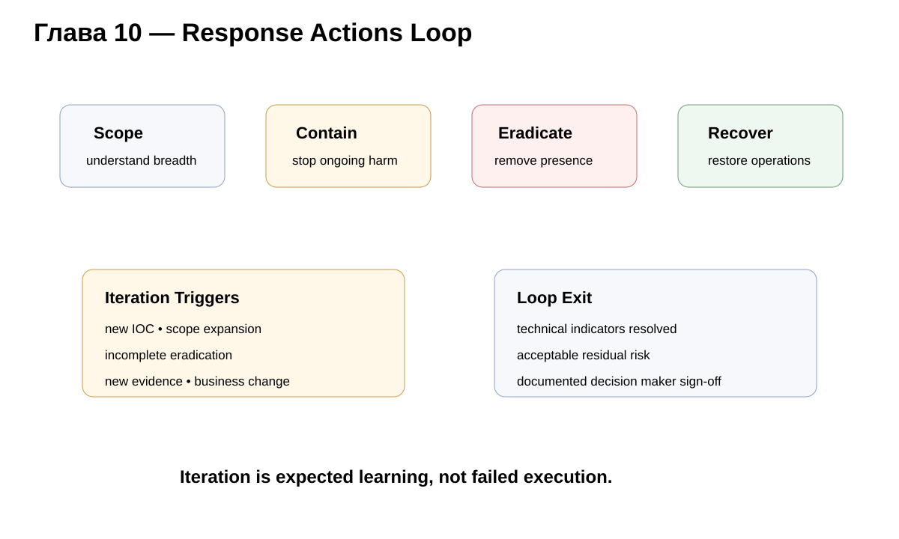

# Глава 10 — Цикл действий реагирования

Практический разбор главы 10 книги *Dynamic Incident Response: A Framework for Security Teams*.



## Идентификация

- Book ID: `dynamic-incident-response-joshua-wright-en-2026`
- Глава: 10
- Source title: `Response Actions Loop`
- Русское название: «Цикл действий реагирования»
- Slug: `response-actions-loop`
- Source policy: `rag_only`
- External sources: запрещены
- Model memory: запрещена
- Прямой доступ к PDF: не использовался
- Язык артефактов: русский

## Provenance

- Canonical RAG: `p0213:c01`–`p0223:c01`
- PDF pages: 213–223
- `p0224:c01` начинает Chapter 11 `Scope Activity`.
- Source format: PDF
- RAG validation status: `READY_WITH_KNOWN_LIMITATIONS`
- Chapter boundary verified: yes

## Содержимое

- [cheatsheet.md](cheatsheet.md) — operational reference по итеративному loop.
- [commands.md](commands.md) — command-level material отсутствует; сохранены только source-supported operational concepts.
- [diagram.md](diagram.md) — Mermaid-схема loop, iteration triggers и exit decision.
- [visual-cheatsheet.svg](visual-cheatsheet.svg) — компактная модель.
- [visual-cheatsheet-detailed.svg](visual-cheatsheet-detailed.svg) — подробная карта итераций, triggers, documentation и stop criteria.
- [translation-editorial-findings.md](translation-editorial-findings.md) — findings для RU v2 repair.

## Краткий анализ

Chapter 10 разворачивает центральный operational engine DAIR: **Response Actions Loop**.

Вместо single-pass response книга предлагает повторяющийся цикл:

```text
Scope ↔ Contain ↔ Eradicate ↔ Recover
```

Каждая итерация углубляет понимание incident.

## Почему single-pass не работает

Source выделяет четыре типовых failure mode:

- incomplete understanding;
- insufficient insight;
- incomplete evidence;
- limited scope.

Их общий эффект: responders устраняют видимые симптомы, но оставляют attacker footholds, пропускают связанные systems или не замечают новый attack vector.

## OODA comparison

Source сравнивает loop с OODA Colonel John Boyd.

Сходство:
- continuous adaptation;
- repeated learning cycles.

Различие:
- OODA оптимизирует individual decision speed;
- Response Actions Loop оптимизирует team-wide thoroughness на уровне процесса.

## Four loop activities

### Scope
Понять breadth/depth compromise.

Каждая итерация может:
- расширить scope;
- сузить scope;
- выявить new systems;
- обнаружить additional data access.

### Contain
Ограничить ongoing damage и attacker freedom.

В следующих итерациях containment становится точнее по мере роста понимания.

### Eradicate
Удалить known attacker presence.

Повторные проходы нужны, потому что:
- persistence может быть сложнее, чем казалось;
- обнаруживаются новые backdoors;
- living-off-the-land activity может не исчезнуть после удаления malware.

### Recover
Вернуть operations и одновременно устранить root causes.

Early recovery:
- restore from backups;
- reset credentials;
- patch vulnerabilities.

Later recovery:
- monitoring improvements;
- policy/process changes;
- architecture changes.

## Iteration triggers

Пять больших категорий:

1. new IOC;
2. scope expansion;
3. incomplete eradication;
4. evidence-analysis revelations;
5. changing business priorities or external obligations.

Ключевой principle:

**new information is not failure — it is an expected trigger for another response cycle.**

## External obligations

Law enforcement, regulators, insurance и changing business priorities могут менять response mid-incident.

Например:
- preservation request;
- delayed containment for observation;
- notification deadline;
- mandated scope expansion.

То есть iteration может быть вызвана не только technical evidence.

## Documentation and communication

Каждый loop pass должен создавать coherent record.

Минимум:
- what;
- when;
- who;
- rationale;
- impact;
- stakeholder communication.

Документация должна связывать iterations в один incident narrative.

## Impact assessment

Нужно фиксировать:
- affected business functions;
- number of users;
- system downtime;
- revenue impact;
- workarounds;
- cost/remediation context.

Source отмечает, что такие данные могут быть нужны для regulatory submissions, например DORA.

## Knowing When to Stop

Loop нельзя завершать только потому, что responders устали или malware больше не видно.

Technical indicators:
- no new IOC;
- no attacker activity;
- eradication verified;
- systems operate normally.

Business indicators:
- objectives met;
- acceptable risk reached;
- cost-benefit supports closure;
- residual uncertainty consciously accepted.

Final exit должен быть:
- explicit;
- attributed;
- documented.

Source рекомендует фиксировать:
- decision maker;
- supporting technical indicators;
- business indicators;
- residual risks;
- timestamp.

## Practical considerations

Iteration дороже linear process.

Source отдельно выделяет:
- team fatigue;
- budget constraints;
- tool limitations;
- documentation burden;
- shift handoff;
- stakeholder impatience.

Но вывод автора: iterative process дороже upfront, зато уменьшает вероятность incomplete remediation.

## Step-by-Step

1. Run loop expecting each activity to deepen.
2. Identify iteration triggers.
3. Maintain cross-phase documentation and communication.
4. Build cumulative understanding.
5. Monitor technical resolution indicators.
6. Assess business indicators.
7. Engage decision makers for exit.
8. Manage practical constraints throughout iterations.

## Основной принцип

**Успех Response Actions Loop — не “идеально пройти цикл один раз”, а повторять его столько раз, сколько нужно для реального resolution.**

## Ограничения источника

- Figures 66–68 представлены в RAG captions/text references.
- Command-level examples отсутствуют.
- References [1]–[2] present.
- Review questions отсутствуют.

## Связь с ремонтом перевода v2

Семантика главы сильная, но много English headings и hybrid terminology. Для v2 особенно важно закрепить русские canonical names четырёх loop activities и wording для iteration/exit decision.
