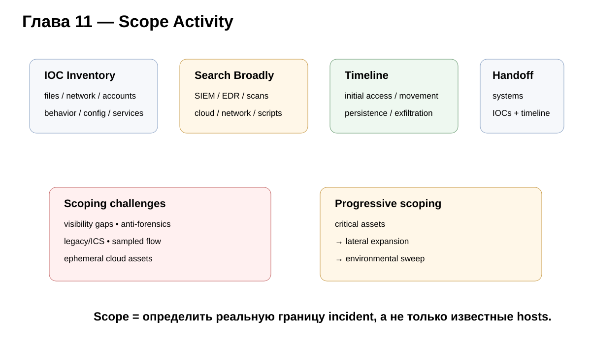

# Глава 11 — Определение масштаба

Практический разбор главы 11 книги *Dynamic Incident Response: A Framework for Security Teams*.



## Идентификация

- Book ID: `dynamic-incident-response-joshua-wright-en-2026`
- Глава: 11
- Source title: `Scope Activity`
- Русское название: «Определение масштаба»
- Slug: `scope-activity`
- Source policy: `rag_only`
- External sources: запрещены
- Model memory: запрещена
- Прямой доступ к PDF: не использовался
- Язык артефактов: русский

## Provenance

- Canonical RAG: `p0224:c01`–`p0243:c01`
- PDF pages: 224–243
- `p0244:c01` начинает Chapter 12 `Contain Activity`.
- Source format: PDF
- RAG validation status: `READY_WITH_KNOWN_LIMITATIONS`
- Chapter boundary verified: yes

## Содержимое

- [cheatsheet.md](cheatsheet.md) — operational reference по scoping.
- [commands.md](commands.md) — source-supported scoping artifacts и cloud/audit examples.
- [diagram.md](diagram.md) — Mermaid-схема progressive scoping и timeline reconstruction.
- [visual-cheatsheet.svg](visual-cheatsheet.svg) — компактная визуальная модель.
- [visual-cheatsheet-detailed.svg](visual-cheatsheet-detailed.svg) — подробная карта IOC classes, methodologies, challenges и handoff.
- [translation-editorial-findings.md](translation-editorial-findings.md) — findings для RU v2 repair.

## Краткий анализ

Chapter 11 формализует Scope как самостоятельную activity между Verify/Triage и активными response actions.

Ключевой переход:

```text
"we have an incident"
        ↓
"we know some of its breadth and depth"
```

Без scoping организация рискует удалить malware на известных hosts, но оставить связанные compromised systems, credentials, cloud resources или lateral-movement paths.

## Главные вопросы Scope

- isolated incident или widespread presence?
- какие systems compromised, какие нет?
- когда началась атака?
- сколько времени attacker имел доступ?
- какие data/resources были accessed или exfiltrated?
- есть ли multiple vectors/persistence mechanisms?

## IOC categories

### Technical IOC

Source перечисляет:

- file-based indicators;
- network indicators;
- process/service indicators;
- registry/configuration indicators;
- account-based indicators.

Главная идея:
один IOC на одном host должен становиться pivot для поиска across the environment.

### Behavioral IOC

Особенно важны:

- temporal patterns;
- data movement;
- lateral movement.

Они позволяют находить compromise, который не виден через статические signatures.

## Scoping methodologies

### Enterprise-Wide Hunting

После подтверждения IOC нужно искать его across available telemetry:

- SIEM/log aggregation;
- EDR;
- inventory tools;
- active scanning;
- network scans;
- authenticated checks;
- custom scripts;
- threat-hunting platforms.

Главный принцип — overlapping coverage из нескольких data sources снижает шанс пропустить compromise.

### Progressive Scoping

Если всю среду проверить сразу нельзя:

1. Critical Asset Prioritization
2. Lateral Expansion
3. Environmental Sweep

То есть сначала high-value systems, затем связанные systems, затем весь environment.

## Timeline reconstruction

Scope владеет canonical attack-progression timeline.

Нужно установить:

- initial compromise;
- patient zero;
- initial vector;
- lateral movement;
- persistence deployment;
- sensitive-data access/exfiltration.

Timeline reconstruction iterative: новая evidence может сдвигать compromise start time назад и расширять incident narrative.

## Scoping challenges

### Visibility gaps

Проблемные зоны:

- unmanaged/BYOD;
- shadow IT;
- legacy;
- IoT;
- ICS;
- short-lived cloud assets.

Для слабологируемых систем source рекомендует alternative evidence:
- network flow;
- auth logs соседних systems;
- connected-system telemetry.

### OT / ICS

Пример Siemens S7-1200 показывает, что некоторые devices:
- имеют limited local diagnostics;
- не отправляют syslog;
- не дают полноценный historical trail.

В таких environments network visibility может быть primary evidence source.

Но sampled flow может пропустить low-volume activity.

### Anti-forensics

Source рассматривает:

- log deletion/modification;
- log replay/flooding;
- timestomping;
- encryption/obfuscation;
- living off the land.

Counter-strategy:
- multiple independent log sources;
- record-ID gaps;
- alternative timestamps;
- behavioral analysis;
- command-line/context analysis.

### Dynamic / Cloud environments

Scoping must include:
- system images;
- container registries;
- IaC templates;
- cloud audit logs;
- short-lived resource history.

Ephemeral resources могут исчезнуть раньше, чем analyst их исследует.

## Integration with response

Scope не isolated phase.

Он:
- feeds containment;
- feeds eradication;
- feeds recovery;
- может выполняться параллельно с ними;
- может быть повторно запущен в любой iteration loop.

## Example 1 — LinkedIn Attachment

PDF выглядит обычным, но analysis через:
- `file`
- `sha256sum`
- `pdfid.py`
- `pdf-parser.py`

выявляет suspicious URLs и referenced payloads.

Эти indicators становятся input для broader scoping.

## Example 2 — Cloud Storage Exfiltration

Azure alert на suspicious Blob container приводит к последовательному expansion:

- container contents;
- Activity Log;
- compromised service principal;
- external IP;
- role assignments;
- attacker-created VM;
- additional resource group;
- exfiltrated sensitive data;
- earlier timeline.

Это показательный пример того, как Scope превращает single suspicious cloud object в full compromise story.

## Step-by-Step

1. Identify IOCs from Detect/Verify.
2. Conduct enterprise-wide hunting.
3. Apply progressive scoping.
4. Reconstruct attack timeline.
5. Document findings.
6. Address scoping challenges.
7. Hand off scoped systems/IOC inventory/timeline to Contain/Eradicate/Recover.

## Основной принцип

**Scope — это поиск полной границы incident, а не проверка только известных infected hosts.**

## Ограничения источника

- Figures 69–73 представлены в RAG captions/text references.
- Listings 41–47 preserved.
- Tables 14–15 preserved.
- Reference [1] present.
- Review questions отсутствуют.

## Связь с ремонтом перевода v2

Chapter 11 — один из наиболее важных operational chapters. Семантика хорошая, но headings и narrative всё ещё heavily hybrid. Для v2 важно закрепить canonical Russian wording для Scope, IOC categories, progressive scoping, timeline reconstruction и anti-forensics.
