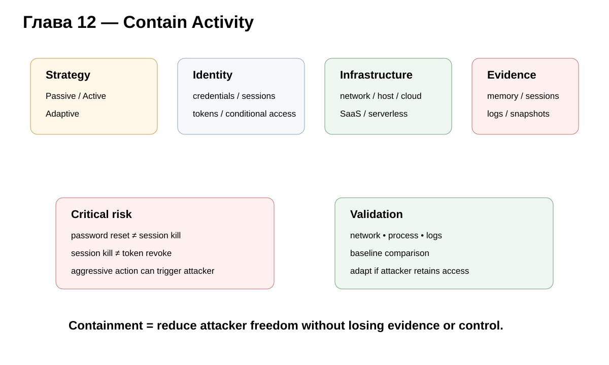

# Глава 12 — Сдерживание

Практический разбор главы 12 книги *Dynamic Incident Response: A Framework for Security Teams*.



## Идентификация

- Book ID: `dynamic-incident-response-joshua-wright-en-2026`
- Глава: 12
- Source title: `Contain Activity`
- Русское название: «Сдерживание»
- Slug: `contain-activity`
- Source policy: `rag_only`
- External sources: запрещены
- Model memory: запрещена
- Прямой доступ к PDF: не использовался
- Язык артефактов: русский

## Provenance

- Canonical RAG: `p0244:c01`–`p0299:c01`
- PDF pages: 244–299
- `p0300:c01` начинает Chapter 13 `Eradicate Activity`.
- Source format: PDF
- RAG validation status: `READY_WITH_KNOWN_LIMITATIONS`
- Chapter boundary verified: yes

## Содержимое

- [cheatsheet.md](cheatsheet.md) — operational reference по containment strategy, identity, cloud, remote work и validation.
- [commands.md](commands.md) — source-supported containment commands и queries.
- [diagram.md](diagram.md) — Mermaid-схема выбора containment strategy и validation loop.
- [visual-cheatsheet.svg](visual-cheatsheet.svg) — компактная визуальная модель.
- [visual-cheatsheet-detailed.svg](visual-cheatsheet-detailed.svg) — подробная карта containment layers и controls.
- [translation-editorial-findings.md](translation-editorial-findings.md) — findings для RU v2 repair.

## Краткий анализ

Chapter 12 — один из самых operationally dense разделов книги. Contain становится точкой перехода от понимания инцидента к активному ограничению attacker capabilities.

Две основные цели:

1. остановить дальнейший вред;
2. сохранить evidence для последующих investigation, eradication и recovery.

Главный tension главы:

```text
act fast
   ↔
preserve evidence
   ↔
do not unnecessarily disrupt business
```

## Containment strategies

### Passive containment

Наблюдение и ограниченное вмешательство, когда:
- важно собрать intelligence;
- attacker behavior ещё недостаточно понятен;
- есть риск спровоцировать destructive action.

### Active containment

Немедленные ограничения:
- isolate host;
- disable account;
- revoke credentials;
- block traffic;
- terminate malicious processes.

### Adaptive containment

Стратегия меняется по мере развития incident.

Source показывает:
- progressive restrictions;
- deceptive containment;
- honeypots/sandboxing;
- controlled attacker visibility.

Ключевой вывод:

**containment strategy должна адаптироваться к attacker behavior, а не быть фиксированным playbook action.**

## Timing and coordination

Premature containment может:
- предупредить attacker;
- ускорить ransomware;
- вызвать data destruction;
- помешать scoping.

Delayed containment может:
- увеличить exfiltration;
- расширить attacker access;
- повысить regulatory impact.

Поэтому timing — explicit decision.

Immediate triggers:
- active destruction/encryption;
- ongoing exfiltration;
- safety/critical-system risk;
- regulatory requirements.

## Identity-first containment

Современный containment строится вокруг identity.

Последовательность:

1. invalidate compromised credentials;
2. terminate active sessions;
3. revoke refresh/persistent tokens;
4. apply conditional access;
5. coordinate SSO;
6. disable third-party integrations where needed.

Критический нюанс:

**password reset не обязательно завершает attacker access.**

Остаются:
- live sessions;
- refresh tokens;
- app-local sessions;
- OAuth grants;
- SaaS caches;
- federated identities.

## Residual-access window

Source отдельно выделяет время между:
- credential revocation;
- actual session termination.

Это measurable SLA, а не случайная задержка.

Attacker может использовать live session для:
- password reset;
- enrollment нового MFA;
- persistence.

## Network/host containment

Source рассматривает:
- VLAN/ACL/security groups;
- DNS sinkholes;
- EDR isolation;
- local firewalls;
- process restrictions;
- WAF;
- database controls.

Important:
DNS sinkhole не универсален:
- hardcoded IP;
- DoH;
- legitimate hosting domains.

## Cloud containment

Cloud требует identity + API-first thinking.

Source covers:
- isolate cloud instances;
- remove from load balancers/scaling groups;
- quarantine security groups/NSGs;
- snapshot resources;
- enable termination/deletion protection;
- resource tagging;
- revoke IAM/service-principal credentials;
- protect evidence;
- contain SaaS/serverless.

## Serverless containment

Traditional network isolation может не работать.

Source предлагает:
- disable triggers;
- preserve code;
- replace function with deny-and-log implementation;
- revoke IAM permissions.

## Remote work

Remote containment требует заранее подготовленных procedures:
- EDR isolation;
- MDM/MAM;
- per-user/per-device VPN restrictions;
- replacement-device logistics;
- home-network/legal considerations;
- identity controls for SaaS.

## Modern non-host compromise

Containment должен охватывать:
- Business Email Compromise;
- supply-chain incidents;
- partner ecosystem breaches;
- SaaS/provider compromise.

В таких cases объект containment может быть не host, а:
- trust relationship;
- API token;
- data synchronization;
- integration permission;
- account/identity.

## Evidence collection

DAIR подчёркивает:

**every step is for data collection.**

Containment особенно важен для volatile evidence:
- memory;
- active connections;
- processes;
- temp/cache;
- local logs;
- configuration;
- attacker behavior.

Но timing зависит от observability:
- если external telemetry хороша → можно isolate first;
- если volatile connections — единственный evidence → collect before isolation.

## Containment validation

Containment должен быть проверен.

Channels:
- network monitoring;
- process monitoring;
- log analysis;
- baseline comparison.

Проверить:
- C2 не возобновился;
- malware не respawned;
- persistence не появилась;
- attacker не сменил infrastructure;
- auth attempts не продолжаются;
- data exfiltration прекратилась.

## Example — Multi-Tenant Credential Exposure

Kubernetes dashboard exposed secrets для трёх customers.

Containment:
- disable AWS access keys во всех трёх accounts;
- quarantine attacker-created EC2;
- add tags;
- enable termination protection;
- snapshot volumes;
- remove Kubernetes RBAC binding;
- validate via CloudTrail/K8s logs.

Key lesson:

**confirmed compromise у одного tenant может требовать precautionary containment across all exposed tenants.**

## Example — Ransomware Rapid Response

Response:
- immediate EDR isolation;
- disable account;
- revoke sessions/tokens;
- timestamp actions.

Lesson:
well-prepared playbook + EDR + identity controls позволяют выполнить coordinated containment за минуты.

## Step-by-Step

1. Assess urgency and strategy.
2. Implement identity/access containment.
3. Implement network/host containment.
4. Implement cloud-specific containment.
5. Address remote/modern environment challenges.
6. Collect and preserve evidence.
7. Validate containment.
8. Document actions and communicate status.

## Основной принцип

**Containment — это не “отключить систему”, а управляемое уменьшение attacker freedom при сохранении evidence и приемлемой business continuity.**

## Ограничения источника

- Figures 74–90 представлены в RAG captions/text references.
- Listings 48–61 preserved.
- Tables 16–25 preserved.
- References [1]–[5].
- Review questions отсутствуют.

## Связь с ремонтом перевода v2

Chapter 12 — CRITICAL editorial target. Перевод богатый, но extremely mixed-language, headings местами дублируются, а visual density высокая. Для v2 особенно важны canonical terminology для containment/identity/session/cloud controls и clean A4 layout для многочисленных tables/listings.
