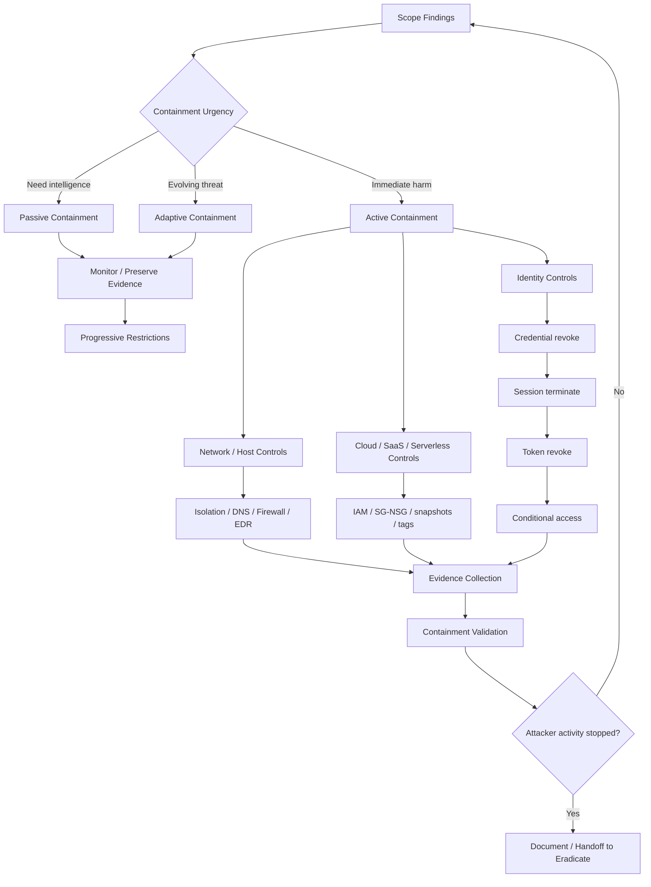

# Диаграмма: Contain Activity

## Interpretation

Containment is not one irreversible switch.

It is a controlled loop:
- choose strategy;
- act;
- preserve evidence;
- validate;
- adapt if attacker retains access.
