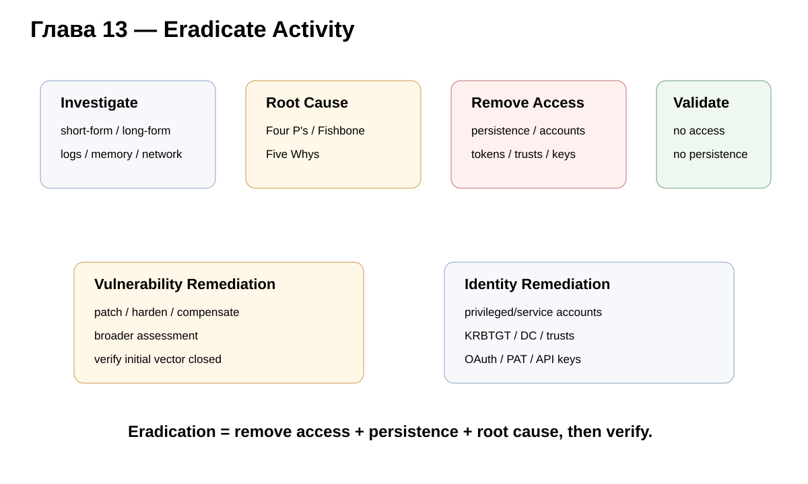

# Глава 13 — Искоренение угрозы

Практический разбор главы 13 книги *Dynamic Incident Response: A Framework for Security Teams*.



## Идентификация

- Book ID: `dynamic-incident-response-joshua-wright-en-2026`
- Глава: 13
- Source title: `Eradicate Activity`
- Русское название: «Искоренение угрозы»
- Slug: `eradicate-activity`
- Source policy: `rag_only`
- External sources: запрещены
- Model memory: запрещена
- Прямой доступ к PDF: не использовался
- Язык артефактов: русский

## Provenance

- Canonical RAG: `p0300:c01`–`p0404:c01`
- PDF pages: 300–404
- `p0405:c01` начинает Chapter 14 `Recover Activity`.
- Source format: PDF
- RAG validation status: `READY_WITH_KNOWN_LIMITATIONS`
- Chapter boundary verified: yes

## Содержимое

- [cheatsheet.md](cheatsheet.md) — operational reference по investigation, root cause, persistence, identity и vulnerability remediation.
- [commands.md](commands.md) — source-supported commands и high-risk eradication actions.
- [diagram.md](diagram.md) — Mermaid-схема investigation → eradicate → validate.
- [visual-cheatsheet.svg](visual-cheatsheet.svg) — компактная визуальная модель.
- [visual-cheatsheet-detailed.svg](visual-cheatsheet-detailed.svg) — подробная карта eradication workstreams.
- [translation-editorial-findings.md](translation-editorial-findings.md) — findings для RU v2 repair.

## Краткий анализ

Chapter 13 — самый насыщенный technical chapter на текущем этапе. Eradication начинается только после containment и отвечает на вопрос:

**что именно нужно удалить, изменить или пересобрать, чтобы attacker реально потерял доступ и incident не повторился?**

Ключевой принцип:

```text
symptom removal
    ≠
eradication
```

Нужно одновременно:
- понять attacker actions;
- найти persistence;
- определить root cause;
- убрать доступ;
- исправить vulnerability/misconfiguration;
- подтвердить, что threat действительно устранён.

## Short-form vs Long-form investigation

Source разделяет investigation на два параллельных track.

### Short-form
Цель:
- быстро получить достаточно evidence для безопасных eradication actions.

Фокус:
- persistence;
- compromised accounts;
- attacker tooling;
- vulnerable systems;
- immediate root cause clues.

### Long-form
Цель:
- глубокое forensic understanding.

Фокус:
- full imaging;
- low-level artifacts;
- timeline reconstruction;
- anti-forensics;
- complex attacker behavior.

Практический вывод:

**не нужно ждать окончания long-form forensic analysis, чтобы начать безопасную eradication, если short-form уже дал достаточную уверенность.**

## Root Cause Analysis

Chapter 13 делает RCA центральной частью eradication.

Используются:
- Four P's;
- Fishbone / Ishikawa;
- Five Whys.

Пример public S3 bucket показывает, что root cause редко сводится к одной ошибке.

Проблема может включать:
- People;
- Process;
- Product;
- Policy.

Следовательно, eradication должна исправлять не только affected object, но и systemic conditions.

## Investigation techniques

### Logs
- Sigma;
- Hayabusa;
- SIEM.

### Live investigation
- baseline/current-state comparison;
- differential analysis.

### Endpoint telemetry
- centralized hunts;
- Velociraptor;
- IOC-based queries.

### Memory
- process memory;
- whole-system memory;
- Volatility;
- MemProcFS.

### Network
- PCAP;
- flow;
- DNS;
- proxy;
- firewall;
- NDR.

### Malware
- hashes;
- VirusTotal;
- PE structure;
- dynamic analysis;
- sandboxes.

### BEC / identity
- inbox rules;
- OAuth grants;
- delegated permissions;
- sign-in analysis;
- financial transaction context.

### Insider threat
- data access;
- privilege changes;
- exfiltration methods;
- persistence.

### Supply chain / SaaS / MSP
- trusted software;
- vendor credentials;
- downstream integrations;
- hardware;
- provider logs.

### Cloud
- control plane;
- IAM;
- images;
- storage/exfiltration;
- serverless;
- network configuration.

## Eradicating attacker access

### Persistence removal

Build persistence inventory first.

Then remove:
- Windows services/tasks/registry/startup;
- Linux cron/systemd/SSH keys/accounts;
- web shells;
- cloud functions/policies;
- container image modifications.

Important:
**remove with a planned sequence and verify immediately after each change.**

## Account and identity remediation

Chapter 13 treats identity eradication as a large coordinated operation.

Source covers:
- local accounts;
- Active Directory;
- privileged accounts;
- service accounts;
- KRBTGT;
- domain-controller machine accounts;
- trust passwords;
- unconstrained delegation;
- Entra ID;
- session/token revocation;
- OAuth app consent;
- PATs/API keys/service credentials.

Critical point:

**password reset alone is insufficient for severe compromise.**

In some cases account recreation may be safer than simple reset.

## KRBTGT

If domain compromise includes KRBTGT exposure:

1. reset once;
2. verify AD replication;
3. wait at least maximum Kerberos ticket lifetime;
4. reset again;
5. verify replication again.

Source stresses that replication correctness is part of the eradication procedure.

## Targeted removal vs rebuild

Decision depends on:
- severity of compromise;
- system criticality;
- availability of known-good sources.

Rebuild is not automatically better.

Without investigation, rebuild may restore service while leaving:
- same vulnerability;
- compromised identity;
- malicious integration;
- vulnerable image/template.

## Vulnerability remediation

Source covers:
- patch exploited vulnerability;
- test before broad rollout;
- phased deployment;
- inventory-based tracking;
- compensating controls for unpatchable systems;
- broader vulnerability assessment;
- configuration hardening;
- service enumeration;
- network-device review;
- disable unnecessary services.

Important:

**compensating controls are temporary risk reduction, not permanent eradication.**

## Eradication challenges

- living off the land;
- fileless malware;
- legitimate RMM abuse;
- cross-trust persistence.

Key lesson:
trusted/native tools can be attacker tools when context is malicious.

## Examples

### Memory Forensics Discovery
Volatility reveals suspicious processes, injected code, network connections, command lines and handles that endpoint protection missed.

### Coordinated Credential Reset
Tiered AD reset:
- KRBTGT;
- privileged accounts;
- service identities;
- general users;
- continuous validation during reset.

This demonstrates why identity eradication must be sequenced and monitored, not executed as a blind bulk reset.

## Step-by-Step

1. Short-form investigation.
2. Root Cause Analysis.
3. Remove persistence.
4. Remediate accounts/identity.
5. Targeted removal or rebuild.
6. Remediate vulnerabilities.
7. Address advanced eradication challenges.
8. Validate eradication.
9. Document and hand off to Recover.

## Основной принцип

**Eradication is complete only when attacker access, persistence, exploited weakness and relevant identity paths are all addressed and validated.**

## Ограничения источника

- Figures 91–121 представлены в RAG captions/text references.
- Listings 62–114 preserved.
- Tables 26–31 preserved.
- References [1]–[38].
- Review questions отсутствуют.
- Chapter contains many state-changing examples; exact execution still requires environment-specific validation.

## Связь с ремонтом перевода v2

Chapter 13 — CRITICAL editorial target. Он очень длинный, содержит огромное количество English headings, inconsistent hierarchy и большое число command listings. Для v2 особенно важны:
- stable RU terminology;
- visual separation investigation vs eradication;
- explicit risk/verification/rollback formatting;
- A4 QA для Listings 62–114 и Tables 26–31.
