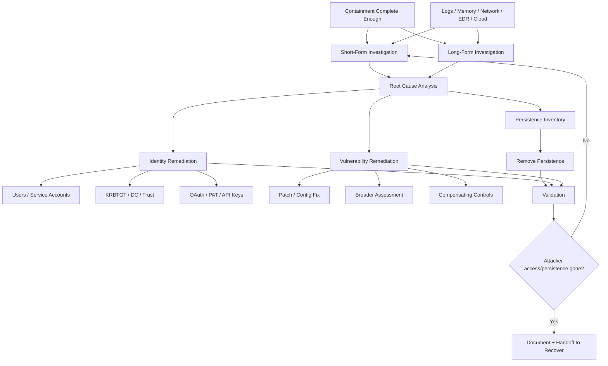

# Диаграмма: Eradicate Activity

## Interpretation

Eradication is evidence-driven.

Нельзя безопасно удалить то, что команда ещё не понимает.

Главный feedback loop:
- investigation reveals new artifact;
- artifact changes remediation scope;
- remediation is validated;
- failure returns team to investigation.
