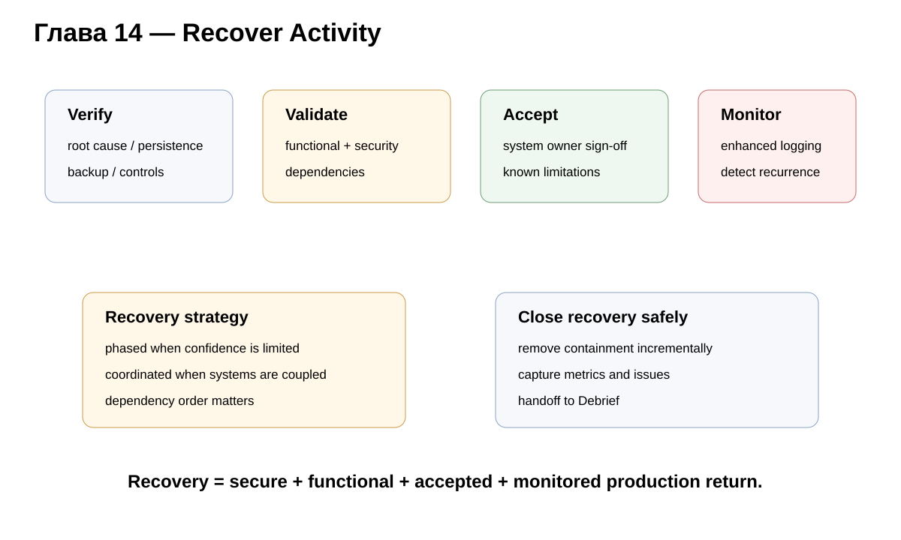

# Глава 14 — Восстановление

Практический разбор главы 14 книги *Dynamic Incident Response: A Framework for Security Teams*.



## Идентификация

- Book ID: `dynamic-incident-response-joshua-wright-en-2026`
- Глава: 14
- Source title: `Recover Activity`
- Русское название: «Восстановление»
- Slug: `recover-activity`
- Source policy: `rag_only`
- External sources: запрещены
- Model memory: запрещена
- Прямой доступ к PDF: не использовался
- Язык артефактов: русский

## Provenance

- Canonical RAG: `p0405:c01`–`p0433:c01`
- PDF pages: 405–433
- `p0434:c01` начинает Chapter 15 `Debrief Activity`.
- Source format: PDF
- RAG validation status: `READY_WITH_KNOWN_LIMITATIONS`
- Chapter boundary verified: yes

## Содержимое

- [cheatsheet.md](cheatsheet.md) — operational map recovery.
- [commands.md](commands.md) — source-supported validation/restoration commands and checks.
- [diagram.md](diagram.md) — Mermaid-схема recovery flow.
- [visual-cheatsheet.svg](visual-cheatsheet.svg) — компактная визуальная модель.
- [visual-cheatsheet-detailed.svg](visual-cheatsheet-detailed.svg) — подробная карта recovery controls.
- [translation-editorial-findings.md](translation-editorial-findings.md) — findings для RU v2 repair.

## Краткий анализ

Chapter 14 описывает Recover как controlled return to normal operations после eradication.

Главный принцип:

```text
restore service
     ≠
recovery complete
```

Recovery считается успешной, когда система:
- безопасна;
- функциональна;
- принята system owner;
- наблюдается enhanced monitoring;
- возвращена в production с понятным rollback path.

## Pre-Restoration Verification

Перед возвратом системы в production source требует подтвердить:

- root cause remediation;
- актуальность patches;
- persistence removal;
- backup integrity;
- rebuild integrity;
- security controls;
- IOC scan после hardening.

Критический lesson:

**backup должен предшествовать initial compromise.**

Самый свежий backup может быть unsafe, если attacker уже находился внутри environment.

## System Validation Testing

Нужно проверять два слоя:

### Functional
- core business workflows;
- data access;
- transactions;
- service dependencies.

### Security
- EDR;
- firewall;
- logging;
- hardening;
- patches;
- authentication;
- required interconnectivity.

## System Owner Acceptance

System owner должен подтвердить:
- business functionality;
- production readiness;
- known limitations.

Это не формальность.

Owner acceptance:
- фиксирует accountability;
- задаёт baseline normal operation;
- уменьшает риск later blame на IR за unrelated problems.

## Enhanced Monitoring

Recovery продолжается после production return.

Source рекомендует временно усилить:
- authentication auditing;
- process creation;
- network connections;
- filesystem/config changes;
- privileged actions;
- incident-specific IOC/TTP detections.

Important:
усиленное logging может перегрузить forwarding/storage pipeline.

Перед включением:
- проверить collector capacity;
- проверить delivery;
- определить retention;
- назначить monitor owner.

Source приводит **30 days minimum** как typical practice, не как universal requirement.

## Coordinated Production Restoration

Recovery — cross-functional process.

Обычно:
- IT operations/system owners выполняют restoration;
- IRT консультирует по incident-specific risk;
- decision makers определяют timing/risk tolerance.

Foundational dependencies часто восстанавливаются раньше:
- AD;
- DNS;
- network infrastructure.

## Phased vs Coordinated Recovery

### Phased Recovery
Подходит когда:
- confidence ограничен;
- capacity ограничена;
- нужно наблюдать между batches.

Плюс:
- локализует failures;
- создаёт checkpoints.

### Coordinated Recovery
Подходит когда:
- systems tightly coupled;
- dependencies требуют синхронного восстановления;
- partial return создаёт operational failure.

Главный вывод:

**phased recovery обычно снижает риск, но не является универсально правильной стратегией.**

## Containment Action Removal

Containment controls нельзя просто снять все сразу.

Нужно:
- inventory;
- incremental removal;
- validation after each removal;
- решить, какие controls оставить permanently.

Некоторые temporary controls могут стать durable security improvements.

## Metrics Capture

Source предлагает фиксировать:
- restoration start/end;
- validation completion;
- owner acceptance;
- production return;
- bottlenecks;
- deviations;
- personnel hours;
- third-party support;
- extra cost.

Эти данные идут в Debrief.

## Cloud Recovery

Source covers:
- snapshot selection;
- timeline validation;
- IAM recovery;
- cloud logging;
- IaC review;
- hybrid dependencies.

Snapshot recovery особенно опасен при неправильной temporal selection.

## Recovery Challenges

- data loss from clean-backup recovery;
- business pressure;
- uncertainty in eradication confidence;
- coordination complexity;
- user communication;
- post-recovery problem attribution.

## Example — Domain Controller Environment

Source показывает phased recovery AD environment:

1. выбрать clean backup;
2. test restore;
3. подтвердить, что initial vector закрыт;
4. восстановить primary DC;
5. проверить core services;
6. проверить replication;
7. восстановить secondary DC;
8. затем member servers/workstations;
9. держать enhanced monitoring.

Главный lesson:

**dependency-aware recovery важнее “включить всё как можно быстрее”.**

## Step-by-Step

1. Pre-restoration verification.
2. System validation testing.
3. System owner acceptance.
4. Enhanced monitoring.
5. Coordinated production restoration.
6. Remove containment measures.
7. Capture recovery metrics.

## Основной принцип

**Recovery — это controlled production release с security validation, business acceptance и наблюдением после восстановления.**

## Ограничения источника

- Figures 122–130 представлены в RAG captions/text references.
- Listings 115–121 preserved.
- Tables 32–34 preserved.
- References [1]–[2].
- Review questions отсутствуют.

## Связь с ремонтом перевода v2

Chapter 14 имеет хороший semantic coverage, но prose/heading style остаётся hybrid. Для v2 критичны clean terminology, separation of validation vs restoration и A4 QA для command/table blocks.
