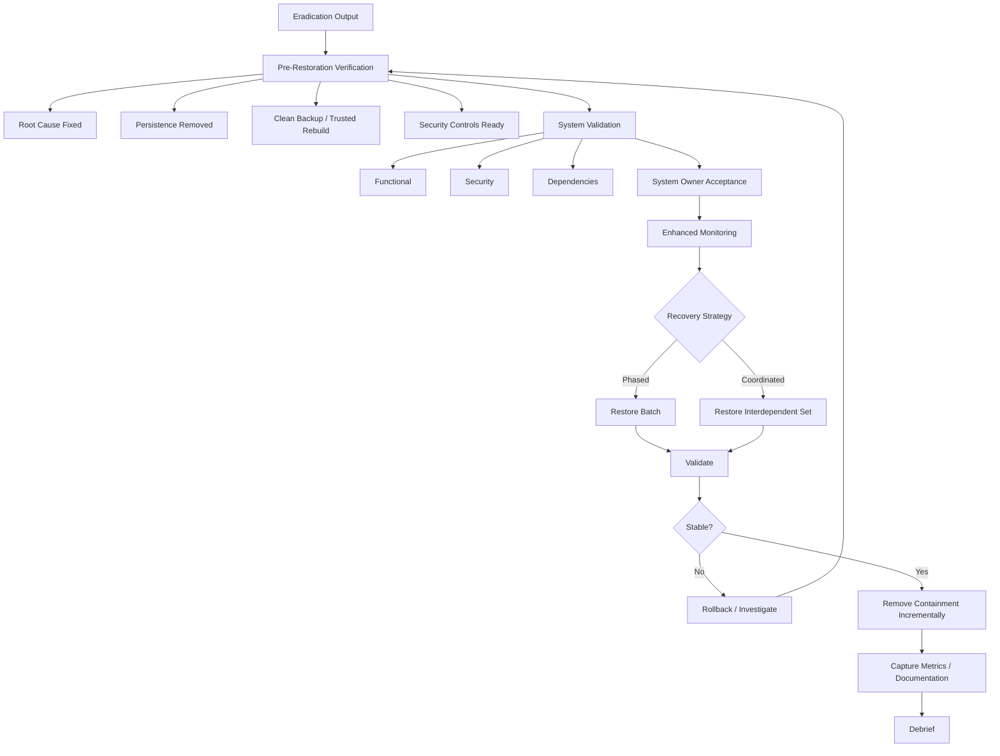

# Диаграмма: Recover Activity

## Interpretation

Recover is a production-release process, not just system startup.

Each restoration step is gated by:
- evidence;
- technical validation;
- owner acceptance;
- monitoring.
