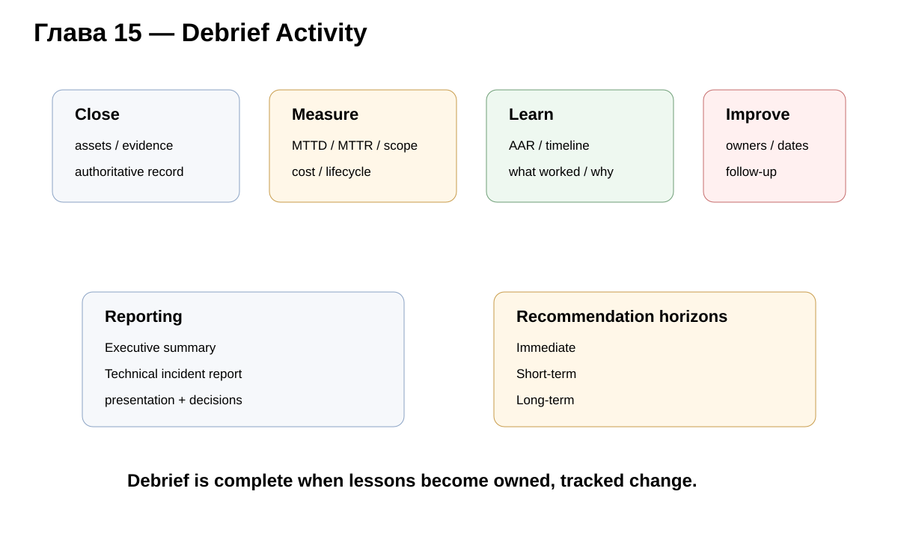

# Глава 15 — Разбор инцидента

Практический разбор главы 15 книги *Dynamic Incident Response: A Framework for Security Teams*.



## Идентификация

- Book ID: `dynamic-incident-response-joshua-wright-en-2026`
- Глава: 15
- Source title: `Debrief Activity`
- Русское название: «Разбор инцидента»
- Slug: `debrief-activity`
- Source policy: `rag_only`
- External sources: запрещены
- Model memory: запрещена
- Прямой доступ к PDF: не использовался
- Язык артефактов: русский

## Provenance

- Canonical RAG: `p0434:c01`–`p0470:c01`
- PDF pages: 434–470
- `p0471:c01` — Part 3 divider.
- `p0472:c01` начинает Chapter 16 `Accelerating Incident Response with AI`.
- Source format: PDF
- RAG validation status: `READY_WITH_KNOWN_LIMITATIONS`
- Chapter boundary verified: yes

## Содержимое

- [cheatsheet.md](cheatsheet.md) — operational map Debrief activity.
- [commands.md](commands.md) — command-level material отсутствует; сохранены process artifacts and acceptance checks.
- [diagram.md](diagram.md) — Mermaid flow closure → AAR → recommendations → accountability.
- [visual-cheatsheet.svg](visual-cheatsheet.svg) — компактная визуальная модель.
- [visual-cheatsheet-detailed.svg](visual-cheatsheet-detailed.svg) — подробная карта documentation, metrics, AAR и follow-up.
- [translation-editorial-findings.md](translation-editorial-findings.md) — findings для RU v2 repair.

## Краткий анализ

Chapter 15 завершает active incident response и превращает накопленный опыт в institutional memory и organizational change.

Две основные цели:

1. **incident closure**;
2. **organizational learning**.

Главный принцип:

```text
incident closed
   ≠
work complete
```

Если findings не превращаются в assigned, funded и tracked improvements, Debrief не создаёт lasting value.

## Transition to Debrief

Переход возможен, когда:

- active threat больше не требует response actions;
- decision makers подтверждают переход;
- technical uncertainty достигла приемлемого уровня;
- remaining tasks могут перейти в post-incident work.

Source подчёркивает два условия:

### Technical readiness
- threat activity stopped;
- systems stabilized;
- remaining risk understood.

### Organizational decision
- leadership agrees active response can end;
- ownership of remaining actions defined.

## Temporary assets

Во время incident создаются:

- isolated systems;
- forensic images;
- temporary accounts;
- elevated access;
- temporary monitoring;
- chat channels;
- evidence copies.

Debrief должен решить для каждого:

- retain;
- modify;
- archive;
- decommission.

Особенно важно сохранить evidence согласно legal/regulatory retention requirements.

## Consolidating documentation

Source требует собрать единый authoritative incident record из:

- ticketing;
- chat;
- shared docs;
- analyst notes;
- timelines;
- decision records;
- evidence references.

Key outcome:
**одна согласованная версия incident narrative.**

## Documentation depth

Не каждый incident требует full formal report.

Source предлагает заранее определить thresholds.

Lightweight documentation подходит, когда:
- incident небольшой;
- один system;
- standard playbook;
- нет external notification;
- impact low.

Formal report нужен чаще, если:
- multiple systems;
- privileged account compromise;
- data exposure;
- regulatory notification;
- executive decisions;
- large scope/impact.

## Metrics

Chapter 15 закрепляет измерение:

- MTTD;
- MTTR;
- scope of impact;
- resource utilization;
- total incident lifecycle.

Metrics нужны не ради красивых чисел, а для:
- trend analysis;
- readiness improvement;
- budget/resource justification;
- process bottleneck discovery.

## After-Action Review

AAR строится вокруг вопросов:

1. What was supposed to happen?
2. What actually happened?
3. Why did it happen?
4. What can we do better next time?
5. What worked well?
6. Why did those things work?

Ключевой принцип:
**AAR — не blame session.**

Цель — process/system improvement.

## Visual timeline

Source рекомендует visual timeline как инструмент shared understanding.

Она помогает:
- синхронизировать stakeholders;
- показать delay/bottleneck;
- объяснить cause/effect;
- поддержать executive discussion.

## Driving Organizational Improvement

Recommendations делятся по horizon:

### Immediate
- закрыть ongoing risk;
- исправить critical gap.

### Short-term
- process updates;
- targeted monitoring;
- training;
- limited architecture improvements.

### Long-term
- tooling;
- architecture;
- staffing;
- strategic program changes.

## Incident reports

Source описывает two-report model:

### Executive summary
Для decision makers:
- что произошло;
- impact;
- major decisions;
- key recommendations;
- resource implications.

### Technical report
Для responders/technical teams:
- timeline;
- evidence;
- systems;
- IOC/TTP;
- actions;
- validation;
- lessons.

## Executive reporting levers

Recommendations полезно подавать как management levers:

- Opportunity;
- Benefit;
- Cost;
- Time;
- Resources;
- Compliance;
- Protections.

Это связывает technical findings с decision-making.

## Presentation session

Цели:

- shared understanding;
- findings review;
- recommendation alignment;
- formal closure.

Не цель:
- повторно спорить о старых decisions;
- искать виноватых;
- утонуть в technical minutiae.

На выходе должны быть:

- decisions;
- approved/modified/deferred recommendations;
- owners;
- due dates;
- follow-up schedule.

## Debrief challenges

Source выделяет:

- incomplete documentation;
- lost organizational attention;
- blame dynamics;
- legal/regulatory constraints;
- resource constraints.

Практический lesson:
после стабилизации incident management attention быстро падает, поэтому improvements нужно оформить и закрепить быстро.

## Examples

### Compromised SaaS Account
Небольшой incident:
- full report не нужен;
- достаточно ticket + concise debrief summary;
- AAR выявляет shadow SaaS и MFA coverage gap.

### Healthcare Ransomware
Крупный incident:
- formal timeline;
- executive summary;
- recommendation roadmap;
- longer-term improvement tracking.

## Step-by-Step

1. Determine debrief scope/documentation requirements.
2. Manage temporary assets.
3. Consolidate documentation.
4. Capture incident metrics.
5. Conduct AAR.
6. Develop reports when required.
7. Present findings/recommendations.
8. Drive and track organizational improvement.

## Основной принцип

**Debrief превращает incident evidence и operational pain в accountable organizational change.**

## Ограничения источника

- Figures 131–141 представлены в RAG captions/text references.
- Tables 35–42 preserved.
- Command-level shell/CLI material отсутствует.
- Review questions отсутствуют.

## Связь с ремонтом перевода v2

Chapter 15 имеет strong semantic coverage, но большое количество English headings и management/reporting terminology. Для v2 важны clean RU hierarchy, визуальное разделение closure/AAR/reporting/improvement и A4 QA для крупных таблиц.
