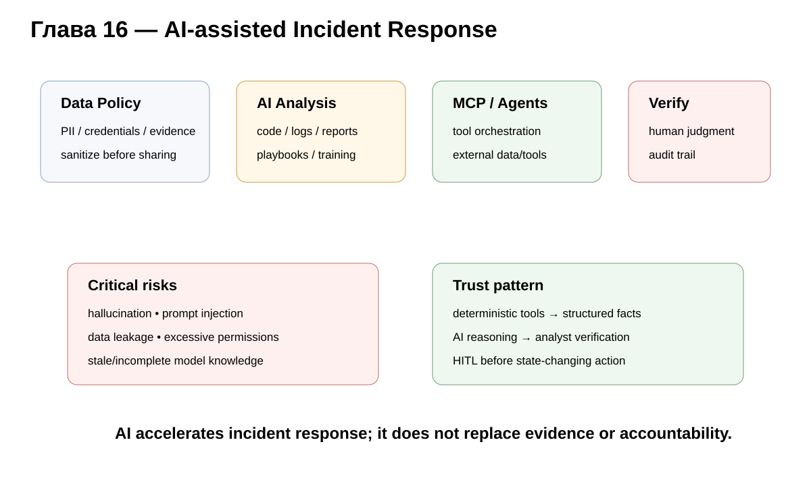

# Глава 16 — Ускорение реагирования на инциденты с помощью ИИ

Практический разбор главы 16 книги *Dynamic Incident Response: A Framework for Security Teams*.



## Идентификация

- Book ID: `dynamic-incident-response-joshua-wright-en-2026`
- Глава: 16
- Source title: `Accelerating Incident Response with AI`
- Русское название: «Ускорение реагирования на инциденты с помощью ИИ»
- Slug: `accelerating-incident-response-with-ai`
- Source policy: `rag_only`
- External sources: запрещены
- Model memory: запрещена
- Прямой доступ к PDF: не использовался
- Язык артефактов: русский

## Provenance

- Canonical RAG: `p0472:c01`–`p0545:c01`
- PDF pages: 472–545
- `p0546:c01` начинает Chapter 17 `Incident Response for Ransomware`.
- Source format: PDF
- RAG validation status: `READY_WITH_KNOWN_LIMITATIONS`
- Chapter boundary verified: yes

## Содержимое

- [cheatsheet.md](cheatsheet.md) — AI-assisted IR capability map.
- [commands.md](commands.md) — source-supported prompts, query examples, MCP/agent artifacts and safety constraints.
- [diagram.md](diagram.md) — Mermaid-схема `human analyst → AI → tools/data → verification`.
- [visual-cheatsheet.svg](visual-cheatsheet.svg) — компактная визуальная модель.
- [visual-cheatsheet-detailed.svg](visual-cheatsheet-detailed.svg) — подробная карта AI use cases, data handling, MCP и agentic controls.
- [translation-editorial-findings.md](translation-editorial-findings.md) — findings для RU v2 repair.

## Краткий анализ

Chapter 16 не позиционирует AI как замену incident responder. Главный тезис прямо обратный:

**AI ускоряет analysis, synthesis, drafting и orchestration, но human judgment, verification и data governance остаются обязательными.**

## Data handling first

Source делает один из самых важных security points всей главы:

**выбор AI platform — сначала data-handling decision, а уже потом cost/capability decision.**

Incident data может включать:

- PII;
- credentials;
- internal documentation;
- client/customer data;
- legal/contractual material;
- forensic evidence.

Shadow AI может превратить один contained incident во второй disclosure event.

## Deployment options

Source сравнивает:

### Commercial frontier models

Плюсы:
- highest capability;
- low setup friction;
- strong reasoning/code/log analysis.

Минусы:
- data leaves organization;
- policy/retention/training terms matter;
- provider controls become part of risk model.

### Open-weight cloud

Плюсы:
- больше organizational control;
- меньше dependency on AI platform provider.

Минусы:
- still cloud-hosted;
- requires deployment/maintenance;
- capability can lag frontier models.

### Open-weight local

Плюсы:
- data remains on organizational infrastructure;
- strongest control over evidence/data flow.

Минусы:
- hardware/GPU cost;
- maintenance burden;
- lower capability on some complex tasks.

## AI limitations

Source explicitly highlights:

- hallucination;
- non-determinism;
- data exposure;
- training cutoff/staleness;
- incomplete detection;
- false positives;
- lack of definitive conclusions;
- context-window limits.

Critical rule:

```text
AI output
   ↓
analyst verification
   ↓
defensible conclusion
```

## Prompting foundations

Source recommends clear prompts with:

- role/context;
- task;
- input;
- constraints;
- reasoning steps where useful;
- output format.

For complex work, structured prompting reduces ambiguity and makes review easier.

## Foundational use cases

### Code analysis / deobfuscation

AI can accelerate:
- unfamiliar language explanation;
- PowerShell deobfuscation;
- malware behavior explanation;
- IOC extraction.

But source explicitly states:

**verification is non-negotiable.**

Generated interpretation must be checked against actual code/tool output.

### Log analysis

Useful for:
- unfamiliar log orientation;
- anomaly detection;
- summary generation;
- query generation;
- beaconing analysis.

Limits:
- model may miss subtle attacks;
- model may over-flag unusual legitimate activity;
- large enterprise logs exceed context windows.

## Translating technical findings

AI can convert technical findings into:
- executive summaries;
- legal/compliance language;
- stakeholder-oriented reports.

This is acceleration, not authority. Analyst still owns factual correctness and tone.

## Intermediate use cases

### Playbook generation

AI can draft DAIR-aligned playbooks quickly.

Useful when analyst provides:
- incident type;
- source evidence;
- constraints;
- output structure.

Generated playbook requires technical review before operational use.

### Incident report drafting

AI can transform structured findings into:
- executive report;
- technical report;
- timeline narrative;
- recommendations.

MCP or specialized guidance can improve report quality.

### Tabletop scenarios

AI can generate:
- scenario ideas;
- organizationally grounded exercises;
- realistic injects;
- Twine interactive scenarios.

The source treats this as practical training acceleration, not merely creative generation.

## MCP

Model Context Protocol allows AI models to access external tools/data through MCP servers.

Architecture:

```text
AI client
   ↓
MCP client
   ↓
MCP server
   ↓
security tool / data source
```

Defensive applications:

- natural-language threat hunting;
- automated enrichment;
- cross-platform correlation;
- incident documentation;
- specialized IR guidance.

## MCP security risks

Source explicitly warns about:

- prompt injection;
- access control;
- audit logging;
- data exposure;
- MCP supply-chain/registry risks.

Key principle:

**MCP expands capability and attack surface at the same time.**

An MCP server is not "just a connector"; it can become a trust boundary between AI and production security systems.

## Agentic AI / Protocol SIFT

Chapter 16 uses Protocol SIFT as an example of tool orchestration.

Shift:

```text
analyst memorizes every tool syntax
        ↓
analyst states investigative intent
        ↓
agent selects tools
        ↓
deterministic tools produce facts
        ↓
model reasons over results
```

This is not unrestricted autonomy.

Source emphasizes trust mechanisms:

- inference constraint;
- Human in the Loop (HITL);
- read-only defaults;
- explicit approval before state-changing commands;
- forensically sound tools;
- auditability/documentation.

## Inference constraint

One of the strongest technical ideas in the chapter.

The AI should not invent raw forensic facts.

Instead:

```text
evidence
  ↓
deterministic parser/tool
  ↓
structured facts
  ↓
AI reasoning
```

This reduces hallucination risk in evidence handling.

## ReAct

Source presents ReAct as:

```text
Reason
  ↓
Act
  ↓
Observe
  ↓
Reason again
```

The model iteratively selects tools, evaluates results and adjusts its approach.

Useful for:
- multi-step forensic workflows;
- investigation automation;
- cross-tool analysis.

Risk:
- autonomy magnifies incorrect permissions, bad prompts or compromised tool integrations.

## Human in the Loop

Source makes HITL mandatory around critical actions.

Good pattern:

- read-only allowlist;
- exact command preview;
- explicit analyst approval;
- audit record;
- state-changing actions always gated.

## Operational verification

Source treats AI outputs differently by task:

### Log analysis
Validate suspicious findings against source logs/query.

### Reports
Validate facts, dates, impact and claims.

### Playbooks
Validate technical steps, platform assumptions and safe execution.

### Documents
Validate source fidelity and required audience framing.

## Organizational capability

Source recommends:

- prompt libraries;
- skill files;
- documented use cases;
- structured training paths;
- practical exercises;
- cross-training.

The goal is repeatable capability, not one analyst's private prompt collection.

## Stable principles

Chapter closes with principles that remain stable despite model/ecosystem change:

- AI accelerates analysis but does not replace judgment.
- Verification remains essential.
- Organizational policy governs data sharing.
- Documentation should show how conclusions were reached.

## Основной принцип

**AI is safest and most useful in IR when it accelerates a controlled, evidence-grounded workflow rather than replacing it.**

## Ограничения источника

- Figures 142–177 представлены в RAG captions/text references.
- Listings 122–139 preserved.
- Tables 43–49 preserved.
- References [1]–[9] present.
- Некоторые screenshots/outputs имеют third-party/platform provenance.
- Chapter intentionally discusses contemporary platforms as of early 2026; no silent external updating was performed.

## Связь с ремонтом перевода v2

Chapter 16 — CRITICAL editorial target because terminology mixes Russian and English heavily, headings are very dense, and AI/MCP concepts depend on precise trust-boundary wording. RU v2 should preserve technical acronyms while translating narrative consistently and clearly separating capability from trust/risk.
