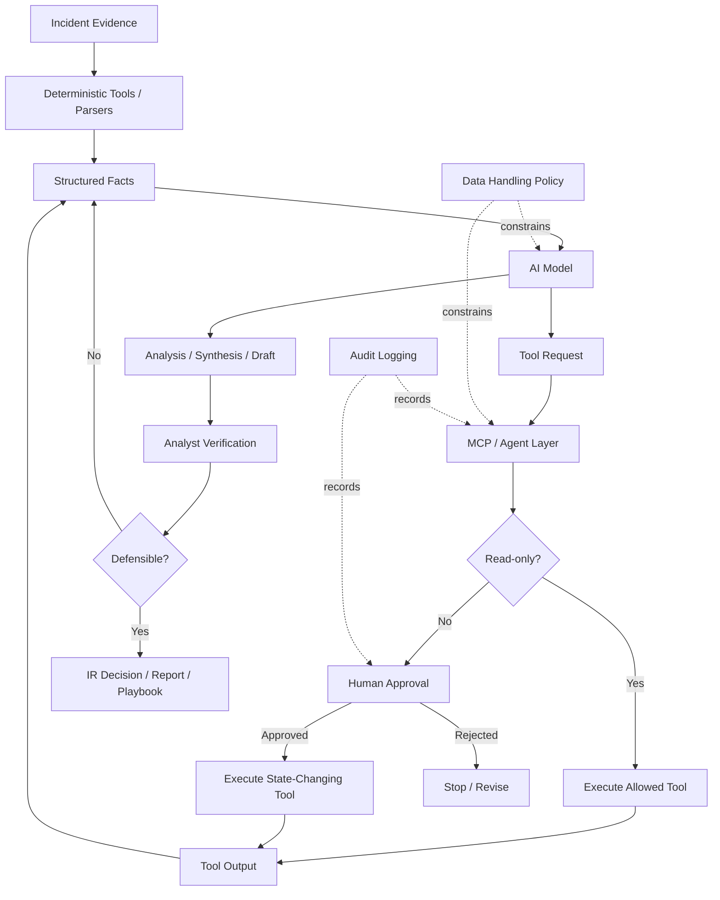

# Диаграмма: AI-assisted Incident Response



## Interpretation

Best-case AI-assisted IR is not:

```text
evidence → model → action
```

It is:

```text
evidence
→ trusted tools
→ structured facts
→ AI reasoning
→ human verification
→ controlled action
```
