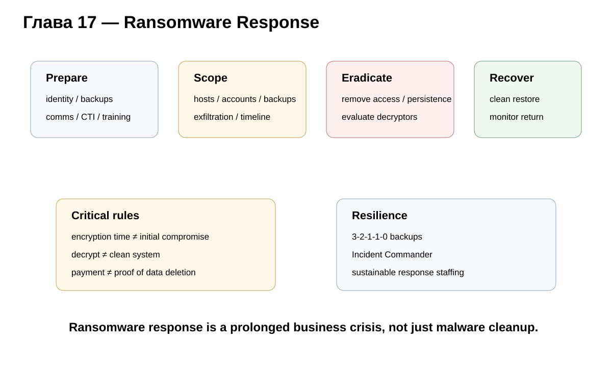

# Глава 17 — Реагирование на инциденты с программами-вымогателями

Практический разбор главы 17 книги *Dynamic Incident Response: A Framework for Security Teams*.

## Идентификация

- Book ID: `dynamic-incident-response-joshua-wright-en-2026`
- Глава: 17
- Source title: `Incident Response for Ransomware`
- Русское название: «Реагирование на инциденты с программами-вымогателями»
- Slug: `incident-response-for-ransomware`
- Source policy: `rag_only`
- External sources: запрещены
- Model memory: запрещена
- Прямой доступ к PDF: не использовался
- Язык артефактов: русский

## Provenance

- Canonical RAG: `p0546:c01`–`p0583:c01`
- PDF pages: 546–583
- `p0584:c01` начинает Chapter 18 `Incident Response for Cloud Systems`.
- Source format: PDF
- RAG validation status: `READY_WITH_KNOWN_LIMITATIONS`
- Chapter boundary verified: yes

## Содержимое

- [cheatsheet.md](cheatsheet.md) — ransomware-specific DAIR map.
- [commands.md](commands.md) — source-supported technical artifacts и operational checks.
- [diagram.md](diagram.md) — Mermaid-схема ransomware response lifecycle.
- [visual-cheatsheet.svg](visual-cheatsheet.svg) — компактная визуальная модель.
- [visual-cheatsheet-detailed.svg](visual-cheatsheet-detailed.svg) — подробная карта preparation, scoping, eradication, recovery и debrief.
- [translation-editorial-findings.md](translation-editorial-findings.md) — findings для RU v2 repair.

## Краткий анализ

Chapter 17 не вводит новый framework. Он накладывает ransomware-specific considerations на DAIR.

Ключевой тезис:

**ransomware response — это не “расшифровать файлы”, а длительная multi-track операция по containment, scoping, identity recovery, data-exposure analysis, restoration и коммуникациям.**

## Типы ransomware/extortion

Source различает:

### Human-Operated Ransomware (HumOR)
- hands-on-keyboard;
- reconnaissance;
- privilege escalation;
- lateral movement;
- backup targeting;
- staged exfiltration;
- encryption/extortion.

### Automated / mass-distributed ransomware
- volume over precision;
- malicious attachments/exploit kits;
- меньше reconnaissance/lateral movement;
- recovery часто проще из-за более узкого scope.

### Encryptionless extortion
- leverage через stolen data;
- encryption может отсутствовать полностью;
- response смещается в сторону exposure assessment, notification и legal/regulatory work.

### Pseudo-ransomware / wipers
- выглядит как ransomware;
- recovery через decryptor может быть невозможен в принципе;
- важно не предполагать, что ransom note означает наличие working decrypt path.

## Multi-vector extortion

Современная ransomware campaign может сочетать:
- encryption;
- data theft;
- public leak threat;
- DDoS;
- pressure on customers/partners;
- direct contact with employees/clients.

Следствие:

**business impact может продолжаться даже после technical recovery.**

## Prepare

Ransomware-specific preparation включает:

- crisis communications;
- holding statement;
- CTI;
- employee/help desk training;
- identity/Tier-0 protection;
- resilient backups;
- response staffing;
- recovery priorities.

### Holding statement

Source отдельно подчёркивает ценность заранее согласованного первого публичного сообщения.

Цель:
- не молчать;
- не overstate;
- не understate;
- избежать uncontrolled narrative.

### CTI

Для ransomware source предпочитает:
- TTPs > generic IOC;
- payload hashes часто быстро устаревают;
- поведенческие техники стабильнее и лучше подходят для hunting/detection.

## Backup resilience

Source рассматривает:

- pull-based architecture;
- network isolation;
- immutability;
- air-gap/offline copies;
- identity separation;
- hypervisor-level protection.

### 3-2-1-1-0

- 3 copies;
- 2 media types;
- 1 off-site;
- 1 immutable/air-gapped;
- 0 recovery-test errors.

Главный смысл:
**backup, который нельзя восстановить, не является recovery capability.**

## Verify / Triage

Нужно определить:
- реальный attack type;
- encryption vs extortion vs wiper;
- business impact;
- victim identifiers;
- scale;
- decision-maker communication;
- expected duration/resource demand.

Source отдельно вводит роль Incident Commander для крупных ransomware incidents.

## Scope

Ransomware scoping должен быть системным.

Source checklist включает:
- known affected hosts;
- Windows/Linux/macOS/ESXi inventory;
- domain membership;
- virtualization;
- backup systems;
- host logs;
- EDR;
- firewall/VPN/NetFlow/NDR;
- SIEM;
- cloud logs;
- SaaS logs.

Главный вопрос:
**насколько далеко attacker дошёл до encryption event?**

## Scope activities

- identify all affected systems;
- determine data exposure;
- map lateral movement;
- identify persistence;
- establish timeline.

Ransomware encryption часто является late-stage action, поэтому encryption timestamp не равен initial compromise.

## Eradicate / Investigation

Chapter 17 особенно акцентирует data-exfiltration analysis.

Evidence:
- AAA/authentication;
- file-access telemetry;
- network shares;
- databases;
- network egress;
- cloud activity.

Source подчёркивает, что уверенность в exfiltration имеет градации, а не всегда бинарный yes/no.

## Decryption

Перед оплатой/полным rebuild стоит проверить:
- exact ransomware family/version;
- No More Ransom;
- vendor/law-enforcement tools;
- leaked keys;
- implementation weaknesses;
- applicability to exact variant.

Safe process:
1. identify family;
2. find candidate decryptors;
3. validate version applicability;
4. test on sample files;
5. plan;
6. backup encrypted data;
7. decrypt on copies/dedicated systems where possible;
8. validate recovered data.

## Recover

Recovery обычно самый длинный ransomware workstream.

Приоритет:
- dependency order;
- identity/core infrastructure first;
- critical business systems first;
- clean restore point;
- backup infrastructure verification;
- backup integrity;
- data-loss acceptance.

### Decrypted does not mean clean

Получение decryptor не означает:
- attacker removed;
- persistence removed;
- identity clean;
- vulnerability fixed.

Decryptor — только один recovery mechanism.

## Watching for attacker return

После восстановления нужен усиленный monitoring, потому что attacker может:
- retain access;
- re-enter;
- использовать stolen credentials;
- exploit same weakness again.

## Communication during recovery

Source разделяет:
- leadership updates;
- user communication;
- recovery-team coordination;
- regulatory notifications;
- customers/partners;
- cyber insurance;
- law enforcement.

## Debrief

Ransomware-specific AAR должен отдельно спрашивать:

- насколько backups пережили attack;
- attacker dwell time;
- удалось ли определить exfiltration;
- как принималось ransom decision;
- какие extortion vectors использовались;
- насколько глубоко были exposed identities/privileges.

## Metrics

Source предлагает ransomware-specific metrics:

- attacker dwell time;
- backup survival rate;
- data exfiltration confidence;
- recovery method distribution;
- encryption spread rate.

Это не обязательный universal set — source прямо рекомендует выбирать metrics по organizational priorities.

## Human element

Source делает сильный operational point:
response team during prolonged ransomware incident — ограниченный critical resource.

Нужны:
- shifts;
- cross-training;
- autonomy;
- access/tools;
- leadership protection;
- food/water/rest.

Это рассматривается не как comfort, а как reliability factor.

## AI threat evolution

Source отмечает, что AI снижает skill barrier для attackers:

- reconnaissance;
- exploitation;
- lateral movement;
- data analysis;
- extortion optimization;
- ransomware development.

В то же время AI может помогать defenders через:
- playbooks;
- RAG;
- analysis;
- faster preparation/detection/containment/recovery support.

Вывод source:
**AI делает foundational preparation более важной, а не менее важной.**

## Recovery is not the end

Technical restoration не закрывает:
- legal exposure;
- regulatory consequences;
- stakeholder trust;
- insurance;
- future extortion from stolen data.

Source cases Blackbaud и Kadokawa показывают, что последствия могут длиться годы и ransom payment не гарантирует удаления stolen data.

## Основной принцип

**Ransomware response — это management of prolonged compromise and business crisis, not merely malware removal or file decryption.**

## Ограничения источника

- Figures 178–184 представлены в RAG captions/text references.
- Listing 140 preserved.
- Tables 50–54 preserved.
- References [1]–[18] present.
- Regulatory/financial cases preserved as source-timed examples; no external updating performed.
- Review questions отсутствуют.

## Связь с ремонтом перевода v2

Chapter 17 — CRITICAL editorial target. Семантика хорошая, но heading density очень высокая, многие headings остаются English, а material сочетает technical response, governance, legal, communications и recovery. RU v2 должен сделать DAIR mapping и cross-functional responsibilities визуально очевидными.
