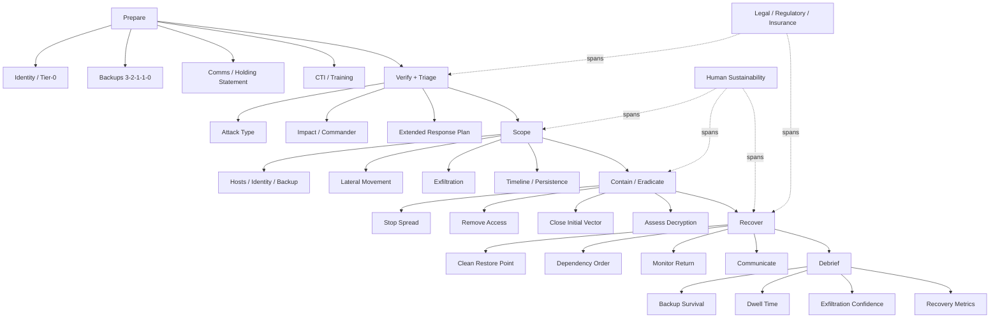

# Диаграмма: Ransomware Response

## Interpretation

Ransomware is a cross-functional crisis.

Technical response alone is insufficient because:
- business continuity;
- legal obligations;
- communications;
- insurance;
- workforce endurance

all influence incident outcome.
