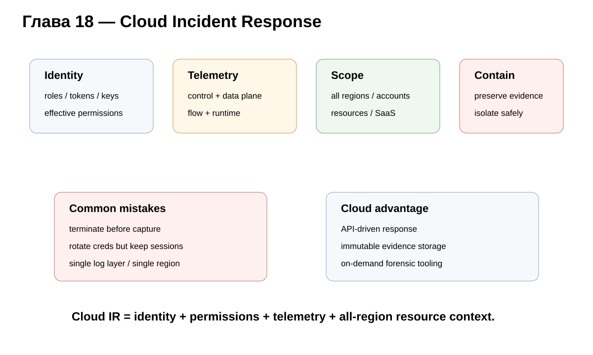

# Глава 18 — Реагирование на инциденты в облачных системах

Практический разбор главы 18 книги *Dynamic Incident Response: A Framework for Security Teams*.



## Идентификация

- Book ID: `dynamic-incident-response-joshua-wright-en-2026`
- Глава: 18
- Source title: `Incident Response for Cloud Systems`
- Русское название: «Реагирование на инциденты в облачных системах»
- Slug: `incident-response-for-cloud-systems`
- Source policy: `rag_only`
- External sources: запрещены
- Model memory: запрещена
- Прямой доступ к PDF: не использовался
- Язык артефактов: русский

## Provenance

- Canonical RAG: `p0584:c01`–`p0612:c01`
- PDF pages: 584–612
- `p0613:c01` начинает Chapter 19 `Incident Response for Operational Technology`.
- Source format: PDF
- RAG validation status: `READY_WITH_KNOWN_LIMITATIONS`
- Chapter boundary verified: yes

## Содержимое

- [cheatsheet.md](cheatsheet.md) — cloud-specific DAIR map.
- [commands.md](commands.md) — source-supported Azure/AWS/cloud response commands and checks.
- [diagram.md](diagram.md) — Mermaid-схема cloud IR flow.
- [visual-cheatsheet.svg](visual-cheatsheet.svg) — компактная визуальная модель.
- [visual-cheatsheet-detailed.svg](visual-cheatsheet-detailed.svg) — подробная карта cloud identity, logging, isolation, persistence и forensics.
- [translation-editorial-findings.md](translation-editorial-findings.md) — findings для RU v2 repair.

## Краткий анализ

Chapter 18 показывает, что cloud IR нельзя выполнять как обычный on-prem incident response с заменой названий сервисов.

Главный сдвиг:

```text
host-centric response
        ↓
identity + control plane + data plane + ephemeral resources
```

В cloud incident responder должен одновременно мыслить:
- identities;
- API actions;
- permissions;
- resources;
- regions/accounts/subscriptions/projects;
- control-plane logs;
- data-plane logs;
- ephemeral workloads;
- SaaS integrations.

## Common Cloud Attacks

Source выделяет ключевые initial access paths:

- weak/absent credentials;
- misconfiguration;
- exposed API/UI;
- excessive permissions.

Важный вывод:
cloud compromise часто начинается не с exploit host vulnerability, а с identity/configuration weakness.

## Impacts

Типовые последствия:
- data theft/extortion;
- ransomware;
- cryptomining;
- BEC/identity misuse;
- persistence through cloud-native resources;
- attacker-created workloads.

## Prepare

### Logging

Cloud response зависит от заранее включённых logs.

Нужно заранее понимать:
- какие log sources включены;
- retention;
- region/account coverage;
- control-plane vs data-plane distinction;
- whether SaaS/cloud-native logs are centrally searchable.

Source отдельно подчёркивает:
**control-plane logs показывают configuration/API actions, но не всегда показывают фактический data access.**

### Permissions

IRT должен заранее иметь:
- read access;
- investigation permissions;
- emergency write access where approved;
- break-glass procedures;
- auditability.

Write access должен быть controlled, least-privilege и ideally temporary.

## Detect

Source рассматривает cloud-native detection services:

### AWS
- GuardDuty;
- malware scanning via EBS snapshots.

### Azure
- Defender for Cloud.

### GCP
- Security Command Center.

Native tooling полезен, но не покрывает всё.

Blind spots:
- short-lived workloads;
- compromised tokens;
- data plane;
- unusual business-context actions;
- cross-cloud correlation.

## Scope

Cloud scoping начинается не с одного VM.

Нужно определить:
- tenant/account/subscription/project;
- resource groups;
- IAM scope;
- direct and inherited roles;
- cross-account/cross-tenant access;
- service principals;
- session/token exposure;
- all regions;
- all related cloud resources;
- SaaS integrations.

Source example с Azure показывает, как один compromised user может иметь:
- Contributor на resource group;
- Owner на subscription.

Следовательно, реальный scope определяется не только visible resource, но и **effective permissions**.

## Log Sources

Source использует:
- Azure Sign-In Logs;
- Azure Activity Log;
- AWS CloudTrail;
- control-plane logs;
- data-plane logs;
- VPC/VNet flow logs;
- host telemetry.

Главный принцип:
**не завершать investigation, основываясь только на control plane.**

## Isolation

Cloud containment часто API-driven.

Source example:
Azure NSG quarantine:
- allow forensic subnet;
- deny other inbound;
- deny outbound;
- attach NSG to compromised NIC.

Плюс:
- VM остаётся powered on;
- volatile state можно сохранить/наблюдать;
- attacker connectivity ограничивается.

## Storage remediation

Для exposed buckets/storage accounts нужно:
- проверить public access;
- data sensitivity;
- access logs;
- attacker activity;
- scope of exposure;
- then remediate permissions.

## Eradication of Cloud Persistence

Persistence может существовать через:

- IAM users/roles;
- access keys;
- app registrations;
- service principals;
- OAuth/session tokens;
- Lambda/functions;
- scheduled automation;
- malicious images;
- resource policies;
- networking;
- cross-account trust.

Критический принцип:
**rotate credentials ≠ revoke active sessions.**

## Compute and workload eradication

Source требует:
- enumerate resources across all regions;
- review functions/serverless;
- inspect workloads not normally used by organization;
- validate images/templates;
- identify attacker-created resources.

## Common Cloud IR Mistakes

Source прямо перечисляет четыре:

1. shutting down compromised instance before capture;
2. rotating credentials without revoking sessions;
3. relying only on control-plane logs;
4. checking only one region.

Это один из самых полезных operational callouts главы.

## Automated Response

Cloud даёт возможность API-driven automation.

Source example:
GuardDuty alert → Lambda workflow:
- isolate EC2;
- enable flow logs;
- snapshot;
- tag;
- preserve evidence;
- start investigation.

Automation полезна только если:
- scope precise;
- permissions bounded;
- actions reversible/controlled;
- audit logs preserved.

## Debrief

Cloud-specific questions:

### Identity
- why did compromised identity have those rights?
- where else did token/key work?
- were sessions fully revoked?

### Resources
- were unknown regions/resources discovered?
- were ephemeral assets captured?

### Networking
- what did flow logs show?
- what network paths enabled access?

### Data exfiltration
- could organization determine what data was accessed?
- were data-plane logs sufficient?

## Leveraging Cloud for IR

Source показывает, что cloud может быть не только target, но и forensic platform.

Use cases:
- on-demand forensic workstations;
- immutable evidence storage;
- automated collection;
- centralized logs;
- serverless analysis.

### Immutable forensic storage

Source example uses S3 immutable storage configuration.

Purpose:
- chain-of-custody support;
- evidence retention;
- tamper resistance.

## Containers and Serverless

Traditional forensics assumes persistent host.

Serverless/containers break that assumption:
- workload may exist seconds;
- filesystem may disappear;
- autoscaling may destroy evidence.

Нужны:
- runtime telemetry;
- audit logs;
- image/registry evidence;
- serverless execution logs;
- centralized evidence capture.

## Multi-cloud

Source highlights:
- centralize logs;
- understand cross-cloud architecture;
- unify identity context;
- avoid per-provider blind spots.

## Evolution of Cloud IR

Trends:

- CSPM for multi-cloud visibility;
- AI-driven SOC;
- runtime visibility;
- token-based attacks;
- cloud-native forensics.

Особенно важен token trend:
stolen session/OAuth/API token может обходить MFA и не выглядеть как new login.

## Основной принцип

**Cloud IR succeeds when responders can reconstruct identity, permissions, API activity, data access and ephemeral resource behavior across the full cloud scope—not merely investigate one VM.**

## Ограничения источника

- Figures 185–192 представлены через captions/text references.
- Listings 141–151 preserved.
- Tables 55–56 preserved.
- References [1]–[9] present.
- Source contains contemporary 2025–2026 cloud tooling examples; no external updating performed.
- Review questions отсутствуют.

## Связь с ремонтом перевода v2

Chapter 18 имеет хороший semantic coverage, но терминология сильно mixed-language. Для v2 важны consistent RU terms для control plane/data plane, permissions, isolation, persistence, token/session и cloud-native forensics. Command-heavy sections also need A4/risk formatting.
