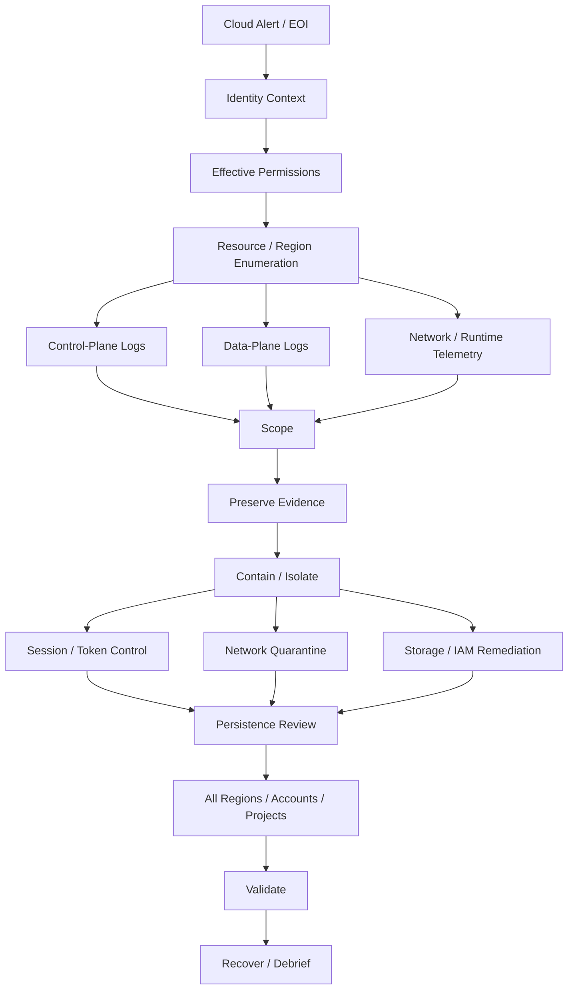

# Диаграмма: Cloud Incident Response

## Interpretation

Cloud scope follows identity and effective permissions before individual resources.

A single compromised workload may be only one symptom of a broader identity or control-plane problem.
