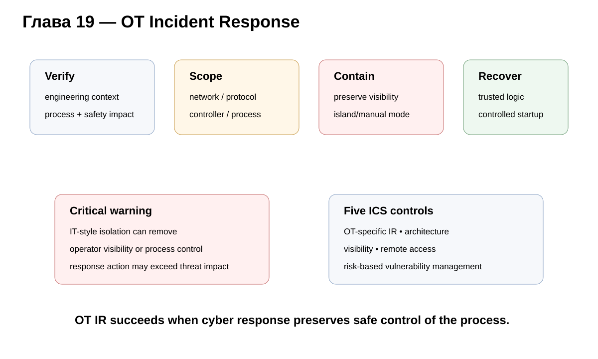

# Глава 19 — Реагирование на инциденты в операционных технологиях

Практический разбор главы 19 книги *Dynamic Incident Response: A Framework for Security Teams*.



## Идентификация

- Book ID: `dynamic-incident-response-joshua-wright-en-2026`
- Глава: 19
- Source title: `Incident Response for Operational Technology`
- Русское название: «Реагирование на инциденты в операционных технологиях»
- Slug: `incident-response-for-operational-technology`
- Source policy: `rag_only`
- External sources: запрещены
- Model memory: запрещена
- Прямой доступ к PDF: не использовался
- Язык артефактов: русский

## Provenance

- Canonical RAG: `p0613:c01`–`p0636:c01`
- PDF pages: 613–636
- `p0637:c01` начинает Chapter 20 `Integrating DAIR with NIST CSF 2.0`.
- Source format: PDF
- RAG validation status: `READY_WITH_KNOWN_LIMITATIONS`
- Chapter boundary verified: yes

## Содержимое

- [cheatsheet.md](cheatsheet.md) — OT-specific DAIR map.
- [commands.md](commands.md) — command-level material отсутствует; сохранены operational checks и safety gates.
- [diagram.md](diagram.md) — Mermaid-схема OT response flow.
- [visual-cheatsheet.svg](visual-cheatsheet.svg) — компактная модель.
- [visual-cheatsheet-detailed.svg](visual-cheatsheet-detailed.svg) — подробная карта OT assets, visibility, containment and recovery.
- [translation-editorial-findings.md](translation-editorial-findings.md) — findings для RU v2 repair.

## Краткий анализ

Chapter 19 показывает, почему OT incident response нельзя считать обычным IT incident response на другом наборе устройств.

Главный принцип:

```text
cyber action
   ↓
physical process impact
   ↓
safety / reliability consequences
```

Поэтому в OT response engineering context и process stability имеют тот же вес, что и cybersecurity evidence.

## IT vs OT

В IT rapid containment обычно влияет на:
- availability;
- productivity;
- digital data.

В OT те же действия могут повлиять на:
- operator visibility;
- physical process control;
- equipment;
- critical infrastructure;
- personnel safety.

Source делает однозначный вывод:

**действие responder может причинить больше вреда, чем сама угроза, если оно выполнено без engineering validation.**

## Safety as primary mission

OT response prioritizes:
- safe operations;
- process stability;
- operator visibility;
- protective functions;
- controlled remediation.

Это меняет order of operations.

Не всегда правильно:
- немедленно isolate;
- reboot;
- reimage;
- auto-block.

## Engineering skill requirement

Responder должен понимать:
- asset role;
- process context;
- industrial protocols;
- normal engineering workflow;
- trusted tools;
- maintenance behavior.

Причина:
современная OT атака часто выглядит "нормально":
- valid credentials;
- legitimate engineering software;
- approved remote access;
- native industrial protocols.

## Lifecycle and vendor constraints

OT systems могут жить десятилетиями.

Remediation ограничивают:
- maintenance windows;
- vendor support;
- certification;
- operational risk;
- restart complexity.

Следствие:
patch/reboot/replace может быть невозможно выполнить немедленно.

## Purdue model

Source использует Purdue-like architecture:

- Level 0 — physical process;
- Level 1 — PLC/RTU/basic control;
- Level 2 — HMI/local SCADA;
- Level 3 — site operations/engineering/historian;
- Level 3.5 — industrial DMZ;
- Levels 4/5 — enterprise/external.

Для IR это помогает определить:
- где произошла activity;
- какой trust boundary пересечён;
- может ли affected system влиять на physical process.

## Why standard IT containment can be dangerous

Source case:
- malware обнаружен на HMI;
- network segmentation уже не позволяла C2/lateral movement;
- process remained stable;
- engineering-approved plan был monitor + sinkhole + removal during maintenance.

Но IT technician немедленно отключил HMI от сети.

Результат:
- operator visibility lost;
- operational disruption появилась именно из-за containment action.

Это ключевой practical example всей главы.

## Purpose of OT IR

Цель не просто:
- найти malware;
- восстановить Windows host.

Цель:
**сохранить безопасный и надёжный physical process, пока incident исследуется и устраняется.**

## Common OT assets

Source covers:

### Non-traditional / embedded
- PLC;
- DCS;
- RTU;
- protection relay;
- VFD;
- SIS / emergency shutdown.

### Traditional OS-based
- HMI;
- engineering workstation;
- historian;
- supervisory servers.

Разные asset types дают разные evidence и разные operational risks.

## DAIR advantage for OT

Iterative DAIR хорошо подходит OT, потому что:
- сначала Verify/Triage;
- затем Scope;
- containment can be delayed/modified;
- new engineering findings trigger re-scope;
- actions can be sequenced safely.

## Fighting through the attack

Source показывает concept:
в некоторых OT incidents цель — не instant shutdown, а продолжение controlled operations while under attack.

Это требует:
- known architecture;
- alternate visibility/control;
- engineering coordination;
- practiced procedures.

## Detect / Verify / Triage

Source делает акцент на:
- network baselines;
- predictable OT communication;
- operator observations;
- historian/alarm data;
- controller logic integrity;
- engineering validation.

Особенно важно:
EDR alert сам по себе не говорит, влияет ли threat на process.

## Operator visibility

Operator может стать последней линией detection:
- unexpected setpoint;
- abnormal valve/pump behavior;
- strange alarm state;
- logic inconsistency.

Cyber telemetry без process context может этого не объяснить.

## Living off the Land in OT

Attacker может злоупотреблять:
- valid engineering tools;
- native protocols;
- remote access;
- legitimate credentials.

Следовательно:
**absence of malware does not imply absence of compromise.**

## Evidence sources

Source включает:
- firewalls/security controls;
- packet capture;
- network flow;
- industrial protocol analysis;
- HMI/SCADA/historian logs;
- engineering workstation artifacts;
- project/config repositories;
- controller logic/configuration;
- operator observations.

## Scope

Ключевой scoping question:

**дошла ли activity до control layer или systems, capable of affecting physical process?**

Если engineering workstation compromised:
- inspect PLC communications;
- verify downloads/config changes;
- identify all controllers reachable from workstation;
- validate logic against known-good baseline.

## Containment

OT containment aims to:
- restrict adversary access;
- preserve visibility;
- preserve process stability;
- preserve safety functions.

Это часто более selective и coordinated, чем enterprise containment.

## Island Mode

Source описывает island mode / manual operations:
- OT network isolated from IT/internet/vendor remote access;
- process continues locally;
- responders gain time for investigation/remediation.

Critical requirement:
**island mode must be pre-planned and exercised.**

Импровизация во время crisis сама создаёт operational risk.

## Eradicate

Eradication в OT:
- remove adversary access/persistence;
- validate controller configurations;
- use known-good logic baselines;
- coordinate changes with engineering;
- avoid disrupting required control communications.

## Recover

Recovery measured not by speed, but by:
- control integrity;
- operator visibility;
- protective functions;
- trusted logic/configuration;
- safe startup sequence.

Source stresses:
**a delayed but validated controller restart is safer than fast restoration with untrusted logic.**

Recovery includes:
- rebuild engineering workstations/HMIs/historians;
- restore vendor software/project files;
- verify firmware/checksums;
- reload trusted logic;
- physical plant walkthrough;
- controlled startup.

## Debrief

OT-specific questions:
- was island mode available/useful?
- were engineering repositories exposed?
- could controller logic be validated?
- was protocol-level visibility sufficient?
- how quickly was physical impact understood?
- were backups usable?
- which trust relationships enabled access?
- were containment decisions appropriately staged?

## Five ICS Cybersecurity Critical Controls

Source closes with five foundations:

1. ICS-specific incident response;
2. defensible control system network architecture;
3. OT network visibility and monitoring;
4. secure remote access;
5. risk-based vulnerability management.

Эти controls поддерживают DAIR across preparation, detection, response and recovery.

## Основной принцип

**OT incident response is successful when the threat is handled without losing safe control of the physical process.**

## Ограничения источника

- Figures 191–199 represented through captions/text references.
- Tables 57–59 preserved.
- No shell/CLI listings.
- References [1]–[9] present.
- Safety/industrial procedures are source-level concepts, not universal site-specific runbooks.
- Review questions отсутствуют.

## Связь с ремонтом перевода v2

Chapter 19 — CRITICAL editorial target. Translation is semantically strong but heavily mixed-language. RU v2 should make safety, engineering authority, asset taxonomy, island mode and DAIR mapping visually explicit.
