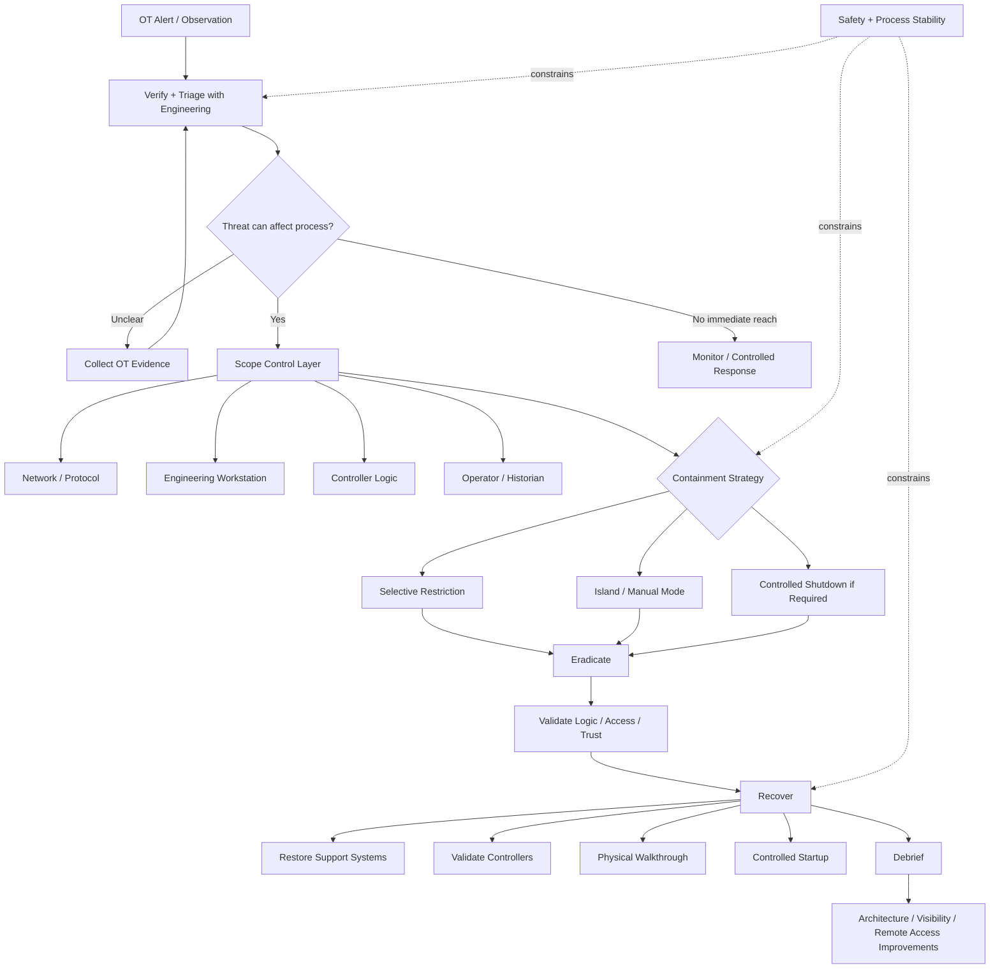

# Диаграмма: OT Incident Response

## Interpretation

OT response is engineering-constrained.

A technically valid cyber action is not acceptable if it creates greater process or safety risk than the incident itself.
