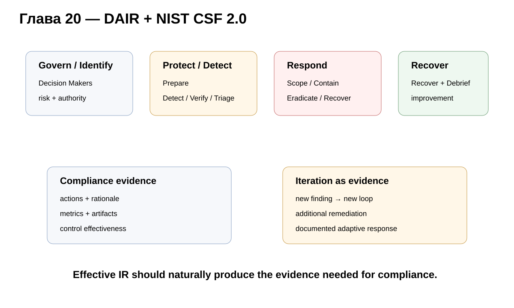

# Глава 20 — Интеграция DAIR с NIST CSF 2.0

Практический разбор главы 20 книги *Dynamic Incident Response: A Framework for Security Teams*.



## Идентификация
- Book ID: `dynamic-incident-response-joshua-wright-en-2026`
- Глава: 20
- Source title: `Integrating DAIR with NIST CSF 2.0`
- Русское название: «Интеграция DAIR с NIST CSF 2.0»
- Source policy: `rag_only`
- External sources: запрещены
- Model memory: запрещена
- Прямой доступ к PDF: не использовался

## Provenance
- Canonical RAG: `p0637:c01`–`p0648:c01`
- PDF pages: 637–648
- `p0649:c01` начинает Afterword.
- Source format: PDF
- Chapter boundary verified: yes

## Содержимое
- [cheatsheet.md](cheatsheet.md)
- [commands.md](commands.md)
- [diagram.md](diagram.md)
- [visual-cheatsheet.svg](visual-cheatsheet.svg)
- [visual-cheatsheet-detailed.svg](visual-cheatsheet-detailed.svg)
- [translation-editorial-findings.md](translation-editorial-findings.md)

## Краткий анализ

Chapter 20 связывает DAIR с NIST CSF 2.0 и NIST SP 800-61 Revision 3.

Главный тезис:

**compliance и operational effectiveness не обязаны конфликтовать, если evidence для аудита создаётся как естественный побочный продукт реальной incident response работы.**

## Шесть функций CSF 2.0

- Govern (GV)
- Identify (ID)
- Protect (PR)
- Detect (DE)
- Respond (RS)
- Recover (RC)

## Mapping DAIR → CSF

### Govern / Identify
Decision Maker coordination:
- risk tolerance;
- business context;
- authority;
- escalation;
- impact decisions.

### Protect
Prepare:
- plans;
- playbooks;
- training;
- detection readiness;
- forensic readiness.

### Detect
Detect + Verify + Triage:
- find;
- validate;
- prioritize.

### Respond
Response Actions Loop:
- Scope;
- Contain;
- Eradicate;
- Recover.

### Recover
Recover + Debrief:
- restore;
- validate;
- learn;
- improve.

## Why iteration helps compliance

Source reframes repeated loop cycles as maturity evidence, not failure.

Important rule:

```text
new finding
→ new iteration
→ additional remediation
→ stronger evidence of adaptive response
```

Document:
- what triggered the iteration;
- what scope changed;
- what additional remediation occurred;
- why the decision was made.

## Govern through Decision Makers

Decision Makers are involved throughout the lifecycle, not only at the beginning/end.

Their records support:
- GV.OC organizational context;
- GV.RM risk management;
- GV.RR roles/responsibilities/authority;
- GV.PO policy;
- GV.SC supply-chain risk management.

## Compliance artifacts

DAIR naturally produces:
- plans/playbooks/training records;
- alert/triage/incident declaration records;
- scoping and containment decisions;
- eradication and recovery verification;
- debrief/RCA/improvement tracking;
- stakeholder consultation and risk rationale.

Key source point:

**document rationale, not only actions.**

## Demonstrating control effectiveness

Source distinguishes:
- documented capability;
- demonstrated effectiveness;
- metrics/measurement;
- continuous improvement.

Auditors need evidence that controls actually work, not merely that policy documents exist.

## Audit preparation

Useful practices:
- map incident docs to CSF functions;
- cross-reference DAIR activity and CSF function in procedures;
- keep timelines/reports/lessons learned easy to retrieve;
- train responders to explain DAIR using CSF terminology.

## Incident tracking platform

Ticketing/case management can reduce compliance overhead if configured with:
- DAIR/CSF-aligned statuses;
- iteration support;
- Decision Maker fields;
- evidence links;
- retention-aware records.

## Communication templates

Prepared communication templates can be tagged to:
- CSF function;
- DAIR activity;
- executive/technical audience.

This allows routine operational updates to become audit-ready evidence.

## Основной принцип

**Compliance should emerge from disciplined incident response operations, not from a separate evidence-assembly exercise after the fact.**

## Ограничения источника

- Figure 200 represented through caption/text reference.
- Tables 60–64 preserved.
- No shell/CLI listings.
- Reference [1] present.
- Source timing and NIST framing preserved; no external update/reconciliation performed.

## Связь с ремонтом перевода v2

Chapter 20 semantic coverage is strong, but RU/EN governance/compliance terminology remains mixed. For v2, the most important task is consistent terminology and clean mapping visuals.
