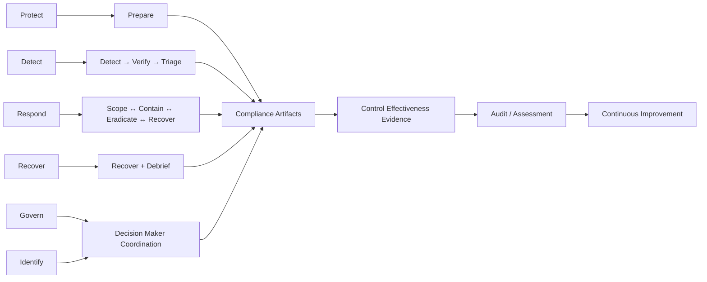

# Диаграмма: DAIR mapped to NIST CSF 2.0

## Interpretation

DAIR does not replace CSF 2.0.

DAIR provides the tactical incident-response operating model that can generate evidence demonstrating CSF-aligned capability and effectiveness.
