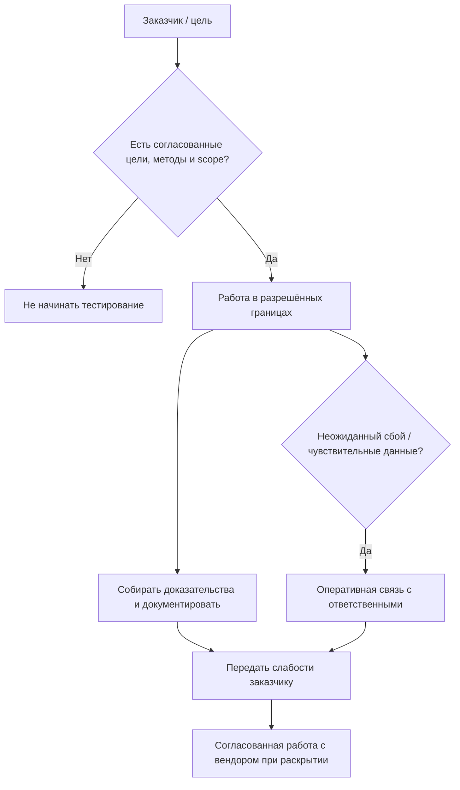
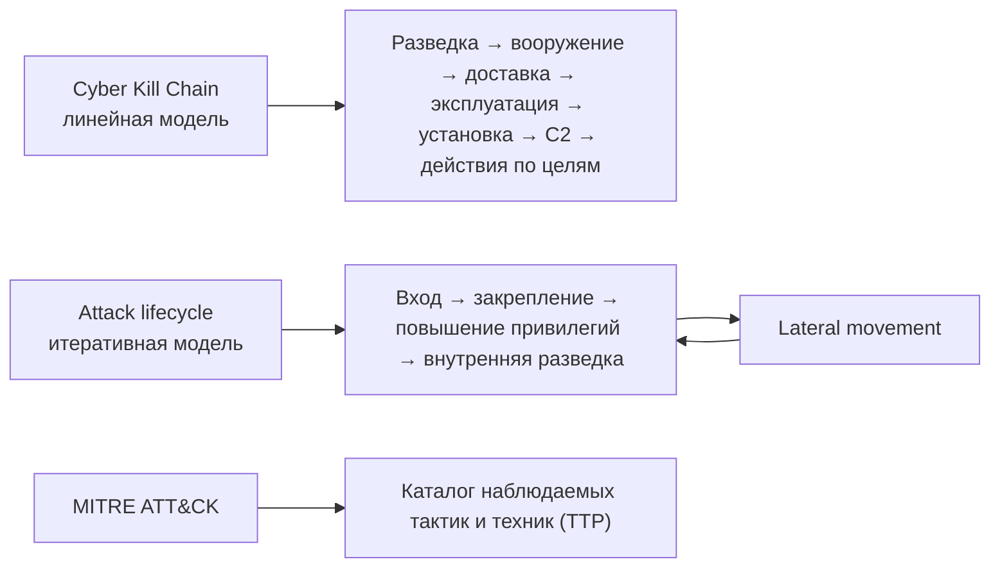
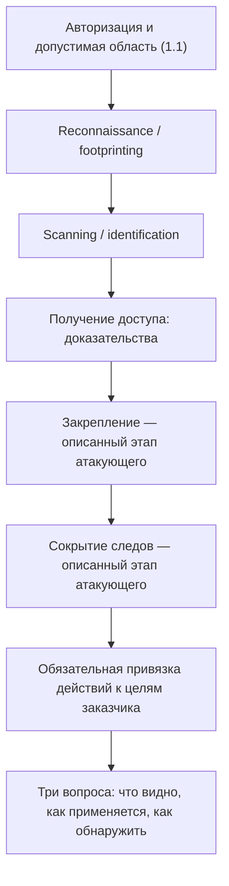

# Диаграммы — глава 1

Диаграммы передают концепции источника и **не являются инструкцией осуществлять атаку**. Обозначения: PDF-страницы отсчитываются от первой страницы файла.

## 1. Этическая граница

Основание: `p0002:c01`–`p0003:c01`.

## 2. Три угла зрения на модель атаки

Основание: `p0006:c01`–`p0010:c01`. Разные модели показаны отдельно, а не как тождественные схемы.

## 3. Последовательность методологии по тексту 1.3

Условие: фазы D/E **не означают разрешения модифицировать реальные системы или журналы**. Конкретные действия/rollback не определены в главе. Основание: `p0011:c01`–`p0014:c01`; согласование `p0003:c01`.
