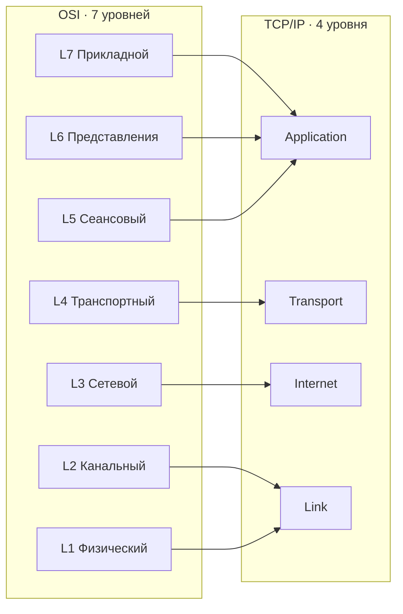
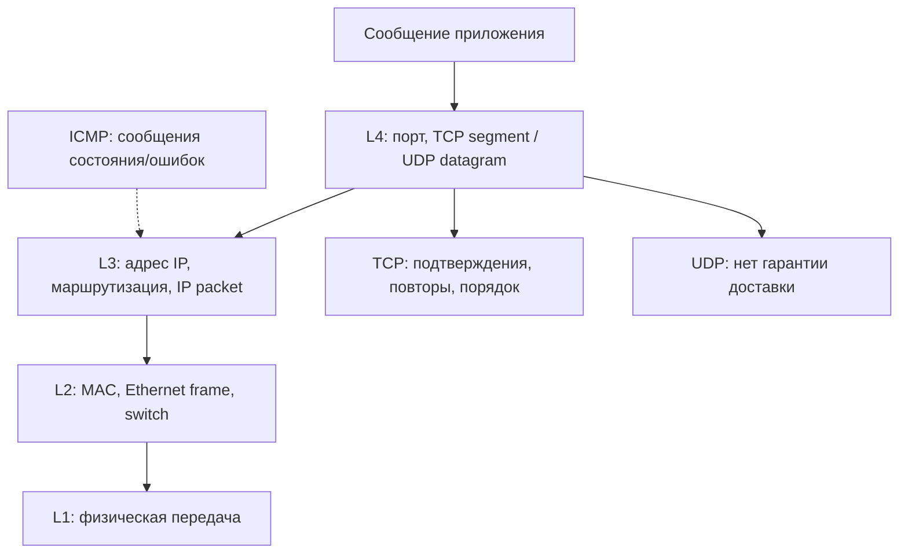
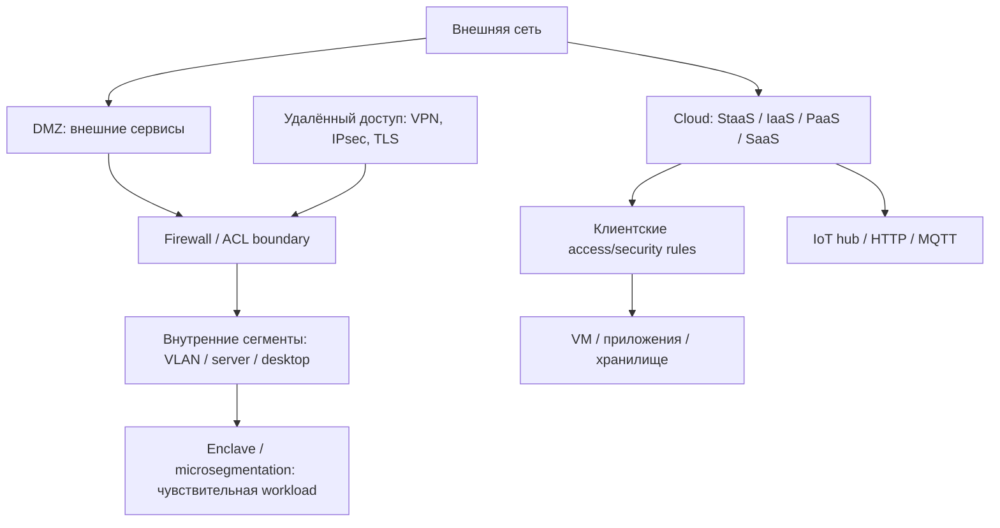

# Diagram — глава 2

Все Mermaid-схемы основаны на PDF pp. 15–42. Это концептуальная модель, **не фактическая схема сети читателя**.

## Модели OSI и TCP/IP

RAG: `p0016:c01`–`p0019:c01`.

## Адресация и транспорт

RAG: `p0017:c01`, `p0022:c01`, `p0024:c01`, `p0029:c01`–`p0033:c01`. О степени надёжности IP имеется [Source contradiction] между p24 и p42; см. `source-findings.md`.

## Архитектурные границы и облако

Стрелки показывают **логическую группировку понятий источника**, а не фактические разрешения трафика между зонами. Нет real-world конфигурации и критериев пересылки: [Needs confirmation]. RAG: `p0033:c01`–`p0041:c01`.
