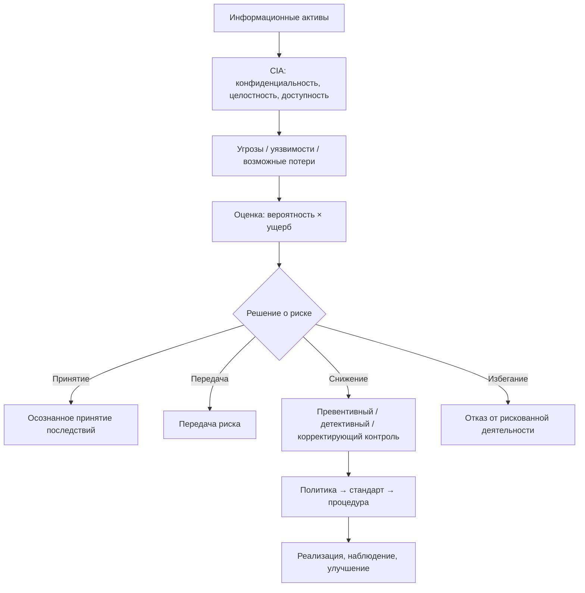
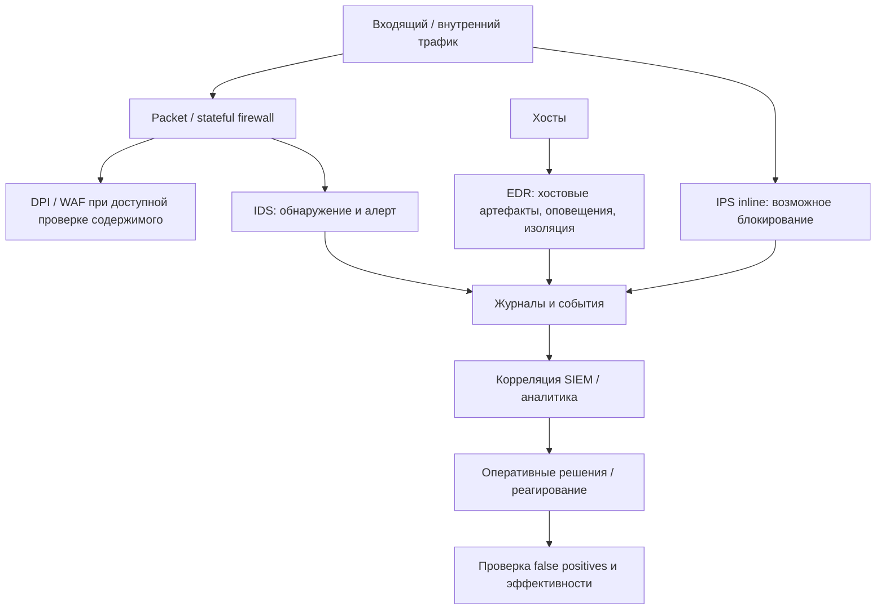
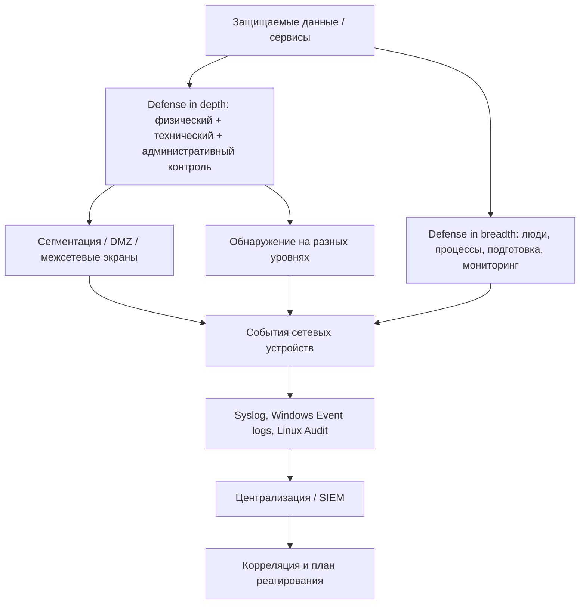

# Mermaid — глава 3: модель принятия защитных решений

Все узлы отражают текст источника PDF pp. 43–71. Диаграммы концептуальные, а не описание существующей инфраструктуры.

## 1. Цели защиты и риск

Основание: `p0043:c01`, `p0048:c01`–`p0052:c01`. Решение о риске — бизнесовое; диаграмма не рассчитала риск конкретной среды.

## 2. Уровни технического обнаружения и реагирования

Стрелки — логическое объединение перечисленных функций, **не утверждение**, что любой IDS обязан работать inline или все указанные продукты реально развернуты. `p0053:c01`–`p0063:c01`.

## 3. Defense in depth + breadth и аудит

Основание: `p0064:c01`–`p0071:c01`. Ни один путь не означает, что изменение firewalls/audit разрешено. Параметры и rollback — **[Needs confirmation]**.
