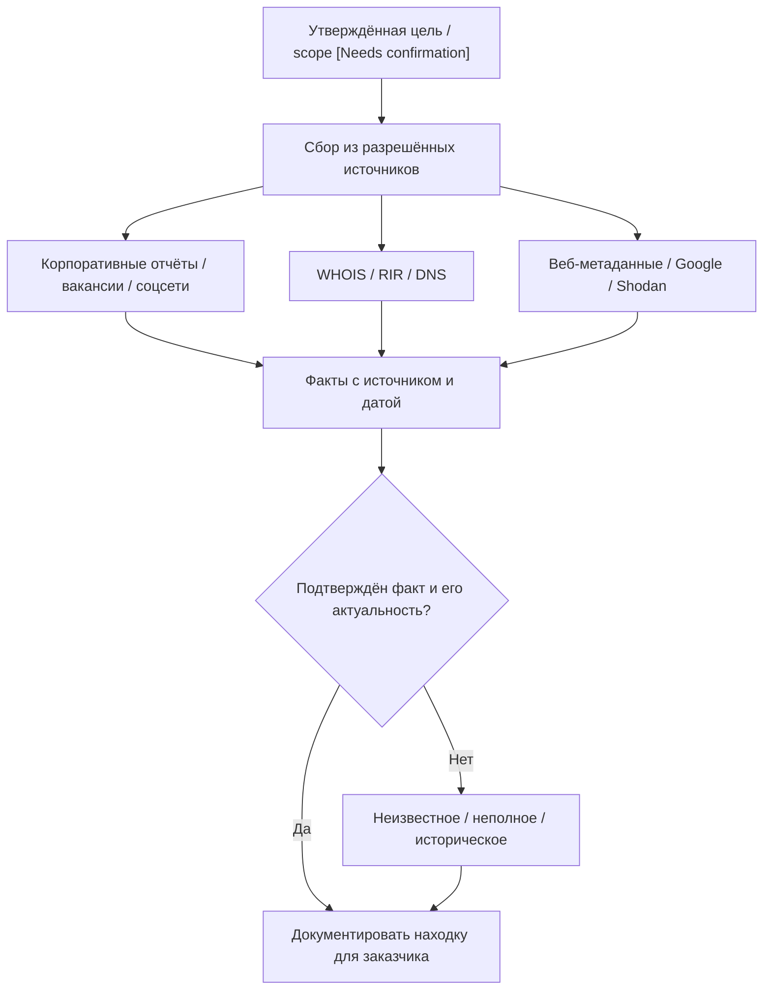
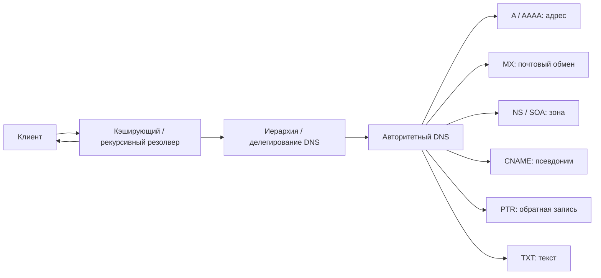
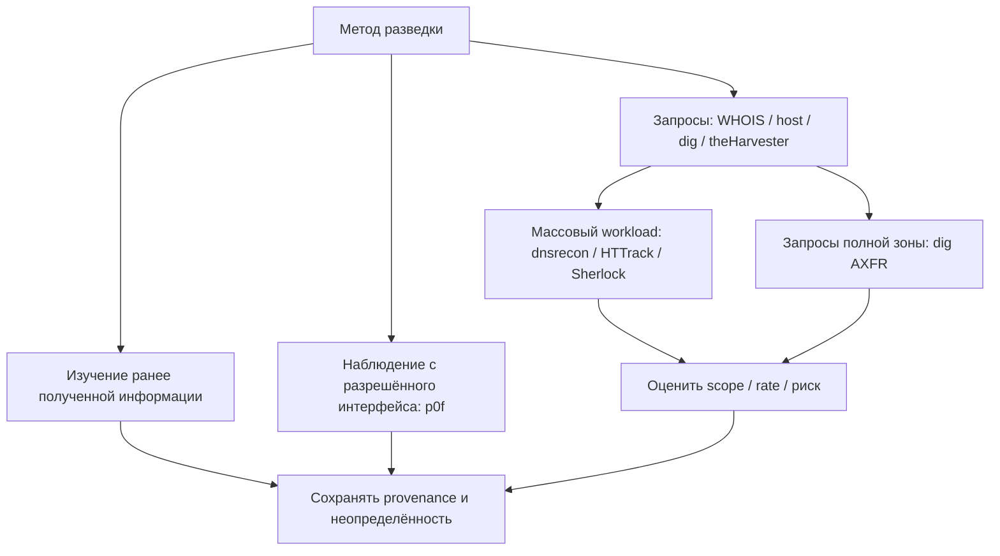

# Диаграммы — глава 4 (Mermaid)

Источник: `ethical-hacking-basics-ru:p0072:c01`–`p0098:c01`, PDF pp. 72–98. Схемы **концептуальные**, не схема реального периметра и не разрешение выполнять тестирование.

## 1. От источника информации к оценке её надёжности

Реестровые и индексные сведения не равны разрешённым целям. RAG `p0072:c01`–`p0082:c01`, `p0095:c01`–`p0098:c01`.

## 2. DNS как источник разных видов информации

Текстовая концепция DNS: `p0082:c02`, `p0083:c01`–`p0084:c01`. Терминологический конфликт про PTR в `p0086:c01` записан в `source-findings.md`; диаграмма не воспроизводит это ошибочное направление как факт.

## 3. Разница между наблюдением и генерацией сетевого трафика

Указанные источником средства и ограничение допустимости: `p0075:c01`–`p0088:c01`, `p0091:c01`–`p0094:c01`. Никакая стрелка не означает, что запуск был выполнен или разрешён.
