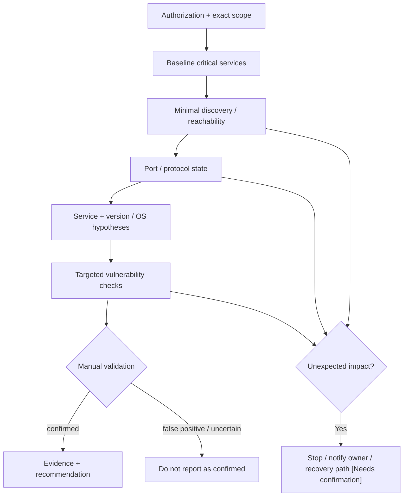
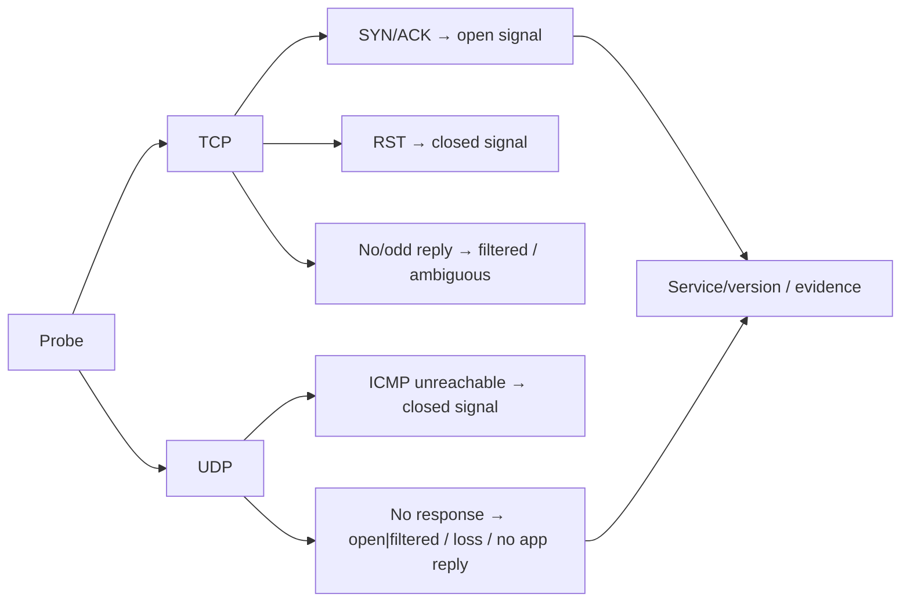
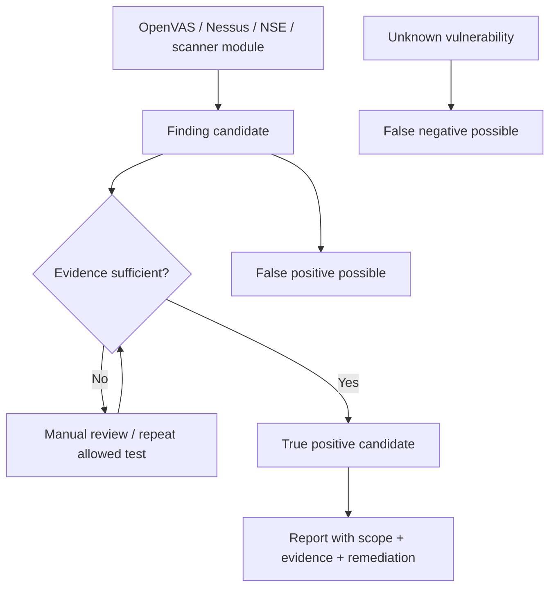
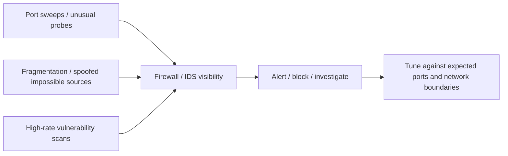

# Диаграммы — глава 5

RAG-only source: PDF pp. 99–139. Mermaid represents book logic and safety boundaries, not a real network.

## 1. Controlled active assessment

Source basis: `p0099:c01`, `p0100:c01`–`p0109:c01`, `p0122:c01`, `p0128:c01`.

## 2. Interpreting network scan results

Source: `p0103:c01`–`p0107:c01`. Это модель интерпретации описанной главы, не универсальная guarantee конкретного firewall/NAT path.

## 3. Scanner finding → defensible finding

Source: `p0122:c01`–`p0129:c01`.

## 4. Red-team behavior as defensive telemetry

Source: `p0138:c01`–`p0139:c02`. Evasion mechanics are intentionally not expanded into an operational bypass workflow.
