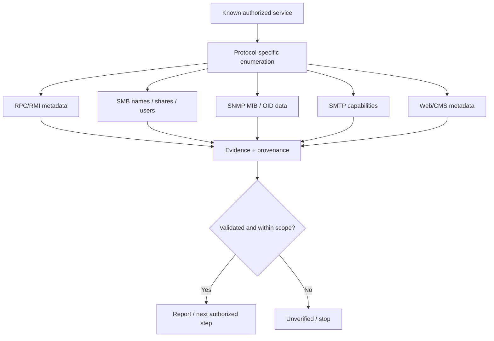
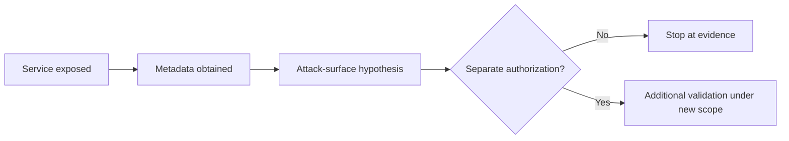
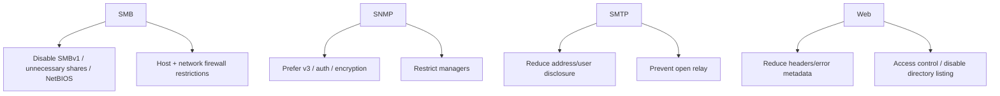
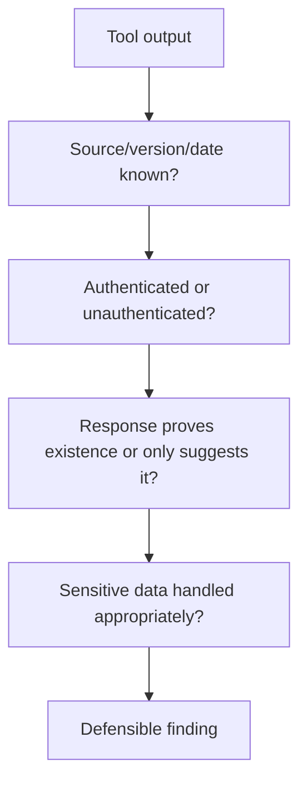

# Диаграммы — глава 6

## 1. Service → enumeration → evidence

## 2. Enumeration is not exploitation

## 3. Service-specific defenses

## 4. Evidence quality

Source basis: `p0140:c01`–`p0168:c02`.
